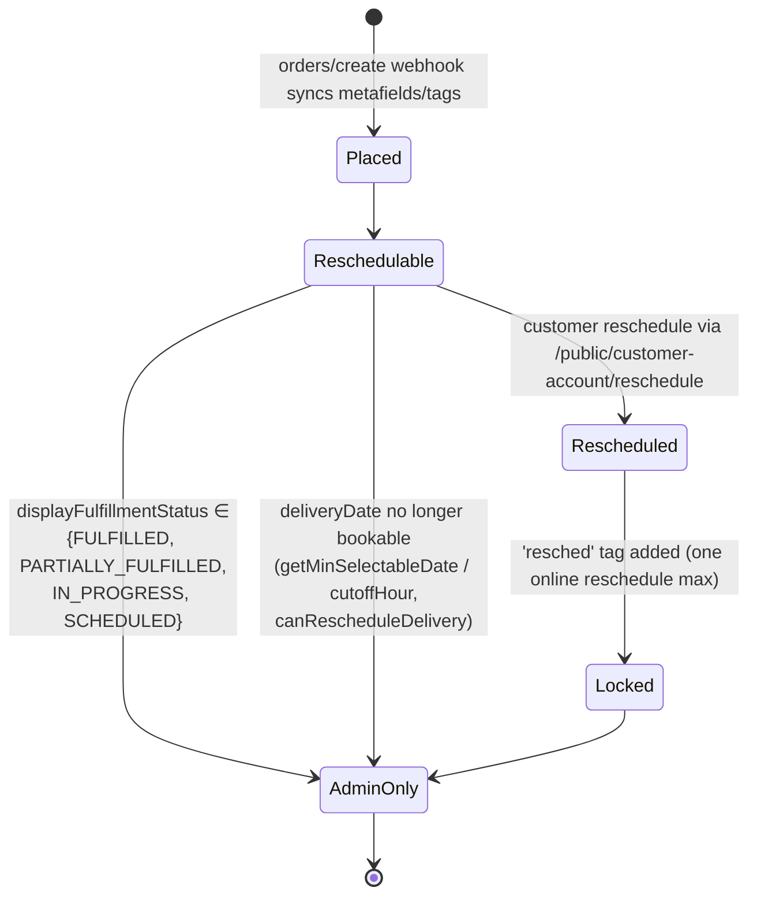

# API — Routes, Extensions, Auth & Write-Path Contract

> Part of the docs set. Source of truth: [architecture.md](./architecture.md).

This file covers every route surface, extension, webhook, service, the four auth mechanisms, and — most importantly — the **order write-path contract** (which routes actually mutate delivery state). For system topology and the data model, see [architecture.md](./architecture.md). For dated verification history, see [verification-log.md](./verification-log.md).

## Five route surfaces, five different auth mechanisms

Know which one you're in before writing a handler:

- **Embedded admin routes** (`app/routes/app.*`) — `authenticate.admin(request)`, session-cookie-based, runs inside the Shopify Admin iframe.
- **App Proxy routes** (`app/routes/apps.schedule-rules*.ts`) — HMAC-signed by Shopify, prefix `/apps/schedule-rules` per `shopify.app.toml`, called from storefront/theme JS.
- **Customer-account JWT routes** (`app/routes/public.customer-account.*.ts`) — verify a session token JWT passed by customer-account UI extensions; separate auth path from both of the above.
- **Shopify webhooks** (`app/routes/webhooks.orders.*` / `webhooks.app.*`) — registered in `shopify.app.toml` `[[webhooks.subscriptions]]`, HMAC-verified by the Shopify webhook middleware. The live delivery-relevant subscription is `orders/create` (`webhooks.orders.create.ts`, the new-order delivery sync). The `orders/cancelled` subscription and its handler existed only for the removed custom Lalamove cancel flow and are gone.
- **Meta Messenger webhook** (`app/routes/webhooks.messenger.ts`) — NOT a Shopify surface: Meta signs every POST with `X-Hub-Signature-256` (HMAC-SHA256 of the raw body, app secret), verified by hand via `lib/verify-meta-signature.server.ts`. Not registered in `shopify.app.toml`; never touches `authenticate.*`. See the [Meta Messenger webhook](#meta-messenger-webhook-flowercart-messenger-agent) section.

## Extensions (5 total — verified via each `shopify.extension.toml`)

| Handle                         | Target                                                                                    | Status / Write capability                                          | Source                                                                                                                                                                                                                            |
| ------------------------------ | ----------------------------------------------------------------------------------------- | ------------------------------------------------------------------ | --------------------------------------------------------------------------------------------------------------------------------------------------------------------------------------------------------------------------------- |
| `order-delivery-block`         | `admin.order-details.block.render`                                                        | **Read-only.** Queries order metafields/attrs; no mutations.       | [src/BlockExtension.jsx](../extensions/order-delivery-block/src/BlockExtension.jsx)                                                                                                                                               |
| `delivery-reschedule-action`   | `admin.order-details.action.render`                                                       | **Read-only.** Single `query GetReschedule` for status display.    | [src/OrderActionExtension.jsx](../extensions/delivery-reschedule-action/src/OrderActionExtension.jsx)                                                                                                                             |
| `delivery-date-editor`         | `customer-account.order-status.block.render`                                              | **Read-only block.** Calls backend for snapshot/refresh, not write. | [src/index.tsx](../extensions/delivery-date-editor/src/index.tsx)                                                                                                                                                                |
| `delivery-reschedule-customer` | `customer-account.order.action.menu-item.render` + `customer-account.order.action.render` | **Write path** for customer reschedule via `/public/customer-account/reschedule`. | [src/order-action-menu-item.tsx](../extensions/delivery-reschedule-customer/src/order-action-menu-item.tsx) + [src/order-action-modal.tsx](../extensions/delivery-reschedule-customer/src/order-action-modal.tsx) |
| `delivery-thank-you`           | `purchase.thank-you.block.render`                                                         | **Read-only.** Reads metafields via host APIs; no backend call.    | [src/Checkout.jsx](../extensions/delivery-thank-you/src/Checkout.jsx)                                                                                                                                                            |
| `cod-fee-notice`               | `purchase.thank-you.block.render`                                                         | **Read-only.** COD-only banner (selected payment option type `paymentOnDelivery`): shows the +₱70 fee and checkout-total+fee, since the fee lands post-purchase via order edit. No backend call. | [src/Checkout.jsx](../extensions/cod-fee-notice/src/Checkout.jsx)                                                                                                                                                            |

**Walang theme app extension. Walang Checkout UI Extension (other than thank-you).** Only `./src/index.tsx` is registered in `delivery-date-editor/shopify.extension.toml`; other source files in that folder are not wired and do not run.

## Embedded admin routes

| Path                                  | File                                                                                  | Has `action` (writes)?                                                                                                                                                                                                                                                                                       |
| ------------------------------------- | ------------------------------------------------------------------------------------- | ------------------------------------------------------------------------------------------------------------------------------------------------------------------------------------------------------------------------------------------------------------------------------------------------------------ |
| `/app` (shell + nav)                  | [app/routes/app.jsx](../app/routes/app.jsx)                                           | No — loader only.                                                                                                                                                                                                                                                                                            |
| `/app/_index` (redirect to orders)    | [app/routes/app.\_index.jsx](../app/routes/app._index.jsx)                            | No — loader-side redirect. Default destination is `/app/orders` (`sanitizeEmbeddedAppReturnTo(...) ?? "/app/orders"`; Scheduler V2 D2 — Orders Ops is the app home since Phase 3).                                                                                                                            |
| `/app/orders`                         | [app/routes/app.orders.tsx](../app/routes/app.orders.tsx)                             | **Yes — generic order bulk actions PLUS, since Orders Ops V2 Phase 4, the merchant `reschedule` op (a delivery write path — see §2, row 4).** Generic mutations: `orderClose`, `orderOpen`, `orderCancel`, `tagsAdd`, `tagsRemove`, `fulfillmentCreate`. The `reschedule` op calls the shared `rescheduleOrderDelivery()` service. Also hosts the `sendEmail` op (Customer Email, 2026-07-13, ADR-11): sends plain-text mail through the merchant's business mailbox via [`send-customer-email.server.ts`](../app/services/send-customer-email.server.ts) — an **outbound side effect that writes NOTHING to any order** (explicitly NOT a delivery write path; the §2 table is unchanged). |
| `/app/orders/reschedule-rules`        | [app/routes/app.orders_.reschedule-rules.ts](../app/routes/app.orders_.reschedule-rules.ts) | No — read-only resource route (loader only): returns the delivery schedule rules + live booked counts for the reschedule modal (fetched lazily on modal open; session auth).                                                                                                                       |
| `/app/scheduler`                      | [app/routes/app.scheduler.tsx](../app/routes/app.scheduler.tsx)                       | **Yes — writes `DeliveryScheduleConfig` only** (Scheduler V2 Phase 3 merged Polaris page). Granular ops (`op` discriminator via [scheduler-ops.server.ts](../app/services/scheduler-ops.server.ts)): `saveSettings` · `createSlot` · `updateSlotDisplay` · `reorderSlots` · `deleteSlot` · `saveDayOverride` · `clearDayOverride` · `refreshCounts` (cache bust, no write). All writes go through `upsertScheduleRules` under the optimistic `version` guard; every response is `200 + {ok,…}` (ADR-11). Does not touch any order. |
| `/app/schedule-rules`                 | [app/routes/app.schedule-rules.tsx](../app/routes/app.schedule-rules.tsx)             | No — thin authenticated redirect stub to `/app/scheduler` (Scheduler V2 D2; embedded query params preserved). The old folder-route editor is deleted.                                                                                                                                                        |
| `/app/cod-settings`                   | [app/routes/app.cod-settings.tsx](../app/routes/app.cod-settings.tsx)                 | **Yes — COD knobs only, NOT delivery state** (2026-07-28): merges `minimumAmount`/`maximumAmount` into the `$app:cod-eligibility` `function-configuration` metafield on the app's PaymentCustomization (`metafieldsSet`; advanced keys preserved), toggles the customization via `paymentCustomizationUpdate(enabled)`, and updates the COD Fee variant's price (`productVariantsBulkUpdate`; variant resolved by the shared exact-SKU `findCodFeeVariant()` so this page prices the variant the webhook actually charges). Writes no order/metafield/tag delivery state — §2 table unchanged. Nav item "COD Settings". The action always answers `200 + {ok, errors}` (ADR-11; it previously had no try/catch and let an upstream throw out as a 5xx). |

## Shopify auth / bootstrap routes

Boilerplate scaffold para sa OAuth at non-embedded login. Hindi business logic.

| Path              | File                                                                  | Purpose                                                                                              |
| ----------------- | --------------------------------------------------------------------- | ---------------------------------------------------------------------------------------------------- |
| `/` (root index)  | [app/routes/\_index/route.jsx](../app/routes/_index/route.jsx)        | Redirects to `/app?shop=...` kung may `?shop=` param; else shows template landing/login form.        |
| `/auth/*` (splat) | [app/routes/auth.$.jsx](../app/routes/auth.$.jsx)                     | Shopify auth boundary — calls `authenticate.admin`, sets `boundary.headers`.                          |
| `/auth/login`     | [app/routes/auth.login/route.jsx](../app/routes/auth.login/route.jsx) | Non-embedded login form; calls `login()` from `shopify.server`.                                       |

## App proxy routes (HMAC-signed by Shopify, prefix `/apps/schedule-rules`)

| Path                                   | File                                                                                 |
| -------------------------------------- | ------------------------------------------------------------------------------------ |
| `GET /apps/schedule-rules`             | [apps.schedule-rules.ts](../app/routes/apps.schedule-rules.ts)                       |
| `POST /apps/schedule-rules/validate`   | [apps.schedule-rules.validate.ts](../app/routes/apps.schedule-rules.validate.ts)     |
| `POST /apps/schedule-rules/reschedule` | [apps.schedule-rules.reschedule.ts](../app/routes/apps.schedule-rules.reschedule.ts) — **route exists but no registered extension target currently calls it**; only the dead `delivery-date-editor/src/order-action-modal.tsx` references it. |
| `GET /apps/schedule-rules/products`    | [apps.schedule-rules.products.ts](../app/routes/apps.schedule-rules.products.ts) — unrelated to delivery scheduling; paginates collection products for the theme's "Show more" button (`assets/global.js`'s `collection-show-more` custom element, in the separate theme repo). **Only route that does NOT call `authenticate.public.appProxy`** — verifies the signature by hand (`lib/verify-app-proxy.server.ts`) and queries the Storefront API directly, to avoid a Prisma/Neon session lookup on every cold start. See [verification log 2026-07-02](./verification-log.md) and [decisions.md ADR-2/ADR-3](./decisions.md). |

## Customer-account JWT routes (called by customer-account extensions)

| Path                                           | File                                                                                                 | Caller                                                                                                            |
| ---------------------------------------------- | ---------------------------------------------------------------------------------------------------- | ----------------------------------------------------------------------------------------------------------------- |
| `POST /public/customer-account/schedule-rules` | [public.customer-account.schedule-rules.ts](../app/routes/public.customer-account.schedule-rules.ts) | `delivery-date-editor` (block) + `delivery-reschedule-customer` (modal)                                            |
| `POST /public/customer-account/order-delivery` | [public.customer-account.order-delivery.ts](../app/routes/public.customer-account.order-delivery.ts) | `delivery-date-editor` (block snapshot refresh)                                                                    |
| `POST /public/customer-account/reschedule`     | [public.customer-account.reschedule.ts](../app/routes/public.customer-account.reschedule.ts)         | `delivery-reschedule-customer` modal — **the only live customer reschedule write path**                            |

## Webhooks (per `shopify.app.toml`)

| Topic               | File                                                                           |
| ------------------- | ------------------------------------------------------------------------------ |
| `orders/create`     | [webhooks.orders.create.ts](../app/routes/webhooks.orders.create.ts) — delivery sync (§2 row 1) **+ COD fee auto-add** (see the COD fee subsection under §2's caveats) |
| `app/uninstalled`   | [webhooks.app.uninstalled.jsx](../app/routes/webhooks.app.uninstalled.jsx)     |
| `app/scopes_update` | [webhooks.app.scopes_update.jsx](../app/routes/webhooks.app.scopes_update.jsx) |

API version sa `shopify.app.toml` is `2026-04`.

## Meta Messenger webhook (FlowerCart Messenger agent)

| Path | File | Auth |
| --- | --- | --- |
| `GET /webhooks/messenger` (verify handshake) + `POST /webhooks/messenger` (events) | [webhooks.messenger.ts](../app/routes/webhooks.messenger.ts) | GET: `hub.verify_token` vs `MESSENGER_VERIFY_TOKEN`; POST: `X-Hub-Signature-256` HMAC over the raw body via [verify-meta-signature.server.ts](../app/lib/verify-meta-signature.server.ts) |
| `POST /webhooks/messenger/worker` (Cloud Tasks worker) | [webhooks.messenger_.worker.ts](../app/routes/webhooks.messenger_.worker.ts) | `X-Messenger-Worker-Signature` HMAC over the raw task payload (same `sha256=<hex>` format + verifier lib) keyed with `MESSENGER_WORKER_SECRET` — the app's SIXTH auth surface, invoked only by Cloud Tasks |

Phase 3 (queue + Neon) of the FlowerCart Messenger agent — master context lives outside the repo (`flowercart-messenger-CLAUDE.md` + the `flowercart-agent-architecture.md` companion). Contract highlights:

- **Writes NOTHING to any order, metafield, or tag** — the §2 write-paths table is unchanged. Postgres now holds the CONVERSATION (`MessengerThread`/`MessengerMessage` — see [architecture.md](./architecture.md)), never the order. The only outbound side effect is a Messenger Send API text reply via [messenger-send.server.ts](../app/services/messenger-send.server.ts) (plain `fetch`, pinned Graph API version, token in the Authorization header only).
- Ingress shape (phase 3): webhook = verify → record in Neon (`MessengerMessage.mid` unique = Meta-redelivery dedupe) → enqueue a Cloud Tasks task (`{ mid }`, queue `messenger-events`, us-central1) → 200. The worker route does the send and is retry-idempotent: `repliedAt` is set right after a successful send, and a retry that finds it set skips. If the queue is not configured (local dev) the webhook processes inline; if the enqueue itself fails, the recorded row is deleted so Meta's redelivery can reprocess.
- Worker status contract with Cloud Tasks (it retries any non-2xx, max 5 attempts): 200 = done or unfixable (unknown mid, already replied, malformed payload, send not configured); 503 = transient send failure, retry.
- After a valid signature the WEBHOOK always returns 200 — Meta redelivers on non-200 and disables the webhook after repeated failures. Invalid/missing signature → 401 (both routes).
- `message.is_echo` events are skipped (the `message_echoes` page field is subscribed — without the skip the bot would echo its own replies forever). `entry[].standby` is ignored in v1.
- Env: `MESSENGER_APP_SECRET`, `MESSENGER_VERIFY_TOKEN`, `MESSENGER_PAGE_ACCESS_TOKEN`, `MESSENGER_WORKER_SECRET` (Secret Manager) + `MESSENGER_PAGE_ID`, `MESSENGER_TASKS_QUEUE_PATH`, `MESSENGER_WORKER_URL` (plain). All optional on fresh checkouts — the routes degrade to designed 403/401/not-configured failures and the queue falls back to inline processing.

> **Courier dispatch note:** Last-mile courier booking is handled by the **official Shopify Lalamove app**, not this app. The former custom Lalamove callback endpoint (`webhooks.lalamove.ts`) and the `orders/cancelled` webhook (which existed only to cancel a Lalamove order) were removed 2026-07-04 — see the [verification log](./verification-log.md) and [decisions.md ADR-1](./decisions.md).

## Services / lib

| Module                            | File                                                                                                                  |
| --------------------------------- | --------------------------------------------------------------------------------------------------------------------- |
| Validation engine                 | [app/lib/delivery-availability.ts](../app/lib/delivery-availability.ts) — includes `validateMerchantRescheduleSelection` (merchant-mode data-integrity checks, §5 of the V2 design; additive, storefront/customer paths unchanged). `isSlotBlocked` / `isSlotAtCapacity` / `getSlotCapacityEntry` resolve override-map keys canonically (ADR-13) |
| **Reschedule write orchestration** | [app/services/reschedule-order-delivery.server.ts](../app/services/reschedule-order-delivery.server.ts) — `rescheduleOrderDelivery()`, the ONE shared write sequence both reschedule sources call (REC-1) |
| Shared constants (reschedule tag) | [app/lib/constants.ts](../app/lib/constants.ts) — single source of `RESCHEDULED_ORDER_TAG`                            |
| Strict rules schema (Scheduler V2 §4.1) | [app/lib/schedule-rules-schema.ts](../app/lib/schedule-rules-schema.ts) — `validateScheduleRulesPatch` (strict write gate, field errors; pre-existing duplicate slot labels are grandfathered) + `deserializeStoredScheduleRules` (lenient-but-loud read, `ConfigHealthIssue[]`; the only place override entries are pruned — ADR-13) |
| Canonical slot comparator (Scheduler V2 §4.2) | [app/lib/slot-value.ts](../app/lib/slot-value.ts) — `normalizeSlotValueForMatch`/`resolveConfiguredSlotValue`/`slotValuesMatch` + `findSlotOverrideKey` (override-map key resolution, exact spelling wins a tie — ADR-13); comparison only, stored/written slot values stay verbatim |
| Embedded URL path builder         | [app/lib/embedded-route.js](../app/lib/embedded-route.js)                                                             |
| Order utility helpers             | [app/lib/order-utils.ts](../app/lib/order-utils.ts)                                                                   |
| Rules loader + booked-count merge | [app/services/schedule-rules.server.ts](../app/services/schedule-rules.server.ts) — `getScheduleRulesDetailed` owns `countsMeta` (`ok`/`partial`/`untracked`/`skipped`/`error` + optional `truncation`) |
| Order metafield + tag sync        | [app/services/order-delivery-metafields.server.ts](../app/services/order-delivery-metafields.server.ts)               |
| Booked-counts engine (Scheduler V2 §5, ADR-12) | [app/services/delivery-bookings.server.ts](../app/services/delivery-bookings.server.ts) — `getDeliveryBookingsSnapshot` (metafield-date-scoped orders search, 60s in-process memo; returns `truncation` when either scan cap clipped the set) + `deriveBookedCounts` (per-read counts w/ exclude-self) |
| Scheduler granular ops (Scheduler V2 §4.4) | [app/services/scheduler-ops.server.ts](../app/services/scheduler-ops.server.ts) — `runSchedulerOp` (per-section patch + version guard) |
| Structured slot times (Scheduler V2 §4.3)  | [app/lib/slot-times.ts](../app/lib/slot-times.ts) — `generateSlotValue`/`parseSlotValueToTimes` (frozen `"9AM-12PM"` wire format) |
| Scheduler overview aggregations   | [app/lib/scheduler-overview.ts](../app/lib/scheduler-overview.ts) (pure; replaced the dashboard math of the former `app/modules/scheduler.jsx` + `app/modules/scheduler.server.js`, both deleted in Scheduler V2 Phase 5 on 2026-07-18) |
| Session shop extractor            | [app/modules/session.server.js](../app/modules/session.server.js)                                                     |
| Meta webhook signature verify (Messenger) | [app/lib/verify-meta-signature.server.ts](../app/lib/verify-meta-signature.server.ts) — `verifyMetaWebhookSignature` (HMAC-SHA256 over the raw body, timing-safe) |
| Messenger Send API (Messenger)    | [app/services/messenger-send.server.ts](../app/services/messenger-send.server.ts) — `sendMessengerTextMessage` + `sendMessengerGenericTemplate` (phase-5 product carousel; plain fetch, pinned Graph version, result union, never throws) |
| Messenger live products (Messenger, phase 5) | [app/services/messenger-products.server.ts](../app/services/messenger-products.server.ts) — `searchShopProducts` (Admin GraphQL, live prices, cap 8) + `getVariantLive` (postback-time re-validation; READ-ONLY, zero order writes) |
| Messenger Cloud Tasks enqueue (Messenger) | [app/services/messenger-queue.server.ts](../app/services/messenger-queue.server.ts) — `enqueueMessengerEchoTask` (Cloud Tasks REST via plain fetch, metadata-server OAuth, HMAC-signed task payload, result union, never throws) |
| Messenger Neon events (Messenger) | [app/services/messenger-events.server.ts](../app/services/messenger-events.server.ts) — `recordInboundTextMessage` (thread upsert + mid dedupe), `processEchoByMid` (retry-idempotent send), `deleteRecordedMessage` |

---

## 2. Actual order write paths (the only places that mutate delivery state)

Every other surface in the system is read-only. Confirmed in code:

- `delivery-reschedule-action/src/OrderActionExtension.jsx` → single `query GetReschedule` call, no mutations.
- `order-delivery-block/src/BlockExtension.jsx` → reads only.
- `delivery-thank-you/src/Checkout.jsx` → reads metafields via host APIs.
- `delivery-date-editor/src/index.tsx` → reads block state + calls read endpoints.

The four delivery-schedule write paths (the 4th — merchant reschedule — added by Orders Ops V2 Phase 4, 2026-07-11, per ADR-10):

| Trigger / route | File | Metafield writes | Tag writes | Custom attribute writes |
| --- | --- | --- | --- | --- |
| `orders/create` webhook | [webhooks.orders.create.ts](../app/routes/webhooks.orders.create.ts) | Via `syncOrderDeliveryMetafields`: `custom.date`, `custom.time_slot`, plus legacy mirror metafields `delivery.date`, `delivery.time_slot`, `sidekick.delivery_date`, **plus the additive `delivery.sync_status` (Scheduler V2 D4, 2026-07-17): `"ok"` \| `"attention:<code>"` — the checkout-time validation outcome. Validation no longer gates the write: parseable date+slot ALWAYS sync (DEF-7 fixed); validation "now" = the order's `created_at`, and over-capacity is advisory (`attention:capacity`, never blocks)** | Via `syncOrderDeliveryScheduleTag`: replaces existing delivery schedule tags with new date + slot label | None |
| App Proxy reschedule | [apps.schedule-rules.reschedule.ts](../app/routes/apps.schedule-rules.reschedule.ts) | `metafieldsSet`: `custom.date`, `custom.time_slot`, `$app.reschedule_status`, `$app.reschedule_requested_at` (no legacy mirrors written here) | Via `syncOrderDeliveryScheduleTag` with `additionalTags: ['resched']`: removes prior delivery schedule tags, adds new date + slot + `'resched'` | `orderUpdate(customAttributes)`: sets `Delivery Date` and `Delivery Time` |
| Customer Account JWT reschedule | [public.customer-account.reschedule.ts](../app/routes/public.customer-account.reschedule.ts) → **`rescheduleOrderDelivery()`** ([reschedule-order-delivery.server.ts](../app/services/reschedule-order-delivery.server.ts)) | One `metafieldsSet`: `custom.date`, `custom.time_slot`, **legacy mirrors `delivery.date`, `delivery.time_slot`, `sidekick.delivery_date` (added by the Phase 4 refactor, REC-2 — previously left stale)**, `$app.reschedule_status`, `$app.reschedule_requested_at`; separate `metafieldsSet` appends to `delivery.reschedule_history` (`source: "customer"`) | Via `syncOrderDeliveryScheduleTag` with `additionalTags: ['resched']` | `orderUpdate(customAttributes)`: sets `Delivery Date` and `Delivery Time` |
| **Merchant reschedule (admin)** | [app.orders.tsx](../app/routes/app.orders.tsx) `action`, op `reschedule` → **the same `rescheduleOrderDelivery()`** with `source: "merchant"` | **Identical** to the customer row (one shared write sequence, REC-1); history events carry `source: "merchant"` | Same, **except NO `'resched'` lock tag** — a merchant override does not consume the customer's self-service reschedule (§5) | Same |

**`orders/create` failure contract (hardened 2026-07-29):** the handler is failure-tolerant end to end — the rules read (its Postgres hit included) and both sync calls are individually guarded, so an upstream/Neon failure logs and returns 200 instead of a 5xx that Shopify retries and eventually flags the subscription for. The counts read passes `excludeOrderId` for the order being synced, so a webhook redelivery (whose `custom.date` is already written) can no longer count the order against its own slot and stamp a legal in-capacity order `attention:capacity`. A truncated counts scan (`countsMeta.status: "partial"`, see [scheduler-v2-ux.md §5](./scheduler-v2-ux.md)) is logged alongside the `"error"` case; the capacity check still runs fail-open either way.

**Merchant path validation (administrative override, ADR-10 / §5 matrix):** `validateMerchantRescheduleSelection` hard-enforces only data integrity (date format, slot exists, blocked date/slot); slot capacity is warn + explicit confirm override (server responds `capacity_override_required` with the projected load unless `capacityOverride=1`; the projection's "already in the target date+slot" test compares the slot through the canonical comparator and the date as an exact ISO string, so a drifted stored spelling no longer double-counts an order that is not moving); the customer gates (`resched` lock, current-date-still-bookable (`canRescheduleDelivery`), `FULFILLED`, cutoff/prep window, `maxDays`) deliberately do NOT apply. Per REC-5 (declined hardening) the merchant op has **no pre-write race-guard recheck** — the customer route keeps its own `RECHECK_ORDER_STATE_QUERY` behavior.

**Important:** The `RESCHEDULED_ORDER_TAG = "resched"` constant is centralized in [`app/lib/constants.ts`](../app/lib/constants.ts).

The active `delivery-reschedule-customer` modal posts to `/public/customer-account/reschedule` (CA_RE). The App Proxy `/apps/schedule-rules/reschedule` (P_RES) route exists in the backend and still writes if reached via a signed proxy URL, but no registered extension target wires to it (and it has NOT been moved onto the shared service — it still inlines its own writes without mirrors).

### Caveat — the OTHER admin bulk actions remain outside the delivery contract

Besides the `reschedule` op above, the `/app/orders` `action` handler runs these generic mutations:

- `orderClose` / `orderOpen` (archive/unarchive)
- `orderCancel`
- `tagsAdd` / `tagsRemove` — **freeform text input**; merchant types arbitrary tag strings
- `fulfillmentCreate` (mark fulfilled, with optional tracking number/URL)

The `sendEmail` op (Customer Email, ADR-11) is not an order mutation at all: it
re-reads the order's customer email (read-only query — the recipient is never
client-supplied) and sends SMTP mail via `sendCustomerEmail()`; it writes no
metafield, tag, or customAttribute.

None of these generic mutations are part of the delivery sync contract — none write `custom.date`, `custom.time_slot`, `delivery.date`, `delivery.time_slot`, `sidekick.delivery_date`, `$app.reschedule_status`, `$app.reschedule_requested_at`, `delivery.reschedule_history`, or the `Delivery Date` / `Delivery Time` customAttributes. (The former bouquet-photo pipeline — `stagedUploadsCreate` + `fileCreate` + a `custom.bouquet_photo` `orderUpdate` — was **removed 2026-07-12**; the feature was descoped from Orders Ops V2, see audit §F.)

However, because the tag input is freeform, a merchant *can* manually add or remove a string that matches `DELIVERY_SCHEDULE_TAG_PATTERN` (e.g. `2026-05-23` or `9AM-12PM`). The system does not validate or enforce this — if it happens, downstream readers (`order-delivery-block`, scheduler queries) will see the manually-typed tag the same way they see auto-synced delivery tags. Treat this as a manual-override side channel; the supported merchant path is the `reschedule` op.

### COD fee auto-add — an order-edit write OUTSIDE the delivery contract (2026-07-28)

[webhooks.orders.create.ts](../app/routes/webhooks.orders.create.ts) also calls [`applyCodFeeToOrder()`](../app/services/cod-fee.server.ts) when the new order was paid via the merchant's manual **Cash on Delivery** method (`payment_gateway_names` entry containing "cash on delivery" or exactly "cod"). It adds the hidden **COD Fee** variant (matched by EXACT SKU `COD-FEE`, ₱70) to the order via `orderEditBegin` → `orderEditAddVariant` → `orderEditCommit(notifyCustomer: false)` — requires the `write_order_edits` scope. Design facts:

- **Post-purchase by necessity**: Shopify cannot alter the checkout total based on the selected payment method (payment selection is the final step; no Function API sees it). The fee appears on the final invoice/order status page; COD cash collected includes it. Chosen over a flat ₱70 shipping rate because the production store's shipping is carrier-calculated by the official Lalamove app — a flat rate would surface as a competing (cheaper) shipping option.
- **Independent of the delivery sync**: runs even when the order has no parseable delivery attributes; its failure never blocks the sync or the webhook 200.
- **Redelivery-safe**: an order already carrying the `COD-FEE` SKU is skipped. The guard is a live line-item scan (not payload-based) that **pages through the line-item connection**, bounded at 10 × 100 = 1,000 items, and is three-state — `present` (skip), `absent` (add the fee), `unknown` (lookup errored or the bound was hit). Only `absent` proceeds to the order edit, so a truncated/failed scan costs a missing fee, never a double charge. (Before 2026-07-29 it read only the first 100 line items.)
- **Variant matched by EXACT SKU**: `findCodFeeVariant()` — exported from [`cod-fee.server.ts`](../app/services/cod-fee.server.ts) and used by BOTH this webhook and the `/app/cod-settings` loader, so merchant and webhook can never address different variants — fetches 50 `sku:COD-FEE` candidates and keeps only `node.sku === "COD-FEE"`. Shopify's search tokenizes on hyphens, so the former `first: 1` lookup could charge `COD-FEE-OLD`; and because the redelivery guard compares SKUs exactly, that mismatch made every redelivery stack another fee. No exact match ⇒ no fee (logged), never "whatever came back first".
- **NOT delivery state**: writes no delivery metafield/tag/attribute — the §2 table above is unchanged. It is an order **line-item** mutation, the only one the app performs automatically.
- The COD Fee product must exist per store (SKU `COD-FEE`); it is deliberately unpublished from the Online Store channel. Missing product → logged failure, order stays fee-less.

### Courier dispatch write paths — none (removed 2026-07-04)

This app no longer writes any `lalamove.*` metafields or performs any last-mile dispatch. Courier booking is handled entirely by the **official Shopify Lalamove app**. The former custom integration (a `webhooks.lalamove.ts` callback that wrote `lalamove.status`/`lalamove.driver_*` + `fulfillmentCreate`, an `orders/cancelled` webhook that cancelled the Lalamove order, and an `app.orders.tsx` dispatch action that wrote `lalamove.order_id`/`lalamove.share_link`) was deleted — see the 2026-07-04 verification-log entry. Do not reintroduce a `lalamove.*` write surface here.

---

## 3. User-flow sequence (only the flows that exist in live code)

```mermaid
sequenceDiagram
    autonumber
    participant Shop as Shopify (storefront/checkout)
    participant WH as /webhooks/orders/create
    participant Eng as lib/delivery-availability
    participant SR as services/schedule-rules.server
    participant DB as Postgres
    participant ODM as services/order-delivery-metafields.server
    participant SADM as Admin GraphQL

    Note over Shop,SADM: A) New order → ALWAYS-sync canonical delivery state (D4)
    Shop->>WH: orders/create payload
    WH->>WH: extractDeliveryAttributesFromPayload (cart attrs)
    alt no parseable date+slot
        WH-->>Shop: 200 (log "sync skipped" — nothing usable to write)
    else parseable
        WH->>SR: getScheduleRulesDetailed(shop, admin)
        SR->>DB: SELECT DeliveryScheduleConfig
        SR->>SADM: booked-counts scan (60s cache; fail-open)
        WH->>Eng: evaluateDeliverySyncStatus(rules, date, slot,<br/>checkoutTime = payload created_at)
        Note right of Eng: outcome = "ok" | "attention:<code>"<br/>(capacity advisory → attention:capacity)<br/>— never gates the write
        WH->>ODM: syncOrderDeliveryMetafields(+syncStatus)
        ODM->>SADM: metafieldsSet (custom.date, custom.time_slot,<br/>delivery.date, delivery.time_slot,<br/>sidekick.delivery_date, delivery.sync_status)
        WH->>ODM: syncOrderDeliveryScheduleTag
        ODM->>SADM: tagsRemove(prior delivery tags) + tagsAdd(date, slot)
    end

    participant Cust as Customer
    participant CADE as delivery-date-editor (CA block)
    participant CARC as delivery-reschedule-customer (CA action modal)
    participant CA_SR as /public/customer-account/schedule-rules
    participant CA_OD as /public/customer-account/order-delivery
    participant CA_RE as /public/customer-account/reschedule

    Note over Cust,CA_RE: B) Customer views + reschedules (only live path)
    Cust->>CADE: open order status page
    CADE->>CA_SR: POST {sessionToken}
    CA_SR->>SR: getScheduleRulesWithBookedCounts
    CA_SR-->>CADE: rules JSON
    CADE->>CA_OD: POST {sessionToken, orderId}
    CA_OD->>SADM: query order (customer.id, metafields, attrs)
    CA_OD-->>CADE: current delivery snapshot

    Cust->>CARC: open "Reschedule delivery" action
    CARC->>CA_SR: POST {sessionToken} (rules + booked counts)
    CARC->>CA_RE: POST {sessionToken, orderId, date, timeSlot} (form-urlencoded)
    CA_RE->>CA_RE: verify session token + shop/customer context
    CA_RE->>SADM: ORDER_CUSTOMER_QUERY (ownership + state)
    CA_RE->>CA_RE: verify customer owns order
    CA_RE->>CA_RE: gate: not FULFILLED/IN_PROGRESS/SCHEDULED,<br/>no 'resched' tag,<br/>canRescheduleDelivery (current date still bookable<br/>per schedule rules cutoffHour)
    CA_RE->>Eng: validateDeliverySelection
    CA_RE->>SADM: RECHECK_ORDER_STATE_QUERY (race guard)
    CA_RE->>SADM: metafieldsSet (custom.date, custom.time_slot,<br/>$app.reschedule_status='confirmed',<br/>$app.reschedule_requested_at)
    CA_RE->>SADM: metafieldsSet(delivery.reschedule_history append)
    CA_RE->>SADM: orderUpdate(customAttributes: Delivery Date, Delivery Time)
    CA_RE->>SADM: tagsRemove(old delivery schedule tags)
    CA_RE->>SADM: tagsAdd(new date, slot, 'resched')
    CA_RE-->>CARC: { ok, newDate, newTimeSlot, syncStates }

    participant Merch as Merchant
    participant ARA as delivery-reschedule-action (Admin, read-only)
    participant ADB as order-delivery-block (Admin, read-only)

    Note over Merch,SADM: C) Merchant views delivery status from Admin order page
    Merch->>ADB: open Order page → block shows current delivery
    ADB->>SADM: query order metafields/attrs
    Merch->>ARA: open "Reschedule Status" action
    ARA->>SADM: query reschedule metafields only
    Note right of ARA: No writes. Merchant edits today must happen<br/>through Shopify Admin's native order page or via<br/>backend tooling — not through this extension.
```

---

## 5. Admin operations workflow


### Reschedule lock — state machine actually enforced in code

(from [apps.schedule-rules.reschedule.ts](../app/routes/apps.schedule-rules.reschedule.ts) and [public.customer-account.reschedule.ts](../app/routes/public.customer-account.reschedule.ts))



Both reschedule routes use `RESCHEDULED_ORDER_TAG = "resched"` (imported from [`app/lib/constants.ts`](../app/lib/constants.ts)) as the lock primitive. Removing this tag on Shopify side re-opens the online reschedule flow — fragile by design.
