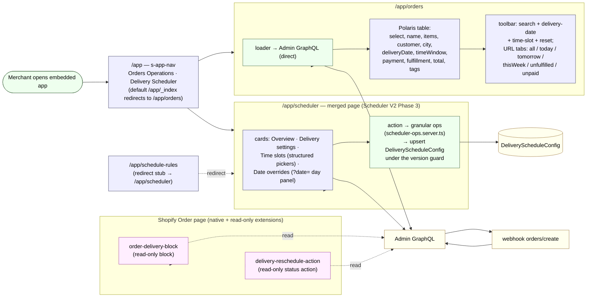
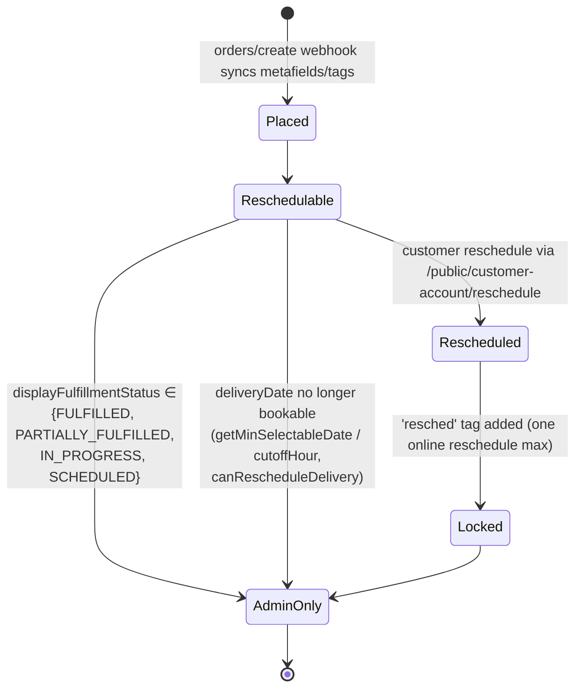

# API — Routes, Extensions, Auth & Write-Path Contract

> Part of the docs set. Source of truth: [architecture.md](./architecture.md).

This file covers every route surface, extension, webhook, service, the four auth mechanisms, and — most importantly — the **order write-path contract** (which routes actually mutate delivery state). For system topology and the data model, see [architecture.md](./architecture.md). For dated verification history, see [verification-log.md](./verification-log.md).

## Seven route surfaces, six different auth mechanisms

Know which one you're in before writing a handler. Seven surfaces, but only six
mechanisms — the Sidekick tool routes (added 2026-08-19) reuse the embedded
admin's session-token auth from a different, cross-origin caller:

- **Embedded admin routes** (`app/routes/app.*`) — `authenticate.admin(request)`, session-cookie-based, runs inside the Shopify Admin iframe.
- **App Proxy routes** (`app/routes/apps.schedule-rules*.ts`) — HMAC-signed by Shopify, prefix `/apps/schedule-rules` per `shopify.app.toml`, called from storefront/theme JS.
- **Customer-account JWT routes** (`app/routes/public.customer-account.*.ts`) — verify a session token JWT passed by customer-account UI extensions; separate auth path from both of the above.
- **Shopify webhooks** (`app/routes/webhooks.orders.*` / `webhooks.app.*`) — registered in `shopify.app.toml` `[[webhooks.subscriptions]]`, HMAC-verified by the Shopify webhook middleware. The live delivery-relevant subscription is `orders/create` (`webhooks.orders.create.ts` — since ADR-22 a THIN receiver: it records a durable `DeliverySyncTask` row + enqueues; the actual sync runs in the Cloud Tasks worker, see the delivery-sync work queue section). The `orders/cancelled` subscription and its handler existed only for the removed custom Lalamove cancel flow and are gone.
- **Sidekick tool routes** (`app/routes/sidekick.tools.*.ts`, 2026-08-19) — **the same session-token `authenticate.admin` mechanism as the embedded admin routes above**, but called by the cross-origin Sidekick sandbox instead of the Admin iframe, so every response is `cors`-wrapped. Read-only; see [Sidekick tool routes](#sidekick-tool-routes).
- **Meta Messenger webhook** (`app/routes/webhooks.messenger.ts`) — NOT a Shopify surface: Meta signs every POST with `X-Hub-Signature-256` (HMAC-SHA256 of the raw body, app secret), verified by hand via `lib/verify-meta-signature.server.ts`. Not registered in `shopify.app.toml`; never touches `authenticate.*`. See the [Meta Messenger webhook](#meta-messenger-webhook-flowercart-messenger-agent) section.
- **Support-chat routes** (`app/routes/api.support-chat*.ts` + `webhooks.support-chat_.worker.ts`, 2026-08-21, ADR-20) — a NEW auth surface: `authenticate.public.customerAccount(request)` verifies the customer-account session-token JWT (a mechanism this app never called before — distinct from both `authenticate.admin` and the hand-rolled `public.customer-account.*` JWT verification used by the older reschedule routes) for the two `POST`/`GET` `api.support-chat*` routes, and the same HMAC-over-raw-body scheme as the Messenger worker (keyed with `MESSENGER_WORKER_SECRET`) for the Cloud Tasks worker. See [Support chat](#support-chat-customer-account-extension-adr-20). Backend deployed; the extension is NOT yet linked into the customer-account nav menu (separate small fix, not blocking).
- **Storefront chat widget routes** (`app/routes/apps.schedule-rules.support-chat*.ts`, 2026-08-22, ADR-21) — reuses the existing App Proxy mechanism (bullet above), same `verifyAppProxySignature` helper as `apps.schedule-rules.products.ts`. Live in production — see [Storefront chat widget](#storefront-chat-widget-theme-app-extension-adr-21).

## Extensions (12 total — verified via each `shopify.extension.toml`)

| Handle                         | Target                                                                                    | Status / Write capability                                          | Source                                                                                                                                                                                                                            |
| ------------------------------ | ----------------------------------------------------------------------------------------- | ------------------------------------------------------------------ | --------------------------------------------------------------------------------------------------------------------------------------------------------------------------------------------------------------------------------- |
| `order-delivery-block`         | `admin.order-details.block.render`                                                        | **Read-only.** Queries order metafields/attrs; no mutations.       | [src/BlockExtension.jsx](../extensions/order-delivery-block/src/BlockExtension.jsx)                                                                                                                                               |
| `delivery-reschedule-action`   | `admin.order-details.action.render`                                                       | **Read-only.** Single `query GetReschedule` for status display.    | [src/OrderActionExtension.jsx](../extensions/delivery-reschedule-action/src/OrderActionExtension.jsx)                                                                                                                             |
| `delivery-date-editor`         | `customer-account.order-status.block.render`                                              | **Read-only block.** Calls backend for snapshot/refresh, not write. | [src/index.tsx](../extensions/delivery-date-editor/src/index.tsx)                                                                                                                                                                |
| `delivery-reschedule-customer` | `customer-account.order.action.menu-item.render` + `customer-account.order.action.render` | **Write path** for customer reschedule via `/public/customer-account/reschedule`. | [src/order-action-menu-item.tsx](../extensions/delivery-reschedule-customer/src/order-action-menu-item.tsx) + [src/order-action-modal.tsx](../extensions/delivery-reschedule-customer/src/order-action-modal.tsx) |
| `delivery-thank-you`           | `purchase.thank-you.block.render`                                                         | **Read-only.** One card: delivery schedule + a COD sentence explaining the "COD FEE" line item. Deliberately does NOT restate the total — that is `cod-fee-notice`'s row. COD detection/fee resolution in `src/cod-fee.js`. No backend call. | [src/Checkout.jsx](../extensions/delivery-thank-you/src/Checkout.jsx) + [src/cod-fee.js](../extensions/delivery-thank-you/src/cod-fee.js) |
| `cod-fee-notice`               | `purchase.thank-you.block.render`                                                         | **Read-only.** COD-only (payment option type `paymentOnDelivery`), TWO rows: **`COD FEE`** (the fee) and **`Total with fee`** = Shopify's own Total + the fee, i.e. the cash to hand the rider. The merchant places this block in the checkout editor's **Order summary** section and drags it below `Total`; new blocks land at the top of the section, and adding it twice is how the same rows end up rendered twice. The `COD FEE` row is suppressed by `codFeeLineIsVisible()` when Shopify is already listing the real `COD FEE` line item — that line comes from `order.lineItems` (added by the order edit 7–10s after this page renders) and no extension can hide it. ⚠️ `purchase.thank-you.cart-line-list.render-after` would have put the fee row in the item list itself, but **it does not run on this shop**: a diagnostic build rendering unconditionally produced nothing on a live COD order (dev-22, order `#TA47AH0MC`, 2026-08-14). Do not reach for that target again without re-testing. `src/cod-fee.js` is a byte-identical copy of `delivery-thank-you`'s, pinned by `test/thank-you-cod-fee.test.ts`. No backend call. | [src/Checkout.jsx](../extensions/cod-fee-notice/src/Checkout.jsx) + [src/cod-fee.js](../extensions/cod-fee-notice/src/cod-fee.js) |
| `cod-eligibility`              | Shopify Function (`payment_customization`)                                                | **Read-only w.r.t. orders.** Runs on Shopify infra; hides the manual COD method outside the NCR ZIP/city + subtotal window. No backend call, no order writes. | [src/cart_payment_methods_transform_run.ts](../extensions/cod-eligibility/src/cart_payment_methods_transform_run.ts) |
| `delivery-sidekick-data`       | `admin.app.tools.data` (Sidekick App Data)                                                | **Read-only.** Registers three Sidekick tools (`get_delivery_booked_counts`, `get_order_delivery`, `get_schedule_config_summary`); each is a relative `fetch` onto a `/sidekick/tools/*` route (see [Sidekick tool routes](#sidekick-tool-routes)). No mutations anywhere in the chain. | [src/index.js](../extensions/delivery-sidekick-data/src/index.js) + [tools.json](../extensions/delivery-sidekick-data/tools.json) |
| `delivery-sidekick-actions`    | `admin.app.intent.link` ×2 (Sidekick App Actions)                                         | **Deep link only — writes nothing.** Two intents, both `application/shipment`: `edit` → `/app/orders?order=<legacyId>&search=<#name>` (open an order's delivery panel to reschedule) and `create` → `/app/scheduler?date=<YYYY-MM-DD>` (open that day's capacity/override panel). Navigation only; the merchant makes the change on the page, through the existing `/app/orders` `reschedule` op or the scheduler ops. The declared `describe_open_delivery_view` tool is **not registered in App Home yet** (deferred). | [shopify.extension.toml](../extensions/delivery-sidekick-actions/shopify.extension.toml) + [intent-order-reschedule.json](../extensions/delivery-sidekick-actions/intent-order-reschedule.json) |
| `delivery-sidekick-scheduler` | `admin.app.intent.link` (`admin_link`) | **Deep-link only.** Sidekick intent na nagbubukas ng `/app/scheduler?date=` (day override panel). Hiwalay na extension dahil ISANG targeting block lang ang tinatanggap ng `admin_link` sa deploy validation (nahuli 2026-08-19). Walang sariling write. | [shopify.extension.toml](../extensions/delivery-sidekick-scheduler/shopify.extension.toml) |
| `support-chat`                | `customer-account.page.render` (full-page — 2026-08-21, ADR-20) | **Write path, but only into SupportChat\* Postgres — zero Shopify order writes.** Full-page customer-account chat UI backed by the same agent brain the Messenger bot runs (`runAgentTurn` in [agent-core.server.ts](../app/services/agent-core.server.ts)). Enqueue-then-poll: `POST /api/support-chat` then `GET /api/support-chat/:jobId` (see [Support chat](#support-chat-customer-account-extension-adr-20)). Requires `network_access = true` in `shopify.extension.toml`, which requires the Partner Dashboard "Allow network access in checkout and account UI extensions" toggle. Must be the only target in its extension (full-page target rule), hence its own directory instead of living next to `delivery-date-editor`. Extension deployed to production; **not yet linked into the customer-account nav menu** (Content → Menus, a one-click admin fix, tracked separately). | [src/SupportChat.jsx](../extensions/support-chat/src/SupportChat.jsx) |
| `storefront-chat-widget`      | `type = "theme"` — app embed, `target: "body"` (2026-08-22, ADR-21) | **Write path, but only into SupportChat\*/AgentRateLimit Postgres — zero Shopify order writes.** Floating, bottom-right, anonymous chat bubble on the storefront, backed by the SAME agent brain via `runSupportChatTurn`. Enqueue-then-poll over App Proxy: `POST /apps/schedule-rules/support-chat` then `GET /apps/schedule-rules/support-chat/:jobId` (see [Storefront chat widget](#storefront-chat-widget-theme-app-extension-adr-21)). First `type = "theme"` extension in this repo — no build step, vanilla JS/CSS, no Preact. **Live in production** on `flowercart.store`'s active theme, app embed toggle ON (Theme Editor → App embeds → "FlowerBot Chat Widget"); a `page_visibility` block setting restricts which pages it renders on, blank = every page. | [blocks/app-embed.liquid](../extensions/storefront-chat-widget/blocks/app-embed.liquid) + [assets/storefront-chat-widget.js](../extensions/storefront-chat-widget/assets/storefront-chat-widget.js) |

**Walang Checkout UI Extension other than thank-you.** Only `./src/index.tsx` is registered in `delivery-date-editor/shopify.extension.toml` — and as of 2026-08-19 it is also the ONLY file in that `src/` folder (the formerly-unwired extra sources were removed).

## Embedded admin routes

| Path                                  | File                                                                                  | Has `action` (writes)?                                                                                                                                                                                                                                                                                       |
| ------------------------------------- | ------------------------------------------------------------------------------------- | ------------------------------------------------------------------------------------------------------------------------------------------------------------------------------------------------------------------------------------------------------------------------------------------------------------ |
| `/app` (shell + nav)                  | [app/routes/app.jsx](../app/routes/app.jsx)                                           | No — loader only.                                                                                                                                                                                                                                                                                            |
| `/app/_index` (redirect to orders)    | [app/routes/app.\_index.jsx](../app/routes/app._index.jsx)                            | No — loader-side redirect. Default destination is `/app/orders` (`sanitizeEmbeddedAppReturnTo(...) ?? "/app/orders"`; Scheduler V2 D2 — Orders Ops is the app home since Phase 3).                                                                                                                            |
| `/app/orders`                         | [app/routes/app.orders.tsx](../app/routes/app.orders.tsx)                             | **Yes — generic order bulk actions PLUS, since Orders Ops V2 Phase 4, the merchant `reschedule` op (a delivery write path — see §2, row 4).** Generic mutations: `orderClose`, `orderOpen`, `orderCancel`, `tagsAdd`, `tagsRemove`, `fulfillmentCreate`. The `reschedule` op calls the shared `rescheduleOrderDelivery()` service. Also hosts the `sendEmail` op (Customer Email, 2026-07-13, ADR-11): sends plain-text mail through the merchant's business mailbox via [`send-customer-email.server.ts`](../app/services/send-customer-email.server.ts) — an **outbound side effect that writes NOTHING to any order** (explicitly NOT a delivery write path; the §2 table is unchanged). And the `editDetails` op (2026-08-14, ADR-15): a single-order `orderUpdate(shippingAddress)` rewrite of street / apartment / city / ZIP / receiver phone via [`update-order-contact.server.ts`](../app/services/update-order-contact.server.ts) — an order write but **NOT a delivery write** (see the §2 caveat below). |
| `/app/orders/reschedule-rules`        | [app/routes/app.orders_.reschedule-rules.ts](../app/routes/app.orders_.reschedule-rules.ts) | No — read-only resource route (loader only): returns the delivery schedule rules + live booked counts for the reschedule modal (fetched lazily on modal open; session auth).                                                                                                                       |
| `/app/scheduler`                      | [app/routes/app.scheduler.tsx](../app/routes/app.scheduler.tsx)                       | **Yes — writes `DeliveryScheduleConfig` only** (Scheduler V2 Phase 3 merged Polaris page). Granular ops (`op` discriminator via [scheduler-ops.server.ts](../app/services/scheduler-ops.server.ts)): `saveSettings` · `createSlot` · `updateSlotDisplay` · `reorderSlots` · `deleteSlot` · `saveDayOverride` · `clearDayOverride` · `refreshCounts` (cache bust, no write). All writes go through `upsertScheduleRules` under the optimistic `version` guard; every response is `200 + {ok,…}` (ADR-11). Does not touch any order. |
| `/app/schedule-rules`                 | [app/routes/app.schedule-rules.tsx](../app/routes/app.schedule-rules.tsx)             | No — thin authenticated redirect stub to `/app/scheduler` (Scheduler V2 D2; embedded query params preserved). The old folder-route editor is deleted.                                                                                                                                                        |
| `/app/cod-settings`                   | [app/routes/app.cod-settings.tsx](../app/routes/app.cod-settings.tsx)                 | **Yes — COD knobs only, NOT delivery state** (2026-07-28): merges `minimumAmount`/`maximumAmount` into the `$app:cod-eligibility` `function-configuration` metafield on the app's PaymentCustomization (`metafieldsSet`; advanced keys preserved), toggles the customization via `paymentCustomizationUpdate(enabled)`, and updates the COD Fee variant's price (`productVariantsBulkUpdate`; variant resolved by the shared exact-SKU `findCodFeeVariant()` so this page prices the variant the webhook actually charges). **Fee fan-out (2026-08-14):** the same amount is additionally written to `feeAmount` in that function config (the checkout function renames the COD payment method with it — Settings → Payments has no Admin API), and mirrored onto TWO shop metafields, because no one namespace is readable everywhere: `$app:cod`/`fee` for the thank-you UI extensions and `custom`/`cod_fee` for Liquid (`$app:` resolves to `app--<id>--` and only this app can read it). All three are display copies; the variant price above is the amount actually charged, and a mirror failure only `console.warn`s — it must never fail a save that already repriced the variant. Writes no order/metafield/tag delivery state — §2 table unchanged. Nav item "COD Settings". The action always answers `200 + {ok, errors}` (ADR-11; it previously had no try/catch and let an upstream throw out as a 5xx). |

## Shopify auth / bootstrap routes

Boilerplate scaffold para sa OAuth at non-embedded login. Hindi business logic.

| Path              | File                                                                  | Purpose                                                                                              |
| ----------------- | --------------------------------------------------------------------- | ---------------------------------------------------------------------------------------------------- |
| `/` (root index)  | [app/routes/\_index/route.jsx](../app/routes/_index/route.jsx)        | Redirects to `/app?shop=...` kung may `?shop=` param; else shows template landing/login form.        |
| `/auth/*` (splat) | [app/routes/auth.$.jsx](../app/routes/auth.$.jsx)                     | Shopify auth boundary — calls `authenticate.admin`, sets `boundary.headers`.                          |
| `/auth/login`     | [app/routes/auth.login/route.jsx](../app/routes/auth.login/route.jsx) | Non-embedded login form; calls `login()` from `shopify.server`.                                       |

## App proxy routes (HMAC-signed by Shopify, prefix `/apps/schedule-rules`)

| Path                                   | File                                                                                 |
| -------------------------------------- | ------------------------------------------------------------------------------------ |
| `GET /apps/schedule-rules`             | [apps.schedule-rules.ts](../app/routes/apps.schedule-rules.ts)                       |
| `POST /apps/schedule-rules/validate`   | [apps.schedule-rules.validate.ts](../app/routes/apps.schedule-rules.validate.ts)     |
| `POST /apps/schedule-rules/reschedule` | [apps.schedule-rules.reschedule.ts](../app/routes/apps.schedule-rules.reschedule.ts) — **route exists but no registered extension target currently calls it** (the dead `delivery-date-editor/src/order-action-modal.tsx` that once referenced it no longer exists on disk — confirmed 2026-08-19; `delivery-date-editor/src/` contains only `index.tsx`). |
| `GET /apps/schedule-rules/products`    | [apps.schedule-rules.products.ts](../app/routes/apps.schedule-rules.products.ts) — unrelated to delivery scheduling; paginates collection products for the theme's "Show more" button (`assets/global.js`'s `collection-show-more` custom element, in the separate theme repo). **Only route that does NOT call `authenticate.public.appProxy`** — verifies the signature by hand (`lib/verify-app-proxy.server.ts`) and queries the Storefront API directly, to avoid a Prisma/Neon session lookup on every cold start. See [verification log 2026-07-02](./verification-log.md) and [decisions.md ADR-2/ADR-3](./decisions.md). |
| `POST /apps/schedule-rules/support-chat` | [apps.schedule-rules.support-chat.ts](../app/routes/apps.schedule-rules.support-chat.ts) — 2026-08-22, ADR-21. Storefront chat widget entry point; unrelated to delivery scheduling. Same hand-verified signature pattern as `products.ts` (skips the Prisma/Neon session lookup — this route is polled every ~1.5s per active conversation). See [Storefront chat widget](#storefront-chat-widget-theme-app-extension-adr-21). |
| `GET /apps/schedule-rules/support-chat/:jobId` | [apps.schedule-rules.support-chat_.$jobId.ts](../app/routes/apps.schedule-rules.support-chat_.$jobId.ts) — 2026-08-22, ADR-21. Poll route for the above. |
| `GET /apps/schedule-rules/widget-config` | [apps.schedule-rules.widget-config.ts](../app/routes/apps.schedule-rules.widget-config.ts) — 2026-08-23, expanded same day. Serves the merchant-editable greeting/support-phone/starter-chip copy PLUS bubble/panel/text/muted/border colors, panel size, corner radius, position, disclaimer text+toggle, and bubble auto-hide behavior (set on the Messenger admin page; see [widget-design-system.md](./widget-design-system.md)) that the storefront widget fetches before mounting. Same hand-verified signature pattern; `Cache-Control: public, max-age=300`. |
| `GET /apps/schedule-rules/coverage` | [apps.schedule-rules.coverage.ts](../app/routes/apps.schedule-rules.coverage.ts) — 2026-08-25. Backs the storefront **Delivery Fee Checker** block (`delivery-fee-checker.liquid`, inside the storefront-chat-widget theme extension). Takes one `q` param (city / barangay / 4-digit ZIP) and returns `{covered, areas:[{label,feePhp,estimate,provincial}], provincialNote?, freeShippingAbovePhp}`. **Read-only, no Shopify API call, no Postgres** — a pure in-process call to `checkDeliveryCoverage()`, the SAME lookup the FlowerBot agent uses, so the storefront quote and the chat quote cannot drift. Same hand-verified signature pattern + shop match; `Cache-Control: public, max-age=3600`. |

## Customer-account JWT routes (called by customer-account extensions)

| Path                                           | File                                                                                                 | Caller                                                                                                            |
| ---------------------------------------------- | ---------------------------------------------------------------------------------------------------- | ----------------------------------------------------------------------------------------------------------------- |
| `POST /public/customer-account/schedule-rules` | [public.customer-account.schedule-rules.ts](../app/routes/public.customer-account.schedule-rules.ts) | `delivery-date-editor` (block) + `delivery-reschedule-customer` (modal)                                            |
| `POST /public/customer-account/order-delivery` | [public.customer-account.order-delivery.ts](../app/routes/public.customer-account.order-delivery.ts) | `delivery-date-editor` (block snapshot refresh)                                                                    |
| `POST /public/customer-account/reschedule`     | [public.customer-account.reschedule.ts](../app/routes/public.customer-account.reschedule.ts)         | `delivery-reschedule-customer` modal — **the only live customer reschedule write path**                            |

## Webhooks (per `shopify.app.toml`)

| Topic               | File                                                                           |
| ------------------- | ------------------------------------------------------------------------------ |
| `orders/create`     | [webhooks.orders.create.ts](../app/routes/webhooks.orders.create.ts) — **thin receiver (ADR-22):** extracts the work input, upserts the durable `DeliverySyncTask` row, enqueues the Cloud Tasks worker (which performs the delivery sync of §2 row 1 **+ the COD fee auto-add** with per-step retries), acks 200. See the delivery-sync work queue section below. |
| `app/uninstalled`   | [webhooks.app.uninstalled.jsx](../app/routes/webhooks.app.uninstalled.jsx)     |
| `app/scopes_update` | [webhooks.app.scopes_update.jsx](../app/routes/webhooks.app.scopes_update.jsx) |

API version sa `shopify.app.toml` is `2026-04`.

## Delivery-sync work queue (ADR-22 — Phase A, 2026-08-26)

The orders/create sync's async rail: the webhook records a durable
`DeliverySyncTask` row (per-step ledger: `metafieldsDone`/`tagsDone`/`codFeeDone`,
frozen `checkoutTime` validation clock, atomic `lockedAt` worker lease) and the
worker below performs the actual writes with retries — a transient failure is a
scheduled retry instead of a permanent silent skip, and a partial sync resumes
exactly at the step that failed. Core logic:
[delivery-sync-task.server.ts](../app/services/delivery-sync-task.server.ts);
design + merchant constraints (no double-processing; a paid order is never
rejected for cutoff at retry time):
[proposals/orders-async-jobs.md](./proposals/orders-async-jobs.md).

| Path | File | Auth |
| --- | --- | --- |
| `POST /webhooks/delivery-sync/worker` | [webhooks.delivery-sync_.worker.ts](../app/routes/webhooks.delivery-sync_.worker.ts) | HMAC-SHA256 over the raw body (`X-Messenger-Worker-Signature`, `sha256=<hex>`), keyed with `OPS_WORKER_SECRET` falling back to `MESSENGER_WORKER_SECRET` — the SAME resolver runs on the enqueue side so signer/verifier can never disagree. Cloud Tasks contract: 200 = done/unretryable, 503 = retry. |
| `POST /webhooks/bulk-action/worker` | [webhooks.bulk-action_.worker.ts](../app/routes/webhooks.bulk-action_.worker.ts) | Same HMAC scheme + resolver (Phase B). Cooperative chunking: one task processes ≤15 items via `processBulkActionJobChunk`, checkpoints each, then re-enqueues ITSELF (same jobId) and 200s; a failed re-enqueue 503s so Cloud Tasks keeps the chain alive. |
| `GET /app/orders/bulk-job/:jobId` | [app.orders_.bulk-job.$jobId.ts](../app/routes/app.orders_.bulk-job.$jobId.ts) | `authenticate.admin` (embedded fetcher, polled every ~2s while a job runs). Shop-scoped; another shop's job answers exactly like a missing one (`found:false`, always 200 per ADR-11). Per-item results appear only once the job is done/failed. |
| `POST /internal/delivery-sync-sweep` | [internal.delivery-sync-sweep.ts](../app/routes/internal.delivery-sync-sweep.ts) | Shared-secret header (`x-ops-worker-secret` vs the same resolver), timing-safe compare — same pattern as the Lalamove poller. Hourly Cloud Scheduler job (backstop only; the Cloud Tasks retry chains are primary). Rescues stranded `DeliverySyncTask` rows (due per `nextAttemptAt`, lease null/stale) AND stranded `BulkActionJob`s (still open, untouched for a whole lease window). |

Merchant surface: the `/app/orders` loader returns a guarded `syncIssues` count
(failed rows + pending rows at 3+ attempts) that renders a warning banner; its
"Retry sync" button posts `_action=retryDeliverySync` (dispatched before the
bulk machinery, like `sendEmail`) which re-arms the rows and re-enqueues.
Optional env (all default to the Messenger equivalents): `OPS_WORKER_SECRET`,
`OPS_TASKS_QUEUE_PATH`, `DELIVERY_SYNC_WORKER_URL`, `BULK_ACTION_WORKER_URL`.

**Phase B — bulk-action jobs (2026-08-27, review finding S4):** every bulk op's
execution now lives in ONE shared executor (`executeBulkAction`,
[bulk-actions.server.ts](../app/services/bulk-actions.server.ts)) — the action
validates params, then either runs the executor inline (selections ≤ 10,
synchronous response exactly as before) or creates a `BulkActionJob` +
per-order items and answers `{ mode: "job", jobId }` for the client to poll
([bulk-action-jobs.server.ts](../app/services/bulk-action-jobs.server.ts)).
The §2 write-path table is UNCHANGED in substance — the reschedule op still
funnels through `rescheduleOrderDelivery()`; only where the code lives moved.
Retry idempotency added for worker crash-retries: an already-cancelled /
already-fulfilled order re-runs as success, and a reschedule whose metafields
already sit EXACTLY at the target skips the write (no duplicate history) while
drifted spellings still get the repair write (§5 behavior pinned by test).
Finished jobs purge at 7 days via the nightly chat-retention job; done sync
tasks at 30 days (failed sync tasks are kept — they feed the ops banner).

## Lalamove courier-status listener (ADR-16 — NOT a Shopify webhook, NOT dispatch; polling-only as of the same-day addendum)

**Correlation is explicit, not inferred.** The merchant pastes the real Lalamove Order ID (from the Lalamove app's order detail "Additional info" section — NOT the tracking share-link) into a new optional field in the `/app/orders` "Mark as fulfilled" modal, single-order only. The `markFulfilled` handler in [app.orders.tsx](../app/routes/app.orders.tsx) calls `recordLalamoveOrderId()` right after a successful `fulfillmentCreate`. Live-tested 2026-08-16: Lalamove's push webhooks do **not** fire for orders booked through the merchant's manual "Place Order" web flow (confirmed via the Lalamove Partner Portal's own "Webhook attempts" log showing zero order events across a real driver assignment + cancellation, while an unrelated event delivered fine on the same URL) — so the poller below, not the webhook, is what actually runs.

| Path | File | Auth |
| --- | --- | --- |
| `POST /internal/lalamove-poll` | [internal.lalamove-poll.ts](../app/routes/internal.lalamove-poll.ts) | Shared-secret header (`x-lalamove-poll-secret` vs `LALAMOVE_POLL_SECRET`), timing-safe compare. **Primary mechanism** — triggered by the Google Cloud Scheduler job `delivery-scheduler-lalamove-poll` (us-central1, every 10 minutes — cut down from 30 the same day after a live gap) created 2026-08-16. |
| `POST /webhooks/lalamove-tracking` | [webhooks.lalamove-tracking.ts](../app/routes/webhooks.lalamove-tracking.ts) | Lalamove's own HMAC-SHA256 scheme, verified by hand via [verify-lalamove-signature.server.ts](../app/lib/verify-lalamove-signature.server.ts) — never touches `authenticate.*`. **Best-effort only** — left wired in case Lalamove ever pushes something for this account, but confirmed not to in practice (see above). Header/payload shape remains unverified against a real payload. |

Read-only Lalamove Open API client: [lalamove-client.server.ts](../app/lib/lalamove-client.server.ts) — `getOrderStatus(orderId)` (GET `/v3/orders/{id}`, live-verified 2026-08-16 against the production API, including against a manually web-booked order) and `configureLalamoveWebhook(url)` (PATCH `/v3/webhook`, one-time setup call, not wired to any UI). This app never calls Lalamove's order create/edit/cancel endpoints — dispatch stays 100% in the merchant's manual `web.lalamove.com` booking (ADR-1, unaffected by ADR-16).

Matching/write logic: [lalamove-tracking.server.ts](../app/services/lalamove-tracking.server.ts) — `recordLalamoveOrderId()` (validates the merchant-pasted id via `getOrderStatus` before recording, so a mistyped id — e.g. the share-link token pasted by mistake — is caught immediately; marks Delivered immediately if the courier already completed by paste time) and `markLalamoveOrderDelivered()` (the ONE place `fulfillmentEventCreate(status: DELIVERED)` is called, used by both the poller and the best-effort webhook). **This is a fulfillment-status write, explicitly OUTSIDE the delivery-date/slot write-path contract in §2 below** — same framing as `editDetails` and the COD fee auto-add: it touches no delivery metafield, tag, or customAttribute.

Env: `LALAMOVE_API_KEY`, `LALAMOVE_API_SECRET`, `LALAMOVE_MARKET` (`PH`), `LALAMOVE_ENV` (`sandbox`/`production`), `LALAMOVE_SHOP` (single-shop app, same convention as `MESSENGER_SHOP`), `LALAMOVE_POLL_SECRET`. All required for the listener to do anything; a missing key degrades to a logged no-op, never a 5xx.

## Occasion reminder emails (ADR-19 — nightly auto-send, zero order writes)

Nightly scan+send for the occasion reminder feature ([occasion-reminders.server.ts](../app/services/occasion-reminders.server.ts)): finds orders whose delivery date recurs in 7 or 3 days (last-year orders via a `created_at:`-range orders search — deliberately NOT `metafields.custom.date:`, which the orders query silently ignores; older years roll forward from the app's own `OccasionReminder` rows) and auto-sends the merchant's reminder template through `sendCustomerEmail`. The 3-day email carries the `ANNIV200` code and is skipped when the customer has re-ordered since the 7-day send (an `email:`-scoped orders search). Sends are HELD whenever `REMINDER_UNSUBSCRIBE_SECRET`/`SHOPIFY_APP_URL` is missing — never an email without a working opt-out link.

| Path | File | Auth |
| --- | --- | --- |
| `POST /internal/reminder-scan` | [internal.reminder-scan.ts](../app/routes/internal.reminder-scan.ts) | Shared-secret header (`x-reminder-scan-secret` vs `REMINDER_SCAN_SECRET`), timing-safe compare — same pattern as the Lalamove poller. Triggered by the Google Cloud Scheduler job `delivery-scheduler-reminder-scan` (daily, 21:00 UTC = 05:00 Asia/Manila). |
| `GET /public/reminder-unsubscribe` | [public.reminder-unsubscribe.ts](../app/routes/public.reminder-unsubscribe.ts) | Signed HMAC token in `?token=` (keyed with `REMINDER_UNSUBSCRIBE_SECRET`) — clicked from the email footer; no session. Invalid tokens get the same generic 200 page (no enumeration oracle). |
| `/app/reminders` | [app.reminders.tsx](../app/routes/app.reminders.tsx) | `authenticate.admin` (embedded page) — kill-switch toggle, merchant-editable email templates (token render sa shared [reminder-template.ts](../app/lib/reminder-template.ts); unsubscribe footer hindi matatanggal), performance stats (conversion attribution via `convertedAt` + live ANNIV200 usage count — the page's only Admin GraphQL call, read-only), activity feed + merchant Suppress. |

**Everything here is read-only against Shopify** — orders searches only, no mutations; the writes are Postgres rows (`OccasionReminder`, `ReminderSuppression`, `ReminderConfig`, plus the same `EmailSendLog` audit row the `sendEmail` op writes) — so this feature sits OUTSIDE the §2 write-path contract, same posture as `sendEmail`. Machine-enforced: the read-only grep guard in [test/occasion-reminders.test.ts](../test/occasion-reminders.test.ts) fails the suite if any reminder source ever grows a mutation string. Email copy lives in [reminder-copy.server.ts](../app/services/reminder-copy.server.ts) (the merchant's own template — see [brand-voice.md](./brand-voice.md)); occasion keyword detection in [occasion-detection.server.ts](../app/services/occasion-detection.server.ts).

Env: `REMINDER_SCAN_SECRET`, `REMINDER_SHOP` (single-shop convention), `REMINDER_UNSUBSCRIBE_SECRET`; reuses `EMAIL_SMTP_*`/`EMAIL_FROM_NAME` and `SHOPIFY_APP_URL`. The `ReminderConfig.enabled` kill switch defaults to OFF — deploying + scheduling alone sends nothing until the merchant flips it on at `/app/reminders`.

## Chat-data retention purge (2026-08-24 — nightly Postgres cleanup, zero Shopify calls)

The counterweight to the agent channels' insert-only Postgres posture: every support-chat turn writes 1 `SupportChatJob` + 2 `SupportChatMessage` rows and nothing ever deleted them, and the storefront widget is reachable from every page of the store. A nightly Cloud Scheduler job now purges per the merchant's "Standard" retention decision (2026-08-24): jobs > 7 days; idle **storefront** threads (whole thread: messages + jobs + thread row) > 30 days; **customer-account** messages > 90 days (the thread row itself is kept — one per customer, cheap, preserves thread identity); stale `AgentRateLimit` rows > 2 days; stale `LookupAttempt` rows > 30 days. **`MessengerThread`/`MessengerMessage` are deliberately untouched** — live ordering state (`conversationOrderKey`, `humanControl`) rides on those rows; purging them is a product decision, not hygiene.

| Path | File | Auth |
| --- | --- | --- |
| `POST /internal/chat-retention` | [internal.chat-retention.ts](../app/routes/internal.chat-retention.ts) | Shared-secret header (`x-chat-retention-secret` vs `CHAT_RETENTION_SECRET`), timing-safe compare — same pattern as the reminder scan / Lalamove poller. Triggered by the Google Cloud Scheduler job `delivery-scheduler-chat-retention` (daily). |

Purge logic lives in [chat-retention.server.ts](../app/services/chat-retention.server.ts) (`runChatRetentionPurge`, batch-capped at 500 storefront threads per run so a backlog drains across nights). **Zero Shopify calls of any kind** — the route never imports `shopify.server`; machine-enforced by the grep guard in [test/chat-retention.server.test.ts](../test/chat-retention.server.test.ts). Sits OUTSIDE the §2 write-path contract by construction. Env: `CHAT_RETENTION_SECRET`.

## Meta Messenger webhook (FlowerCart Messenger agent)

| Path | File | Auth |
| --- | --- | --- |
| `GET /webhooks/messenger` (verify handshake) + `POST /webhooks/messenger` (events) | [webhooks.messenger.ts](../app/routes/webhooks.messenger.ts) | GET: `hub.verify_token` vs `MESSENGER_VERIFY_TOKEN`; POST: `X-Hub-Signature-256` HMAC over the raw body via [verify-meta-signature.server.ts](../app/lib/verify-meta-signature.server.ts) |
| `POST /webhooks/messenger/worker` (Cloud Tasks worker) | [webhooks.messenger_.worker.ts](../app/routes/webhooks.messenger_.worker.ts) | `X-Messenger-Worker-Signature` HMAC over the raw task payload (same `sha256=<hex>` format + verifier lib) keyed with `MESSENGER_WORKER_SECRET` — the app's SIXTH auth surface, invoked only by Cloud Tasks |

Phase 3 (queue + Neon) of the FlowerCart Messenger agent — master context lives outside the repo (`flowercart-messenger-CLAUDE.md` + the `flowercart-agent-architecture.md` companion). Contract highlights:

- **Writes NOTHING to any order, metafield, or tag** — the §2 write-paths table is unchanged. Postgres now holds the CONVERSATION (`MessengerThread`/`MessengerMessage` — see [architecture.md](./architecture.md)), never the order. The only outbound side effect is a Messenger Send API text reply via [messenger-send.server.ts](../app/services/messenger-send.server.ts) (plain `fetch`, pinned Graph API version, token in the Authorization header only).
- Ingress shape (phase 3): webhook = verify → record in Neon (`MessengerMessage.mid` unique = Meta-redelivery dedupe) → enqueue a Cloud Tasks task (`{ mid }`, queue `messenger-events`, us-central1) → 200. The worker route does the send and is retry-idempotent: `repliedAt` is set right after a successful send, and a retry that finds it set skips. If the queue is not configured (local dev) the webhook processes inline; if the enqueue itself fails, the recorded row is deleted so Meta's redelivery can reprocess.
- Worker status contract with Cloud Tasks (it retries any non-2xx, max 5 attempts): 200 = done or unfixable (unknown mid, already replied, malformed payload, send not configured); 503 = transient send failure, retry.
- After a valid signature the WEBHOOK always returns 200 — Meta redelivers on non-200 and disables the webhook after repeated failures. Invalid/missing signature → 401 (both routes).
- `message.is_echo` events (phase 7 — human takeover): a BOT echo (`message.app_id` present = API-sent; fallback: the mid is already recorded in Neon) is skipped — the loop guard that keeps the bot from echoing its own replies. An echo WITHOUT `app_id` and with an unknown mid is the operator typing from Business Suite: the thread gets `humanControl=true` + `humanControlAt=now` and the text is recorded as a `role="operator"` row (echo psid comes from `recipient.id` — sender is the Page). NO task is ever enqueued for an echo. While `humanControl` is set, customer messages are still recorded but `processAgentTurnByMid` returns `skipped` (no LLM, no send, `repliedAt` untouched); the bot auto-resumes on the first customer message after `MESSENGER_HANDBACK_HOURS` (default 6) with no operator message, resetting `disclosedBot` so it re-discloses (Meta policy). Manual per-thread Pause/Resume lives at [/app/messenger-orders](../app/routes/app.messenger-orders.tsx) (`authenticate.admin`). Since phase 8 that page also lists Shopify orders tagged `messenger` (READ-ONLY Admin GraphQL query in the loader; upstream failure degrades to a banner) and hosts the merchant-triggered `setupProfile` op (Messenger Profile API POST via [messenger-profile.server.ts](../app/services/messenger-profile.server.ts) — outbound Graph only, ADR-11 `200 + ok:false` on failure, zero Shopify writes). `entry[].standby` is ignored in v1.
- Env: `MESSENGER_APP_SECRET`, `MESSENGER_VERIFY_TOKEN`, `MESSENGER_PAGE_ACCESS_TOKEN`, `MESSENGER_WORKER_SECRET` (Secret Manager) + `MESSENGER_PAGE_ID`, `MESSENGER_TASKS_QUEUE_PATH`, `MESSENGER_WORKER_URL`, `MESSENGER_HANDBACK_HOURS` (plain). All optional on fresh checkouts — the routes degrade to designed 403/401/not-configured failures and the queue falls back to inline processing.

> **Courier dispatch note:** Last-mile courier booking is handled by the **official Shopify Lalamove app**, not this app. The former custom Lalamove callback endpoint (`webhooks.lalamove.ts`) and the `orders/cancelled` webhook (which existed only to cancel a Lalamove order) were removed 2026-07-04 — see the [verification log](./verification-log.md) and [decisions.md ADR-1](./decisions.md).

## Sidekick tool routes

**NEW CALLER (2026-08-19), READ-ONLY.** Three JSON POST endpoints that back the
`delivery-sidekick-data` extension's Sidekick tools. Design + scope rationale:
[decisions.md ADR-18](./decisions.md).

| Path | File | Backing service | Cost |
| --- | --- | --- | --- |
| `POST /sidekick/tools/booked-counts` | [sidekick.tools.booked-counts.ts](../app/routes/sidekick.tools.booked-counts.ts) | `getScheduleRulesDetailed` ([schedule-rules.server.ts](../app/services/schedule-rules.server.ts)) | Live Admin order scan (60s memo, ADR-12) |
| `POST /sidekick/tools/order-delivery` | [sidekick.tools.order-delivery.ts](../app/routes/sidekick.tools.order-delivery.ts) | one `query SidekickOrderDelivery` in [sidekick-tools.server.ts](../app/services/sidekick-tools.server.ts) | One Admin GraphQL query, ONE order |
| `POST /sidekick/tools/schedule-config` | [sidekick.tools.schedule-config.ts](../app/routes/sidekick.tools.schedule-config.ts) | `getScheduleRulesWithHealth` (deliberately NOT the booked-count loader) | Postgres config read only |

**Auth — a new caller of an existing mechanism, and the FIRST cross-origin one.**
All three call `authenticate.admin(request)`, joining the nine route files that
already do. The Sidekick sandbox attaches an `Authorization` session-token
header the same way the embedded admin iframe does, and the
shopify-app-react-router middleware exchanges it — no new auth mechanism, and
no new entry in the five-surfaces list beyond the surface itself. What IS new:
the caller is a cross-origin sandbox, so every response goes through the `cors`
helper returned by `authenticate.admin` — embedded admin routes do not need
that, and these are the only routes here that do.

A session-store failure is handled explicitly rather than left to bubble
(`authenticateSidekickRequest` in [sidekick-tools.server.ts](../app/services/sidekick-tools.server.ts)):
`authenticate.admin` legitimately **throws a `Response`** for the platform's own
auth flow, which is rethrown untouched, but it also touches Prisma session
storage behind Neon, whose cold-start timeout throws a plain `Error` that React
Router would turn into a 500 — the exact ADR-11 Cloudflare failure. That case
answers `200 + {ok:false}` with the CORS headers set by hand, because the `cors`
helper is part of the value the failed call never returned.

**Read-only — OUTSIDE the [§2 write-path contract](#2-actual-order-write-paths-the-only-places-that-mutate-delivery-state).**
These routes issue **zero mutations**: no `metafieldsSet`, no `orderUpdate`, no
tag writes, no `upsertScheduleRules`, no Prisma writes. §2's four write paths are
unchanged by Sidekick. `test/sidekick-tools.test.ts` pins this — it asserts the
mocked `admin.graphql` never receives a mutation string and greps the route +
service sources for mutation/write helpers.

**Response contract — ADR-11 applies.** Every upstream failure (rules loader
throw, Admin GraphQL `errors[]`, network throw, order not found) answers
`200 + {ok:false, error}`; invalid input answers `200 + {ok:false, error}` with a
message written for Sidekick to relay to the merchant. Never a 5xx — Cloudflare
replaces origin 5xx bodies with its own HTML and would break the sandbox fetch
the same way it broke the embedded fetcher in 2026-07. Auth failures are the one
exception: `authenticate.admin` owns those and throws its own response.

**Response size.** Sidekick rejects any tool response over 4,000 tokens, so the
routes cap every list and report what they dropped rather than truncating
silently: 14 dates per booked-counts call (`datesOmitted`), 12 slots per date
(`slotsOmitted`), 20 slots and 10-item samples in the config summary, and
exactly one order per lookup. `countsMeta.status` is surfaced verbatim as
`countsStatus` plus a plain-language `countsNote`, so Sidekick can never present
a `partial` scan as a complete number.

## Support chat (customer-account extension, ADR-20)

**Second adapter onto the transport-free agent core** ([architecture.md § Channel abstraction](./architecture.md#channel-abstraction-one-agent-brain-multiple-transports)) — the same LLM tool loop the Messenger bot runs (`runAgentTurn` in [agent-core.server.ts](../app/services/agent-core.server.ts)), fronted by a full-page customer-account UI extension (`extensions/support-chat`) instead of Meta. Design rationale (why customer accounts first, why enqueue-then-poll instead of SSE, why order lookup switched from email-only to order-number+zip): [decisions.md ADR-20](./decisions.md).

**Enqueue-then-poll, never a long-held request** — a customer-account extension runs in a sandboxed Web Worker with no documented streaming support, an agent turn takes 3-15s, and Cloud Run throttles CPU once a response returns (the same constraint that already forced the Messenger path onto Cloud Tasks).

| Path | File | Auth |
| --- | --- | --- |
| `POST /api/support-chat` | [api.support-chat.tsx](../app/routes/api.support-chat.tsx) | `authenticate.public.customerAccount(request)` — verifies the customer-account session-token JWT; the `cors` helper it returns wraps every response, including the `OPTIONS` preflight (answered by the loader, which calls the same `authenticate` and lets Shopify's own 204 through). |
| `GET /api/support-chat/:jobId` | [api.support-chat_.$jobId.tsx](../app/routes/api.support-chat_.$jobId.tsx) | Same `authenticate.public.customerAccount` call, re-run per poll. |
| `POST /webhooks/support-chat/worker` (Cloud Tasks worker) | [webhooks.support-chat_.worker.ts](../app/routes/webhooks.support-chat_.worker.ts) | `X-Messenger-Worker-Signature` HMAC over the raw task payload — the exact same header, format, and secret (`MESSENGER_WORKER_SECRET`) as the Messenger worker; one shared queue-auth scheme, two job kinds. |

**Auth detail — identity comes ONLY from the verified token.** Both routes read the customer id exclusively from `sessionToken.sub` (the JWT's verified claim), never from the request body or query string, so a forged body can never impersonate another customer. Both also compare the token's `dest` claim's host against `MESSENGER_SHOP` and fail closed (`{ ok:false, reason:"shop_mismatch" }`) on a mismatch. The poll route additionally re-checks the looked-up job's `threadId` against the caller's own `customerGid` — a guessed or leaked `jobId` gets the identical `{ ok:false, reason:"not_found" }` whether the job exists under someone else's thread or does not exist at all, so it is not an enumeration oracle.

**Request/response shape:**
- `POST /api/support-chat` body `{ message: string }` (max 4000 chars) → `{ ok:true, jobId }` in well under a second (record the turn, mint a `SupportChatJob` row, enqueue, return — never waits for the LLM). If `SUPPORT_CHAT_WORKER_URL`/`MESSENGER_WORKER_URL` resolve to no usable queue (local dev), the same route processes the turn inline and still returns `{ ok:true, jobId }` once it's done — the extension's poll loop finds it already `"done"`.
- `GET /api/support-chat/:jobId` → `{ ok:true, status:"pending" }` while queued/running, `{ ok:true, status:"done", blocks: AgentBlock[] }` once finished, or `{ ok:true, status:"failed", error }` on a designed LLM/tool failure. `blocks` is the same neutral vocabulary `agent-channel.ts` defines for Messenger — the extension renders `text`/`products`/`slots`/`choices`/`summary`/`order` itself instead of Meta quick replies or a carousel. **No ordering on this channel (v1):** `CUSTOMER_ACCOUNT_CAPABILITIES.ordering` is `false`, so `runAgentTurn` never offers `update_order` here and drops any `summary` block before it is stored; the extension renders a `summary` as plain text with **no Confirm button**, and the worker answers a `CONFIRM_ORDER_`/`EDIT_ORDER` message with a fixed "ordering is not available in this chat" reply without calling the LLM.
- **Order lookup on this channel uses `lookup_my_orders`, not `lookup_order`.** `runAgentTurn` (`app/services/agent-core.server.ts`) swaps the tool list whenever `channel.identity.type === "customer"`: it drops `lookup_order` (order-number + zip, Messenger's no-login path) and offers `lookup_my_orders` instead — a zero-input tool defined in [agent-tools.server.ts](../app/services/agent-tools.server.ts) whose only identity source is the VERIFIED `customerGid` agent-core derives from `channel.identity`, never LLM tool input. A signed-in customer is therefore never asked to recite an order number or a zip, and there is no lockout on this path — nothing is being guessed, Shopify already proved who they are.
- **Both execution paths (worker + inline fallback) run through one shared helper, `runSupportChatTurn`** in [support-chat-turn.server.ts](../app/services/support-chat-turn.server.ts), so the two callers cannot drift apart again. It enforces, in order: (1) the loaded history must end on a customer turn — an assistant-tailed transcript is read by Anthropic as a prefill to continue, not a question to answer, so the job is closed quietly (`status:"done"`, zero blocks, no assistant row persisted) instead of ever calling the LLM; (2) the CONFIRM_ORDER_/EDIT_ORDER commitment-payload interception (same fixed "ordering is not available in this chat" reply, still pre-LLM). Only after both guards pass does it call `runAgentTurn` and persist the result.
- `POST /webhooks/support-chat/worker` body `{ jobId: string }` → `200` for done-or-unretryable (unknown job, already non-`"pending"`, malformed payload, LLM not configured, malformed history — see `runSupportChatTurn` guard 1 above), `503` for a transient failure so Cloud Tasks retries. Zero-duplicate guarantee: a job whose status has moved off `"pending"` is already finished, so a Cloud Tasks retry after a successful run is a no-op — the same posture as `MessengerMessage.repliedAt`.

**ADR-11 applies everywhere except the auth throw itself.** Every failure path after authentication answers `200 + { ok:false, reason }` (`not_signed_in`, `shop_mismatch`, `invalid_body`, `empty_message`, `message_too_long`, `enqueue_failed`, `internal_error`, `not_found`) — never a thrown 5xx. The one exception: `authenticate.public.customerAccount` itself throws its own `Response` (401, or 204 for `OPTIONS`) before the handler body runs at all, which is Shopify's own contract, not an upstream failure this app is relaying.

**Write-path posture — explicitly OUTSIDE the [§2 write-path contract](#2-actual-order-write-paths-the-only-places-that-mutate-delivery-state), same framing as the Messenger webhook and the Sidekick tool routes.** These three routes write ONLY to the three new `SupportChat*` Postgres models ([architecture.md](./architecture.md)) — never a Shopify order, metafield, tag, or customAttribute. Order-status lookups the agent performs on this channel go through the `lookup_my_orders` tool, which calls `lookupOrdersByCustomerId` in [order-lookup.server.ts](../app/services/order-lookup.server.ts) — read-only, and needs no additional customer verification because the caller's own `authenticate.public.customerAccount` already proved identity (contrast with the Messenger `lookup_order` tool, which has no login and so still requires order-number+zip, plus the anti-guessing lockout in [order-lookup.server.ts](../app/services/order-lookup.server.ts) — see ADR-20). That lockout now keys off a machine-readable `LookupFailureReason` (`mismatch`/`ambiguous`/`invalid_input`/`upstream`) rather than the customer-facing error string, so a Shopify/Neon outage (`upstream`) can never burn a lockout attempt against a blameless customer — only a genuine `mismatch` does, and the customer-facing error text stays byte-identical for a wrong order number vs. a wrong zip either way.

**Env:** `MESSENGER_SHOP` (reused — single-shop convention), `MESSENGER_WORKER_SECRET` (reused), plus an optional `SUPPORT_CHAT_WORKER_URL`; when unset it is derived from `MESSENGER_WORKER_URL` by swapping the path suffix, so no new required env var is introduced.

**Deployment status — backend deployed and live-verified.** The extension itself has shipped to production (present in every app version since 87) but is **not yet linked into the customer-account navigation menu** (Content → Menus → "Customer account menu" → add a link to the "Support chat" page — a one-click admin fix, tracked separately, not blocking). See [decisions.md ADR-20](./decisions.md) and the 2026-08-21 [verification-log.md](./verification-log.md) entry.

## Storefront chat widget (theme app extension, ADR-21)

**Third adapter onto the transport-free agent core** ([architecture.md § Channel abstraction](./architecture.md#channel-abstraction-one-agent-brain-multiple-transports)) — the same LLM tool loop, fronted by a Theme App Extension (`extensions/storefront-chat-widget`, `type = "theme"`, app embed) instead of a customer-account page. Floating, bottom-right, anonymous — no customer login required. Design rationale (why a theme app extension and not a second customer-account page, how App Proxy signature-gating + dual rate limits answer ADR-20's "reachable by anyone" objection, why the channel is read off the thread row instead of threaded through every caller): [decisions.md ADR-21](./decisions.md).

**Same enqueue-then-poll shape as the customer-account channel, but over App Proxy instead of a customer-account JWT, and REAL HTTP status codes instead of ADR-11's "always 200."** ADR-11 exists because a customer-account extension's sandboxed `fetch` sees Cloudflare replace an origin 5xx body with generic HTML — App Proxy is a server-to-server Shopify-edge proxy with no such problem, and `apps.schedule-rules.products.ts` already returns real 401/404/502 today.

| Path | File | Auth |
| --- | --- | --- |
| `POST /apps/schedule-rules/support-chat` | [apps.schedule-rules.support-chat.ts](../app/routes/apps.schedule-rules.support-chat.ts) | Hand-verified App Proxy signature (`verifyAppProxySignature`, same helper as `products.ts` — skips the Prisma/Neon session lookup this route would otherwise pay on every ~1.5s poll). |
| `GET /apps/schedule-rules/support-chat/:jobId` | [apps.schedule-rules.support-chat_.$jobId.ts](../app/routes/apps.schedule-rules.support-chat_.$jobId.ts) | Same signature check, re-run per poll. |
| `POST /webhooks/support-chat/worker` (Cloud Tasks worker) | [webhooks.support-chat_.worker.ts](../app/routes/webhooks.support-chat_.worker.ts) | **Unchanged, zero new code** — the same worker route the customer-account channel uses. It reads the channel off `SupportChatThread.channel` at runtime rather than being told which channel it's serving. |
| `GET /apps/schedule-rules/widget-config` | [apps.schedule-rules.widget-config.ts](../app/routes/apps.schedule-rules.widget-config.ts) | Same hand-verified signature check. Read-only against `WidgetConfig` (Postgres) via `widget-config.server.ts`'s 5-minute cache — no Shopify Admin API call, so no lazy-import needed. Write path is the `saveWidgetConfig` action on `app/routes/app.messenger-orders.tsx` (admin, session-token auth), not this route. |
| `GET /apps/schedule-rules/coverage` | [apps.schedule-rules.coverage.ts](../app/routes/apps.schedule-rules.coverage.ts) | Same hand-verified signature check + `shop` match against `MESSENGER_SHOP`. Calls `checkDeliveryCoverage()` (pure, in-process, backed by the generated `app/data/ncr-zipcodes.ts`) and adapts the agent-shaped result for the UI — it deliberately drops `feeNote`, which is an LLM instruction, not shopper copy. No mutation, no metafield/tag write, no Postgres read. Display changes belong in this route, never in `messenger-coverage.server.ts` (shared with the agent). |

**Identity is fully anonymous and 100% client-controlled.** `conversationId` is minted client-side (`crypto.randomUUID()`, persisted in `localStorage`, manual fallback if `randomUUID` is unavailable) and validated server-side only for shape (`/^[0-9a-f-]{36}$/i`) — nothing about it proves who the visitor is, unlike the customer-account channel's JWT-verified `sub` claim. This is the deliberate trade-off ADR-21 makes explicit, not an oversight.

**Request/response shape:**
- `POST /apps/schedule-rules/support-chat` body `{ conversationId: string, message: string }` (message max 4000 chars, `STOREFRONT_CAPABILITIES.textLimit`) → `401 { ok:false, reason:"unauthorized" }` on a bad/missing signature, `401 { ok:false, reason:"shop_mismatch" }` if the proxied `shop` param doesn't match `MESSENGER_SHOP`, `400` for a malformed body/`conversationId`/message length, `429 { ok:false, reason:"rate_limited", retryAfterSeconds }` if either rate-limit layer trips, else `200 { ok:true, jobId }`. Same local-dev inline fallback as the customer-account route when no queue is configured.
- **Dual rate limit, checked BEFORE any `SupportChat*` table write:** per-`conversationId` (20 turns / rolling 60 minutes, key `conv:<id>`) then per-IP from `X-Forwarded-For` (60 turns / rolling 60 minutes, key `ip:<address>`) via `checkAndRecordAgentRateLimit` in [agent-rate-limit.server.ts](../app/services/agent-rate-limit.server.ts) — a fixed-window counter backed by the new `AgentRateLimit` model, with the window-expiry-reset written correctly from the start (see the `recordLookupFailure` lesson in ADR-20). The IP layer is a backstop for the fact that `conversationId` is client-controlled and `localStorage.clear()`-resettable; it is not a defense against a distributed attacker (accepted as out of scope for v1, same posture ADR-20 already accepted for customer-account's total absence of turn throttling).
- `GET /apps/schedule-rules/support-chat/:jobId?conversationId=...` → `401` on a bad signature, `404 { ok:false, reason:"not_found" }` when `conversationId` is missing OR the job's actual `threadId` doesn't match the derived `"storefront:" + conversationId` — **byte-identical either way**, so a guessed `jobId` cannot distinguish "wrong conversation" from "doesn't exist" (same anti-enumeration posture as the customer-account poll route). Otherwise `{ ok:true, status:"pending"|"done"|"failed", blocks?, error? }`, same neutral `AgentBlock[]` vocabulary as every other channel.
- **No ordering on this channel:** `STOREFRONT_CAPABILITIES.ordering` is `false`, identical posture to `CUSTOMER_ACCOUNT_CAPABILITIES` — a `CONFIRM_ORDER_`/`EDIT_ORDER` message is intercepted before the LLM, same fixed reply.
- **Channel is read off the thread row, not passed as a parameter.** `runSupportChatTurn` calls `getSupportChatThreadChannel(threadId)` and branches on the stored `channel` value (`"storefront"` → anonymous identity + `STOREFRONT_CAPABILITIES`; `"customer-account"` → the pre-existing shape) — the same shared helper both channels' worker/inline-fallback paths call, so they cannot drift apart (see ADR-21 for why this was chosen over threading a channel argument through every caller).

**Write-path posture — same framing as the customer-account routes above and the Messenger webhook.** Writes ONLY to `SupportChat*`/`AgentRateLimit` Postgres models — never a Shopify order, metafield, tag, or customAttribute.

**Env:** `MESSENGER_SHOP` (reused), `SHOPIFY_API_SECRET` (reused — same secret App Proxy signatures are keyed with app-wide), plus the same Cloud Tasks queue env as the customer-account channel. No new required env var.

**Deployment status — LIVE in production.** Deployed via `npm run deploy:prod` (app version 88, 2026-08-22) and the app embed toggle saved ON for `flowercart.store`'s active theme (`VERIFY-dynamic-cta`). Live-verified both via a hand-signed curl script against the real Cloud Run backend (bad signature → 401, real turn → real LLM reply, anti-enumeration 404, order-commitment guard) and via a real browser session against the live storefront (product-search turn returned real product cards linking to real `flowercart.store/products/*` URLs; a delivery-cutoff question returned a correct, correctly-toned answer). See the 2026-08-22 [verification-log.md](./verification-log.md) entries.

## Services / lib

| Module                            | File                                                                                                                  |
| --------------------------------- | --------------------------------------------------------------------------------------------------------------------- |
| Validation engine                 | [app/lib/delivery-availability.ts](../app/lib/delivery-availability.ts) — includes `validateMerchantRescheduleSelection` (merchant-mode data-integrity checks, §5 of the V2 design; additive, storefront/customer paths unchanged). `isSlotBlocked` / `isSlotAtCapacity` / `getSlotCapacityEntry` resolve override-map keys canonically (ADR-13) |
| **Reschedule write orchestration** | [app/services/reschedule-order-delivery.server.ts](../app/services/reschedule-order-delivery.server.ts) — `rescheduleOrderDelivery()`, the ONE shared write sequence both reschedule sources call (REC-1) |
| Shared constants (reschedule tag) | [app/lib/constants.ts](../app/lib/constants.ts) — single source of `RESCHEDULED_ORDER_TAG`                            |
| **Order tag vocabulary (2026-08-14)** | [app/lib/order-tags.ts](../app/lib/order-tags.ts) — `MAX_ORDER_TAG_LENGTH` (40, live-verified), the `ORDER_EVENT_TAGS` timeline prefixes, plus `buildOrderEventTag` / `parseOrderEventTag` / `orderEventTagLabel`. Every tag the app writes or reasons about is declared here |
| Strict rules schema (Scheduler V2 §4.1) | [app/lib/schedule-rules-schema.ts](../app/lib/schedule-rules-schema.ts) — `validateScheduleRulesPatch` (strict write gate, field errors; pre-existing duplicate slot labels are grandfathered) + `deserializeStoredScheduleRules` (lenient-but-loud read, `ConfigHealthIssue[]`; the only place override entries are pruned — ADR-13) |
| Canonical slot comparator (Scheduler V2 §4.2) | [app/lib/slot-value.ts](../app/lib/slot-value.ts) — `normalizeSlotValueForMatch`/`resolveConfiguredSlotValue`/`slotValuesMatch` + `findSlotOverrideKey` (override-map key resolution, exact spelling wins a tie — ADR-13); comparison only, stored/written slot values stay verbatim |
| Embedded URL path builder         | [app/lib/embedded-route.js](../app/lib/embedded-route.js)                                                             |
| Order utility helpers             | [app/lib/order-utils.ts](../app/lib/order-utils.ts)                                                                   |
| Rules loader + booked-count merge | [app/services/schedule-rules.server.ts](../app/services/schedule-rules.server.ts) — `getScheduleRulesDetailed` owns `countsMeta` (`ok`/`partial`/`untracked`/`skipped`/`error` + optional `truncation`) |
| Order metafield + tag sync        | [app/services/order-delivery-metafields.server.ts](../app/services/order-delivery-metafields.server.ts)               |
| **Shipping-address rewrite (ADR-15)** | [app/services/update-order-contact.server.ts](../app/services/update-order-contact.server.ts) — `handleEditDetailsOp` (the `editDetails` op) + `buildNextShippingAddress` (the ONE place the overwrite carry-forward happens) / `validateOrderContactPatch` / `hasContactChanges`. Not a delivery write path |
| Booked-counts engine (Scheduler V2 §5, ADR-12) | [app/services/delivery-bookings.server.ts](../app/services/delivery-bookings.server.ts) — `getDeliveryBookingsSnapshot` (metafield-date-scoped orders search, 60s in-process memo; returns `truncation` when either scan cap clipped the set) + `deriveBookedCounts` (per-read counts w/ exclude-self) |
| Scheduler granular ops (Scheduler V2 §4.4) | [app/services/scheduler-ops.server.ts](../app/services/scheduler-ops.server.ts) — `runSchedulerOp` (per-section patch + version guard) |
| Structured slot times (Scheduler V2 §4.3)  | [app/lib/slot-times.ts](../app/lib/slot-times.ts) — `generateSlotValue`/`parseSlotValueToTimes` (frozen `"9AM-12PM"` wire format) |
| Scheduler overview aggregations   | [app/lib/scheduler-overview.ts](../app/lib/scheduler-overview.ts) (pure; replaced the dashboard math of the former `app/modules/scheduler.jsx` + `app/modules/scheduler.server.js`, both deleted in Scheduler V2 Phase 5 on 2026-07-18) |
| Session shop extractor            | [app/modules/session.server.js](../app/modules/session.server.js)                                                     |
| Meta webhook signature verify (Messenger) | [app/lib/verify-meta-signature.server.ts](../app/lib/verify-meta-signature.server.ts) — `verifyMetaWebhookSignature` (HMAC-SHA256 over the raw body, timing-safe) |
| Messenger Send API (Messenger)    | [app/services/messenger-send.server.ts](../app/services/messenger-send.server.ts) — `sendMessengerTextMessage` + `sendMessengerGenericTemplate` (phase-5 product carousel; plain fetch, pinned Graph version, result union, never throws) |
| Messenger live products (Messenger, phase 5 + 9) | [app/services/agent-products.server.ts](../app/services/agent-products.server.ts) — `searchShopProducts` (Admin GraphQL, live prices, cap 8; phase 9: plain-text `description` mula sa `descriptionHtml` cap 1200 chars, at typo fallback — zero keyword hits → titles-only pool first 100 + in-code bigram fuzzy match `fuzzyTitleSimilarity`, refetch cap 3, `fuzzyMatched` flag) + `getVariantLive` (postback-time re-validation, may `description` na rin; READ-ONLY, zero order writes) |
| Messenger draft orders (Messenger, phase 6 — env-gated) | [app/services/messenger-orders.server.ts](../app/services/messenger-orders.server.ts) — `updateMessengerOrderState` (slot-filling state machine, Neon-persisted) + `confirmMessengerOrder` (IDEMPOTENT `draftOrderCreate`: key-before-create, check-before-create, lookup-by-tag on timeout). ⚠️ This is a NEW order write path: creates DRAFT orders only (tags `messenger` + `mo-key-<uuid>` + frozen [date, slot]; customAttributes `Delivery Date`/`Delivery Time`); the customer completes it via the invoice checkout. Requires `read/write_draft_orders` scopes + `MESSENGER_ORDERS_ENABLED=true`. |
| Messenger Cloud Tasks enqueue (Messenger) | [app/services/messenger-queue.server.ts](../app/services/messenger-queue.server.ts) — `enqueueMessengerEchoTask` (Cloud Tasks REST via plain fetch, metadata-server OAuth, HMAC-signed task payload, result union, never throws) |
| Messenger profile setup (Messenger, phase 8) | [app/services/messenger-profile.server.ts](../app/services/messenger-profile.server.ts) — `setMessengerProfile` / `getMessengerProfile` (Get Started + ice breakers + persistent menu via `/me/messenger_profile`; outbound Graph call lang, merchant-triggered mula sa `/app/messenger-orders` `setupProfile` op — NOT a new auth surface, zero order writes, never throws) |
| Messenger Neon events (Messenger) | [app/services/messenger-events.server.ts](../app/services/messenger-events.server.ts) — `recordInboundTextMessage` (thread upsert + mid dedupe), `processEchoByMid` (retry-idempotent send), `deleteRecordedMessage` |

---

## 2. Actual order write paths (the only places that mutate delivery state)

Every other surface in the system is read-only. Confirmed in code:

- `delivery-reschedule-action/src/OrderActionExtension.jsx` → single `query GetReschedule` call, no mutations.
- `order-delivery-block/src/BlockExtension.jsx` → reads only.
- `delivery-thank-you/src/Checkout.jsx` → reads metafields via host APIs.
- `delivery-date-editor/src/index.tsx` → reads block state + calls read endpoints.
- `sidekick.tools.booked-counts.ts` / `sidekick.tools.order-delivery.ts` / `sidekick.tools.schedule-config.ts` → loader/query reads only; no mutation, no Prisma write. Pinned by `test/sidekick-tools.test.ts` (mocked `admin.graphql` never receives a mutation string; route + service sources are grepped for mutation and write-helper names).
- `delivery-sidekick-data/src/index.js` → three relative `fetch` calls onto those three read-only routes.
- `delivery-sidekick-actions` → declares no module at all; it only deep-links into `/app/orders` and `/app/scheduler`, where the merchant performs any write through the paths already listed below.

The four delivery-schedule write paths (the 4th — merchant reschedule — added by Orders Ops V2 Phase 4, 2026-07-11, per ADR-10):

| Trigger / route | File | Metafield writes | Tag writes | Custom attribute writes |
| --- | --- | --- | --- | --- |
| `orders/create` webhook → Cloud Tasks worker (ADR-22) | [webhooks.orders.create.ts](../app/routes/webhooks.orders.create.ts) (thin receiver) → **`processDeliverySyncTask()`** ([delivery-sync-task.server.ts](../app/services/delivery-sync-task.server.ts)) via [webhooks.delivery-sync_.worker.ts](../app/routes/webhooks.delivery-sync_.worker.ts) | Via `syncOrderDeliveryMetafields`: `custom.date`, `custom.time_slot`, plus legacy mirror metafields `delivery.date`, `delivery.time_slot`, `sidekick.delivery_date`, **plus the additive `delivery.sync_status` (Scheduler V2 D4, 2026-07-17): `"ok"` \| `"attention:<code>"` — the checkout-time validation outcome. Validation no longer gates the write: parseable date+slot ALWAYS sync (DEF-7 fixed); validation "now" = the order's `created_at`, and over-capacity is advisory (`attention:capacity`, never blocks)** | Via `syncOrderDeliveryScheduleTag`: replaces existing delivery schedule tags with new date + slot label | None |
| App Proxy reschedule | [apps.schedule-rules.reschedule.ts](../app/routes/apps.schedule-rules.reschedule.ts) | `metafieldsSet`: `custom.date`, `custom.time_slot`, `$app.reschedule_status`, `$app.reschedule_requested_at` (no legacy mirrors written here) | Via `syncOrderDeliveryScheduleTag` with `additionalTags: ['resched']`: removes prior delivery schedule tags, adds new date + slot + `'resched'` | `orderUpdate(customAttributes)`: sets `Delivery Date` and `Delivery Time` |
| Customer Account JWT reschedule | [public.customer-account.reschedule.ts](../app/routes/public.customer-account.reschedule.ts) → **`rescheduleOrderDelivery()`** ([reschedule-order-delivery.server.ts](../app/services/reschedule-order-delivery.server.ts)) | One `metafieldsSet`: `custom.date`, `custom.time_slot`, **legacy mirrors `delivery.date`, `delivery.time_slot`, `sidekick.delivery_date` (added by the Phase 4 refactor, REC-2 — previously left stale)**, `$app.reschedule_status`, `$app.reschedule_requested_at`; separate `metafieldsSet` appends to `delivery.reschedule_history` (`source: "customer"`) | Via `syncOrderDeliveryScheduleTag` with `additionalTags: ['resched']` | `orderUpdate(customAttributes)`: sets `Delivery Date` and `Delivery Time` |
| **Merchant reschedule (admin)** | [app.orders.tsx](../app/routes/app.orders.tsx) `action`, op `reschedule` → `executeBulkAction()` ([bulk-actions.server.ts](../app/services/bulk-actions.server.ts), inline ≤10 orders or via the Phase B job worker) → **the same `rescheduleOrderDelivery()`** with `source: "merchant"` | **Identical** to the customer row (one shared write sequence, REC-1); history events carry `source: "merchant"` | Same, **except NO `'resched'` lock tag** — a merchant override does not consume the customer's self-service reschedule (§5) | Same |

**`orders/create` failure contract (ADR-22, 2026-08-26 — replaces the 2026-07-29 inline-guarded contract):** the webhook itself only extracts, upserts the `DeliverySyncTask` row, and enqueues — its ONLY intentional non-200 is that row upsert failing (Neon truly down), where it throws so Shopify's own redelivery becomes the durable fallback. Every upstream call (offline session, rules read, `metafieldsSet`, `tagsAdd`, COD fee) runs in the worker: a step failure is checkpointed and retried (Cloud Tasks backoff, hourly sweep as backstop, attempts cap ~8 → `failed` + ops-page banner) instead of the old log-and-forget. The validation clock on every retry is the row's frozen `checkoutTime` — a delayed sync can never re-judge a legal checkout as past-cutoff — and validation stays a flag (`delivery.sync_status`), never a gate. The counts read still passes `excludeOrderId` for the order being synced, so a retry (whose `custom.date` a prior partial attempt may already have written) cannot count the order against its own slot; a truncated counts scan (`countsMeta.status: "partial"`) is logged and the capacity check runs fail-open either way.

**Merchant path validation (administrative override, ADR-10 / §5 matrix):** `validateMerchantRescheduleSelection` hard-enforces only data integrity (date format, slot exists, blocked date/slot); slot capacity is warn + explicit confirm override (server responds `capacity_override_required` with the projected load unless `capacityOverride=1`; the projection's "already in the target date+slot" test compares the slot through the canonical comparator and the date as an exact ISO string, so a drifted stored spelling no longer double-counts an order that is not moving); the customer gates (`resched` lock, current-date-still-bookable (`canRescheduleDelivery`), `FULFILLED`, cutoff/prep window, `maxDays`) deliberately do NOT apply. Per REC-5 (declined hardening) the merchant op has **no pre-write race-guard recheck** — the customer route keeps its own `RECHECK_ORDER_STATE_QUERY` behavior.

**Important:** The `RESCHEDULED_ORDER_TAG = "resched"` constant is centralized in [`app/lib/constants.ts`](../app/lib/constants.ts).

The active `delivery-reschedule-customer` modal posts to `/public/customer-account/reschedule` (CA_RE). The App Proxy `/apps/schedule-rules/reschedule` (P_RES) route exists in the backend and still writes if reached via a signed proxy URL, but no registered extension target wires to it (and it has NOT been moved onto the shared service — it still inlines its own writes without mirrors).

### Caveat — the OTHER admin bulk actions remain outside the delivery contract

Besides the `reschedule` op above, the `/app/orders` `action` handler runs these generic mutations:

- `orderClose` / `orderOpen` (archive/unarchive)
- `orderCancel`
- `tagsAdd` / `tagsRemove` — **freeform text input**; merchant types arbitrary tag strings
- `fulfillmentCreate` (mark fulfilled, with optional tracking number/URL, and — single order only, ADR-16 — an optional Lalamove Order ID that starts courier-delivery polling; see the [Lalamove courier-status listener](#lalamove-courier-status-listener-adr-16--not-a-shopify-webhook-not-dispatch-polling-only-as-of-the-same-day-addendum) section above)

The `sendEmail` op (Customer Email, ADR-11) is not an order mutation at all: it
re-reads the order's customer email (read-only query — the recipient is never
client-supplied) and sends SMTP mail via `sendCustomerEmail()`; it writes no
metafield, tag, or customAttribute. Since 2026-08-17 a successful send also
writes one row to Postgres (`EmailSendLog` — shop, order id, recipient,
subject, sent-at), purely so the order panel's `DeliveryTimeline` can show
when the email went out; that's a Postgres-only log write, not an order write,
so it does not join this write-path contract (see `docs/customer-email-design.md`
E-5 revisit).

### `editDetails` — a shipping-address write OUTSIDE the delivery contract (2026-08-14)

The panel's Actions menu → "Edit details" posts the `editDetails` op, handled by
[`update-order-contact.server.ts`](../app/services/update-order-contact.server.ts).
Single order, four editable fields: `address1`, `address2`, `city`, and the
**receiver** phone (`shippingAddress.phone`) — plus an optional `zip` that only the
modal's Google Places address search can supply (2026-08-21; no manual ZIP input
exists). One `orderUpdate(input: {shippingAddress})`
call; requires `write_orders`, which the app already holds — **no scope change, no
reinstall**. Design facts (ADR-15):

- **`OrderInput.shippingAddress` MERGES, despite the schema doc saying it "Overwrites
  the existing shipping address".** Measured live on dev-store order `#1034`
  (2026-08-14): sending `address1` alone left `firstName`, `lastName`, `city`,
  `provinceCode`, `countryCodeV2`, and `zip` untouched. Consequences, in order of how
  easy they are to get wrong:
  - **Clearing a field needs an explicit `""`.** Omitting the key changes nothing —
    a silent no-op that still returns success. `address2: ""` and `phone: ""` both
    clear (verified); `buildNextShippingAddress()` therefore *always* emits those two
    keys, empty or not.
  - **`zip: ""` is rejected** ("Enter a postal code" — PH requires one) and the
    rejection **fails the whole mutation**, taking any street/city edit in the same
    submit down with it. The ZIP therefore has **no manual form row** — it shows in
    the modal's "Kept as is" line. Since 2026-08-21 it is *conditionally* writable:
    when the modal's Places address search returns a postal code, the modal submits
    it and `buildNextShippingAddress()` uses it; a blank/absent `zip` always means
    "carry the stored one forward". A blank zip can never reach the mutation.
  - The carry-forward set is `firstName`/`lastName`/`company`/`provinceCode`/
    `countryCode`/`zip`. Given merge semantics it is belt-and-braces rather than
    load-bearing, and it is kept on purpose — the *documented* contract is overwrite,
    so this keeps working if Shopify ever makes behaviour match the docs.
    `buildNextShippingAddress()` is the ONLY place it happens; nothing else in the
    codebase builds a `MailingAddressInput` for an order.
- **No free-text province or country.** `MailingAddressInput` exposes `provinceCode`
  and `countryCode` only; the `province: "Ontario"` example in Shopify's own
  `orderUpdate` docs is stale. The read side spells the country **`countryCodeV2`**,
  the write side **`countryCode`** — the mapping is asserted by a unit test. Live
  values on this shop are `provinceCode: "PH-00"` (not `"00"`) and
  `countryCode: "PH"`; both round-trip unchanged through a save.
- **The stored address is re-read server-side** at write time and never taken from the
  client, so the carry-forward values cannot be steered by a crafted form post. The
  orders loader also reads the five carry-forward fields, but only so the modal can
  display what it is about to preserve.
- **Sender phone is deliberately NOT editable.** `customer.defaultPhoneNumber` lives on
  the customer record; changing it needs `write_customers`, which the app does not hold
  and which would force a merchant reinstall. The receiver phone above is the number
  the rider actually dials.
- **Administrative override, never blocked** (ADR-10 posture), but the modal warns on
  the two cases where the edit does less than it appears to: a FULFILLED / in-transit
  order (the parcel is already out) and a changed city (shipping was priced by the
  courier at checkout and is **not** re-computed).
- **NOT delivery state**: writes no delivery metafield, tag, or customAttribute — the §2
  table above is unchanged. Failure responses are `200 + ok:false`; validation stays 4xx
  (ADR-11).
- Accepted limits: no concurrency guard (last write wins, same posture as REC-5 on the
  reschedule path), and no delivery-fee re-pricing on a city change.
- **Address search (2026-08-21)**: the modal's "Search address" field is Google
  Places (New) via the Maps JS SDK, wrapped in
  [app/lib/google-places.client.ts](../app/lib/google-places.client.ts) — PH-restricted,
  Metro-Manila-biased, session-token billing, `addressComponents` the only fetched
  field. Entirely client-side sugar: it just fills the same form fields (`address1`,
  `address2` when a unit is known, `city`, and the optional `zip` above), so the write
  path and auth are unchanged. The key rides the orders loader as
  `mapsApiKey` (`GOOGLE_MAPS_API_KEY`, browser-exposed by design — restrict by HTTP
  referrer); an empty key or a failed SDK load hides the field and the manual form
  keeps working.

None of these generic mutations are part of the delivery sync contract — none write `custom.date`, `custom.time_slot`, `delivery.date`, `delivery.time_slot`, `sidekick.delivery_date`, `$app.reschedule_status`, `$app.reschedule_requested_at`, `delivery.reschedule_history`, or the `Delivery Date` / `Delivery Time` customAttributes. (The former bouquet-photo pipeline — `stagedUploadsCreate` + `fileCreate` + a `custom.bouquet_photo` `orderUpdate` — was **removed 2026-07-12**; the feature was descoped from Orders Ops V2, see audit §F.)

However, because the tag input is freeform, a merchant *can* manually add or remove a string that matches `DELIVERY_SCHEDULE_TAG_PATTERN` (e.g. `2026-05-23` or `9AM-12PM`). The system does not validate or enforce this — if it happens, downstream readers (`order-delivery-block`, scheduler queries) will see the manually-typed tag the same way they see auto-synced delivery tags. Treat this as a manual-override side channel; the supported merchant path is the `reschedule` op.

### Order event tags — the merchant's timeline (2026-08-14)

Three tags mark what happened to an order, shaped `<prefix>-<YYYY-MM-DD>` where the
date is the **shop-local** day:

| Tag | Written by | Op |
| --- | --- | --- |
| `resched-<date>` | [reschedule-order-delivery.server.ts](../app/services/reschedule-order-delivery.server.ts) | Both reschedule paths (customer **and** merchant) |
| `addr-<date>` | [update-order-contact.server.ts](../app/services/update-order-contact.server.ts) | `editDetails` |
| `tracked-<date>` | [app.orders.tsx](../app/routes/app.orders.tsx) `action` | `markFulfilled`, only when tracking was supplied and the fulfillment succeeded |

The vocabulary lives in [app/lib/order-tags.ts](../app/lib/order-tags.ts). Facts that
constrain it, all measured live on the dev store:

- **A tag is capped at 40 characters.** 41 is rejected with the opaque `"Order tags is
  invalid"`, and the rejection fails the **entire** `tagsAdd` call — one over-length tag
  silently takes every other tag in the same batch with it. `MAX_TAG_LENGTH` in
  `app.orders.tsx` claimed 255 until this landed, so a merchant's long tag passed our
  validation and then died at Shopify.
- **Event tags must not look like delivery schedule tags.** `syncOrderDeliveryScheduleTag`
  removes prior schedule tags on every reschedule, and `isDeliveryScheduleTag` matches a
  bare ISO date, a bare slot, and the `delivery:` / `delivery date:` / `delivery time:`
  prefixes. A tag in any of those shapes would be deleted by the next reschedule with no
  error. `test/order-tags.test.ts` pins that the three prefixes dodge it.
- **The date is shop-local, never UTC.** Stamped from the scheduler config `timezone` —
  the same source every delivery date uses — so two ops minutes apart cannot tag
  different days. The reschedule tag is derived from `requestedAt` rather than "now", so
  it can never disagree with the `reschedule_history` timestamp. Stamping UTC is the bug
  that made a 4:07 AM Manila reschedule read as the previous day (see the 2026-08-14
  verification-log entry).
- **Tagging never fails the operation.** Each write is guarded and logs on failure, the
  same posture as the reschedule service's mirror steps. An unusable timestamp costs the
  event tag and nothing else — `getShopLocalDate` returns `""` instead of throwing.
- **`resched-<date>` is NOT the `resched` lock.** The lock is matched exactly by both
  reschedule routes and remains customer-flow-only; the event tag is written on both
  paths. `parseOrderEventTag` deliberately returns null for the bare lock.

Two accepted limits: two events of one kind on one day collapse into a single tag
(`delivery.reschedule_history` stays the precise audit trail), and the existing bare date
/ slot tag shapes are **left untouched** — they sit on thousands of live orders and back
merchant-saved admin views, so re-shaping them is a migration, not a cleanup.

### COD fee auto-add — an order-edit write OUTSIDE the delivery contract (2026-07-28)

[webhooks.orders.create.ts](../app/routes/webhooks.orders.create.ts) also calls [`applyCodFeeToOrder()`](../app/services/cod-fee.server.ts) when the new order was paid via the merchant's manual **Cash on Delivery** method (`payment_gateway_names` entry containing "cash on delivery" or exactly "cod"). It adds the hidden **COD Fee** variant (matched by EXACT SKU `COD-FEE`, ₱70) to the order via `orderEditBegin` → `orderEditAddVariant` → `orderEditCommit(notifyCustomer: false)` — requires the `write_order_edits` scope. Design facts:

- **Post-purchase by necessity**: Shopify cannot alter the checkout total based on the selected payment method (payment selection is the final step; no Function API sees it). The fee appears on the final invoice/order status page; COD cash collected includes it. Chosen over a flat ₱70 shipping rate because the production store's shipping is carrier-calculated by the official Lalamove app — a flat rate would surface as a competing (cheaper) shipping option.
- **Independent of the delivery sync**: runs even when the order has no parseable delivery attributes; its failure never blocks the sync or the webhook 200.
- **Redelivery-safe**: an order already carrying the `COD-FEE` SKU is skipped. The guard is a live line-item scan (not payload-based) that **pages through the line-item connection**, bounded at 10 × 100 = 1,000 items, and is three-state — `present` (skip), `absent` (add the fee), `unknown` (lookup errored or the bound was hit). Only `absent` proceeds to the order edit, so a truncated/failed scan costs a missing fee, never a double charge. (Before 2026-07-29 it read only the first 100 line items.)
- **Variant matched by EXACT SKU**: `findCodFeeVariant()` — exported from [`cod-fee.server.ts`](../app/services/cod-fee.server.ts) and used by BOTH this webhook and the `/app/cod-settings` loader, so merchant and webhook can never address different variants — fetches 50 `sku:COD-FEE` candidates and keeps only `node.sku === "COD-FEE"`. Shopify's search tokenizes on hyphens, so the former `first: 1` lookup could charge `COD-FEE-OLD`; and because the redelivery guard compares SKUs exactly, that mismatch made every redelivery stack another fee. No exact match ⇒ no fee (logged), never "whatever came back first".
- **The Thank You page can never show it in Shopify's own Total** (audited 2026-08-07). Three independent blockers, all verified: (1) the fee cannot exist at checkout time, per the bullet above; (2) the Thank You page's cost block is the **pre-edit checkout snapshot** and the order edit never rewrites it — `shopify.cost.totalAmount` stays at the pre-fee amount, while the *line list* does pick the fee line up, so the panel's own arithmetic visibly fails to add up (₱799 + ₱165 shown as ₱964 beside a visible ₱70 COD FEE line); (3) API 2026-04 exposes **eight** `purchase.thank-you.*` targets (`announcement`, `block`, `cart-line-item.render-after`, `cart-line-list.render-after`, `chat`, `customer-information`, `footer`, `header`) — **none renders inside the cost breakdown**, and an extension can only add rows, never edit Shopify-rendered values. (A **block** target CAN be placed *below* the Total: the checkout editor's Thank you page offers an "Add block" slot inside the **Order summary** section — verified live 2026-08-14. That is a position, not an edit; Shopify's own Total still shows the pre-edit amount.) (`purchase.checkout.reductions.render-*` is checkout-only and is the discount area regardless.) The shop is on the `Shopify` plan, so `checkout.liquid`/Scripts are unavailable too. **Releasit COD is no shortcut either** — on non-Plus it uses this same post-purchase order-edit + display-block approach (its checkout-payment-step fee is Plus-only, and its thank-you feature is an instructions *message*); it stays installed but fee-disabled (`_cod_fee.other_settings.isFeeEnabled = false`) purely so its dormant Liquid can render the fee in the confirmation email — **re-enabling it would double-charge**. Mitigation is display-only: the `cod-fee-notice` block states `Total with fee` (Shopify's own total as the visible operand + the fee), positioned by the merchant directly below Shopify's Total. A **static** target was tried first and could only land ABOVE the Subtotal row; it was deleted 2026-08-14 (see git history) rather than left as a second, near-identically named entry in the block picker. **The order record itself is correct** — after the edit, `subtotalPriceSet`/`totalPriceSet` (and their `current*` counterparts) all include the fee, so Admin and the order status page show the right total. **The confirmation email does NOT** (corrected 2026-08-14): Shopify sends it *before* the order edit lands — prod `#4097`, email 20:48:59, `COD Fee` line item 20:49:04 — so at render time the order has no fee at all. The `COD Fee ₱70` row, the `+ ₱70.00` payment line and the "Total Amount Due" in that email are Liquid printing a **hardcoded** number (probably Releasit's dormant snippet, kept for exactly this purpose), which is why `#4097` was emailed ₱1,296 while the customer owed ₱1,311. Anything that email says about the fee must come from `shop.metafields.custom.cod_fee` (below), never from the order.
- **NOT delivery state**: writes no delivery metafield/tag/attribute — the §2 table above is unchanged. It is an order **line-item** mutation, the only one the app performs automatically.
- The COD Fee product must exist per store (SKU `COD-FEE`); it is deliberately unpublished from the Online Store channel. Missing product → logged failure, order stays fee-less.

### Courier dispatch write paths — none (removed 2026-07-04)

This app no longer writes any `lalamove.*` metafields or performs any last-mile dispatch. Courier booking is handled entirely by the **official Shopify Lalamove app**. The former custom integration (a `webhooks.lalamove.ts` callback that wrote `lalamove.status`/`lalamove.driver_*` + `fulfillmentCreate`, an `orders/cancelled` webhook that cancelled the Lalamove order, and an `app.orders.tsx` dispatch action that wrote `lalamove.order_id`/`lalamove.share_link`) was deleted — see the 2026-07-04 verification-log entry. Do not reintroduce a `lalamove.*` write surface here.

---

## 3. User-flow sequence (only the flows that exist in live code)

```mermaid
sequenceDiagram
    autonumber
    participant Shop as Shopify (storefront/checkout)
    participant WH as /webhooks/orders/create
    participant Eng as lib/delivery-availability
    participant SR as services/schedule-rules.server
    participant DB as Postgres
    participant ODM as services/order-delivery-metafields.server
    participant SADM as Admin GraphQL

    Note over Shop,SADM: A) New order → ALWAYS-sync canonical delivery state (D4)
    Shop->>WH: orders/create payload
    WH->>WH: extractDeliveryAttributesFromPayload (cart attrs)
    alt no parseable date+slot
        WH-->>Shop: 200 (log "sync skipped" — nothing usable to write)
    else parseable
        WH->>SR: getScheduleRulesDetailed(shop, admin)
        SR->>DB: SELECT DeliveryScheduleConfig
        SR->>SADM: booked-counts scan (60s cache; fail-open)
        WH->>Eng: evaluateDeliverySyncStatus(rules, date, slot,<br/>checkoutTime = payload created_at)
        Note right of Eng: outcome = "ok" | "attention:<code>"<br/>(capacity advisory → attention:capacity)<br/>— never gates the write
        WH->>ODM: syncOrderDeliveryMetafields(+syncStatus)
        ODM->>SADM: metafieldsSet (custom.date, custom.time_slot,<br/>delivery.date, delivery.time_slot,<br/>sidekick.delivery_date, delivery.sync_status)
        WH->>ODM: syncOrderDeliveryScheduleTag
        ODM->>SADM: tagsRemove(prior delivery tags) + tagsAdd(date, slot)
    end

    participant Cust as Customer
    participant CADE as delivery-date-editor (CA block)
    participant CARC as delivery-reschedule-customer (CA action modal)
    participant CA_SR as /public/customer-account/schedule-rules
    participant CA_OD as /public/customer-account/order-delivery
    participant CA_RE as /public/customer-account/reschedule

    Note over Cust,CA_RE: B) Customer views + reschedules (only live path)
    Cust->>CADE: open order status page
    CADE->>CA_SR: POST {sessionToken}
    CA_SR->>SR: getScheduleRulesWithBookedCounts
    CA_SR-->>CADE: rules JSON
    CADE->>CA_OD: POST {sessionToken, orderId}
    CA_OD->>SADM: query order (customer.id, metafields, attrs)
    CA_OD-->>CADE: current delivery snapshot

    Cust->>CARC: open "Reschedule delivery" action
    CARC->>CA_SR: POST {sessionToken} (rules + booked counts)
    CARC->>CA_RE: POST {sessionToken, orderId, date, timeSlot} (form-urlencoded)
    CA_RE->>CA_RE: verify session token + shop/customer context
    CA_RE->>SADM: ORDER_CUSTOMER_QUERY (ownership + state)
    CA_RE->>CA_RE: verify customer owns order
    CA_RE->>CA_RE: gate: not FULFILLED/IN_PROGRESS/SCHEDULED,<br/>no 'resched' tag,<br/>canRescheduleDelivery (current date still bookable<br/>per schedule rules cutoffHour)
    CA_RE->>Eng: validateDeliverySelection
    CA_RE->>SADM: RECHECK_ORDER_STATE_QUERY (race guard)
    CA_RE->>SADM: metafieldsSet (custom.date, custom.time_slot,<br/>$app.reschedule_status='confirmed',<br/>$app.reschedule_requested_at)
    CA_RE->>SADM: metafieldsSet(delivery.reschedule_history append)
    CA_RE->>SADM: orderUpdate(customAttributes: Delivery Date, Delivery Time)
    CA_RE->>SADM: tagsRemove(old delivery schedule tags)
    CA_RE->>SADM: tagsAdd(new date, slot, 'resched')
    CA_RE-->>CARC: { ok, newDate, newTimeSlot, syncStates }

    participant Merch as Merchant
    participant ARA as delivery-reschedule-action (Admin, read-only)
    participant ADB as order-delivery-block (Admin, read-only)

    Note over Merch,SADM: C) Merchant views delivery status from Admin order page
    Merch->>ADB: open Order page → block shows current delivery
    ADB->>SADM: query order metafields/attrs
    Merch->>ARA: open "Reschedule Status" action
    ARA->>SADM: query reschedule metafields only
    Note right of ARA: No writes. Merchant edits today must happen<br/>through Shopify Admin's native order page or via<br/>backend tooling — not through this extension.
```

---

## 5. Admin operations workflow



### Reschedule lock — state machine actually enforced in code

(from [apps.schedule-rules.reschedule.ts](../app/routes/apps.schedule-rules.reschedule.ts) and [public.customer-account.reschedule.ts](../app/routes/public.customer-account.reschedule.ts))



Both reschedule routes use `RESCHEDULED_ORDER_TAG = "resched"` (imported from [`app/lib/constants.ts`](../app/lib/constants.ts)) as the lock primitive. Removing this tag on Shopify side re-opens the online reschedule flow — fragile by design.
