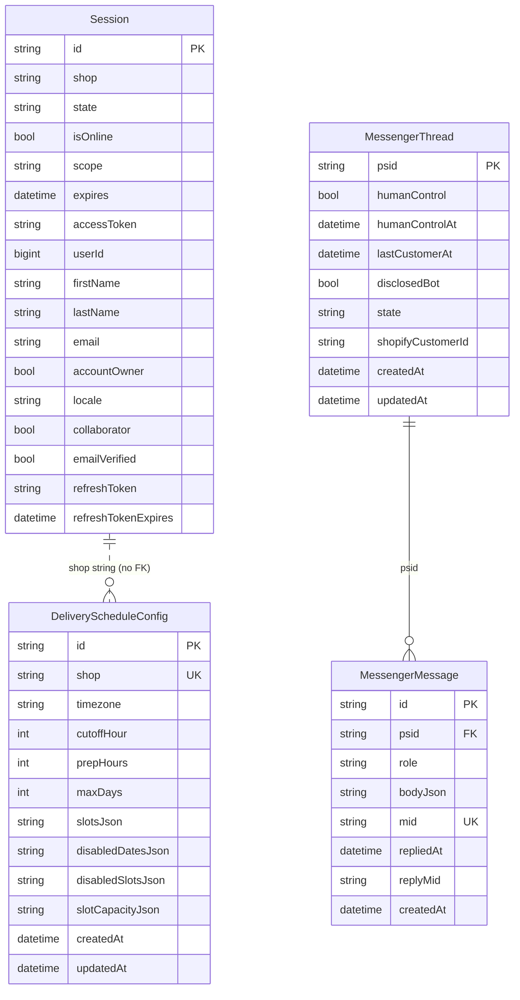
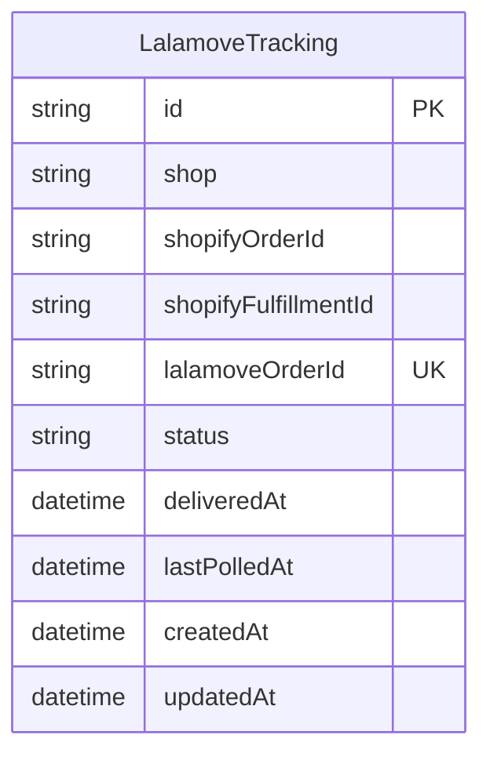

# Delivery Scheduler — Architecture (only what exists)

> **This file covers system topology and data model only.** It is the source of truth and pointer hub for the docs set.
>
> - Route-by-route detail, auth mechanisms, write-path contract → [api.md](./api.md)
> - Orders Operations UI (list page + detail drawer) composition & data flow → [orders-ui.md](./orders-ui.md)
> - Dated verification history → [verification-log.md](./verification-log.md)
> - Why specific technical decisions were made → [decisions.md](./decisions.md)
> - Commands, local dev, testing, deployment/cold-start notes → [development.md](./development.md)
> - Known open issues → [known-issues.md](./known-issues.md)
> - Feature history in plain language → [changelog.md](./changelog.md)

**Last full re-verification:** 2026-07-04
**Canonical truth:** this doc. Any conflict with `../../docs/delivery-operations-architecture.md` (older, drifted) is resolved in favor of this file — see [§ Superseded documents](#superseded-documents).
**Workflow:** before editing any file under `delivery-scheduler/app/`, `extensions/`, `prisma/`, or `shopify.app.toml`/`shopify.app.production.toml`, read this doc first; after the edit, update the relevant doc(s) + add a new entry to [verification-log.md](./verification-log.md) dated today. The project skill `delivery-scheduler-architecture` (in `.claude/skills/`) enforces this loop for future Claude Code agents.

Verified against `app/`, `extensions/`, `prisma/schema.prisma`, `shopify.app.toml` (dev), `shopify.app.production.toml` (prod).
Lahat ng nodes/edges sa baba ay may corresponding file or config.

---

## What's actually in this repo

This is a Shopify embedded app (React Router 7, ported from the Shopify Remix template) that adds delivery-date/time-slot scheduling to checkout and syncs that state onto Shopify orders. **Delivery state lives on the Shopify order, not in Postgres** — Postgres holds eight models (`Session`, `DeliveryScheduleConfig`, the Messenger-agent conversation pair `MessengerThread`/`MessengerMessage` since 2026-08-01, the Lalamove correlation side-table `LalamoveTracking` since 2026-08-16 (ADR-16), the Customer Email send log `EmailSendLog` since 2026-08-17, and the occasion-reminder trio `OccasionReminder`/`ReminderSuppression`/`ReminderConfig` since 2026-08-21 (ADR-19)); everything about a specific order's delivery date/slot/reschedule status is stored as order metafields, tags, and customAttributes. Booked-slot counts are live-derived and never persisted — since Scheduler V2 Phase 2 ([ADR-12](./decisions.md)) they come from a `metafields.custom.date:`-scoped Admin GraphQL orders search over the capacity-tracked dates, memoized in-process for 60 seconds. Last-mile courier dispatch is **not** handled here — it is delegated to the official Shopify Lalamove app (the former custom Lalamove integration was removed 2026-07-04; see [decisions.md ADR-1](./decisions.md)). The app has two outbound side channels besides the Shopify APIs: (1) **customer email** (2026-07-13, [ADR-11](./decisions.md)): the `/app/orders` `sendEmail` op sends plain-text mail through the merchant's business mailbox (Namecheap Private Email SMTP via nodemailer, [`services/send-customer-email.server.ts`](../app/services/send-customer-email.server.ts)) — an outbound side effect that **writes nothing to any order**; since 2026-08-17 it also writes one `EmailSendLog` row to Postgres per send, purely so the order panel's `DeliveryTimeline` can show when an email went out (design: [customer-email-design.md](./customer-email-design.md), E-5 revisit); and (2) the **Meta Messenger webhook** (FlowerCart Messenger agent — phase 3 since 2026-08-01): `GET/POST /webhooks/messenger` receives Meta-signed page events, records them in the Neon conversation models (`MessengerThread`/`MessengerMessage`, mid-unique dedupe), and enqueues a **Cloud Tasks** task (`messenger-events`, us-central1) that the HMAC-authed worker route `POST /webhooks/messenger/worker` processes via the Messenger Send API ([`services/messenger-send.server.ts`](../app/services/messenger-send.server.ts)) — no Admin API, no session storage, zero order writes; route/auth detail in [api.md](./api.md#meta-messenger-webhook-flowercart-messenger-agent). (Master context outside the repo.)

Since 2026-08-21 ([ADR-19](./decisions.md)) the customer-email side channel has a **second, automated caller**: the **occasion reminder scan** — a nightly Cloud Scheduler job (`delivery-scheduler-reminder-scan`, same shared-secret pattern as the Lalamove poller) POSTs `POST /internal/reminder-scan`, which finds orders whose delivery date recurs in 7 or 3 days (last-year orders via a `created_at:`-range Admin GraphQL search, older years rolled forward from the app's own `OccasionReminder` rows) and auto-sends the merchant's reminder template through the same `sendCustomerEmail` mailbox. Read-only against Shopify; its writes are the Postgres reminder models plus the same `EmailSendLog` audit row, so the §2 write-path contract is untouched (machine-enforced by the read-only grep guard in `test/occasion-reminders.test.ts`). A signed public unsubscribe route (`GET /public/reminder-unsubscribe`) feeds `ReminderSuppression`; the merchant kill switch and activity feed live at `/app/reminders`.

A **third caller-side channel** landed 2026-08-19 ([ADR-18](./decisions.md)): **Shopify Sidekick**. Two extensions expose this app's delivery-scheduling domain to Sidekick in the admin — `delivery-sidekick-data` (target `admin.app.tools.data`, headless) registers three tools that relative-`fetch` the new READ-ONLY routes `POST /sidekick/tools/booked-counts` · `/order-delivery` · `/schedule-config`, and `delivery-sidekick-actions` (`admin.app.intent.link` ×2) deep-links the merchant into `/app/orders?order=…` or `/app/scheduler?date=…` so the change is made on the existing page. This is a **new caller of an existing auth mechanism, not a new mechanism**: the Sidekick sandbox sends the same session-token `Authorization` header the embedded admin does, `authenticate.admin` exchanges it, and responses go through the `cors` helper because the sandbox is cross-origin. **Nothing in the Sidekick path writes** — no mutations, no delivery state, no Prisma writes — so §2's four write paths in [api.md](./api.md) are unchanged; route detail is in [api.md § Sidekick tool routes](./api.md#sidekick-tool-routes). The system diagram below predates Sidekick and does not show it.

The full route/extension/service inventory (extensions ×10, embedded admin routes, auth/bootstrap routes, App Proxy routes, customer-account JWT routes, Sidekick tool routes, webhooks, services/lib) lives in **[api.md](./api.md)** — along with the order write-path contract. The one-sentence version proved there: only **4 surfaces** actually mutate delivery-schedule state (`webhooks.orders.create.ts`; `apps.schedule-rules.reschedule.ts` with no live caller; `public.customer-account.reschedule.ts` the only live customer path; and the `/app/orders` merchant `reschedule` op added by Orders Ops V2 Phase 4, ADR-10), and every extension except `delivery-reschedule-customer` is read-only — including the two Sidekick extensions added 2026-08-19 ([ADR-18](./decisions.md)).

### Database (Prisma — `prisma/schema.prisma`)

- `Session`
- `DeliveryScheduleConfig`
- `MessengerThread` / `MessengerMessage` (Messenger agent conversation pair — never the order)
- `LalamoveTracking` (ADR-16 — Lalamove↔Shopify correlation side-table, never delivery state)
- `EmailSendLog` (2026-08-17 — Customer Email send log for the order panel's `DeliveryTimeline`; never delivery state, never joins the order write-path contract in [api.md](./api.md))
- `OccasionReminder` / `ReminderSuppression` / `ReminderConfig` (2026-08-21, ADR-19 — occasion-reminder queue rows, the unsubscribe/do-not-remind list, and the merchant kill switch; never delivery state, never joins the order write-path contract)

---

## 1. System diagram

```mermaid
flowchart TB
    classDef ext fill:#eef,stroke:#557,color:#000
    classDef be  fill:#efe,stroke:#575,color:#000
    classDef db  fill:#fee,stroke:#a55,color:#000
    classDef sh  fill:#ffe,stroke:#a85,color:#000
    classDef rd  fill:#fef,stroke:#a5a,color:#000

    subgraph THANKYOU["Post-purchase"]
        TY["delivery-thank-you<br/>(read-only)"]:::rd
        CFN["cod-fee-notice<br/>(read-only Thank-You banner — shows the<br/>+₱70 COD fee + real total on COD orders)"]:::rd
    end

    subgraph CHECKOUT["Checkout — Shopify Function (runs on Shopify infra, no backend call)"]
        COD["cod-eligibility<br/>(payment customization — hides the COD<br/>manual method unless NCR ZIP/city match<br/>+ subtotal within min/max window,<br/>default ₱2,500 MAX cap; zero order writes)"]:::rd
    end

    subgraph CUSTACCT["Customer Account"]
        CADE["delivery-date-editor<br/>(read-only block)"]:::rd
        CARC["delivery-reschedule-customer<br/>(write — customer reschedule)"]:::ext
    end

    subgraph ADMINUI["Shopify Admin — embedded app"]
        APP["/app (shell + nav) →<br/>orders · scheduler · COD settings"]:::ext
        ORD["/app/orders<br/>(order bulk writes + merchant<br/>reschedule op → shared service)"]:::ext
        SCH["/app/scheduler<br/>(merged page, Scheduler V2 Phase 3 —<br/>writes DeliveryScheduleConfig<br/>via granular ops + version guard)"]:::ext
        COD["/app/cod-settings<br/>(COD min/max + fee amount + toggle —<br/>writes the payment customization<br/>+ reprices the COD-FEE variant)"]:::ext
        RUL["/app/schedule-rules<br/>(redirect stub → /app/scheduler)"]:::rd
    end

    subgraph ADMINEXT["Shopify Admin — order details (read-only)"]
        ADB["order-delivery-block"]:::rd
        ARA["delivery-reschedule-action"]:::rd
    end

    subgraph BACKEND["Backend — Remix/React-Router on Cloud Run"]
        P_GET["GET /apps/schedule-rules"]:::be
        P_VAL["POST /apps/schedule-rules/validate"]:::be
        P_RES["POST /apps/schedule-rules/reschedule<br/>(no live extension caller)"]:::be
        CA_SR["POST /public/customer-account/schedule-rules"]:::be
        CA_OD["POST /public/customer-account/order-delivery"]:::be
        CA_RE["POST /public/customer-account/reschedule<br/>(active customer write path)"]:::be
        WH_OC["POST /webhooks/orders/create<br/>(order-create delivery sync)"]:::be
        ENG["lib/delivery-availability<br/>validateDeliverySelection,<br/>cutoff/prep/disabled/capacity"]:::be
        SR["services/schedule-rules.server<br/>getScheduleRules(+BookedCounts)"]:::be
        ODM["services/order-delivery-metafields.server<br/>syncOrderDeliveryMetafields,<br/>syncOrderDeliveryScheduleTag"]:::be
    end

    subgraph DATA["Postgres (Prisma)"]
        T_CFG[("DeliveryScheduleConfig")]:::db
    end

    subgraph SHOP["Shopify Platform — Admin GraphQL (2026-04)"]
        SADM["Admin GraphQL API"]:::sh
        SMETA["Order metafields:<br/>custom.date, custom.time_slot,<br/>$app.reschedule_status,<br/>$app.reschedule_requested_at,<br/>delivery.reschedule_history,<br/>delivery.sync_status (D4),<br/>delivery.* / sidekick.* (legacy mirrors)"]:::sh
        STAGS["Order tags: YYYY-MM-DD, slot label, 'resched'"]:::sh
        SCATTR["Order customAttributes: 'Delivery Date', 'Delivery Time'"]:::sh
    end

    %% Embedded admin nav
    APP --> ORD
    APP --> SCH
    APP --> COD
    RUL -. redirect .-> SCH
    SCH --> SR
    SCH --> T_CFG

    %% Admin order-page extensions: READ-ONLY
    ADB -. read .-> SADM
    ARA -. read .-> SADM

    %% Customer account extensions
    CADE --> CA_SR
    CADE --> CA_OD
    CARC --> CA_SR
    CARC --> CA_RE

    %% Thank-you reads metafields via host APIs (no backend call)
    TY -. read host metafields .-> SMETA

    %% Backend route → engine + services
    P_GET --> SR
    P_VAL --> ENG
    P_RES --> ENG
    P_RES --> ODM
    CA_SR --> SR
    CA_OD --> SADM
    CA_RE --> ENG
    CA_RE --> SADM
    WH_OC --> ENG
    WH_OC --> ODM

    %% Services → data
    SR --> T_CFG
    SR --> SADM
    ODM --> SADM
    COD --> SADM

    %% Shopify writes only happen via backend routes/services. Admin extensions do NOT write.
    SADM --> SMETA
    SADM --> STAGS
    SADM --> SCATTR
```

**Legend:** pink-tone nodes = **read-only** surfaces. Green = backend routes/services. Yellow = Shopify platform. Blue = surface that performs writes (only `CARC`, `RUL`, `ORD`, `WH_OC`, `CA_RE`, `P_RES`).

Auth `/auth/*` and `/auth/login`, lifecycle webhooks `/webhooks/app/uninstalled` and `/webhooks/app/scopes_update`, and the standalone `delivery-bookings.server.ts` helper are omitted from this diagram — they exist (see the route tables in [api.md](./api.md)) but don't move delivery state. Session storage in Postgres (`Session` model) is also omitted; it backs the auth layer, not delivery logic.

---

## 4. Database diagram (Prisma — actual schema)

**`LalamoveTracking` (ADR-16, 2026-08-16):** a Lalamove↔Shopify correlation side-table, same "Postgres holds the SIDE CHANNEL, never delivery state" posture as the Messenger models above — it is not a delivery-date/slot write, it exists so a Lalamove courier's own `COMPLETE` status can auto-flip a Shopify fulfillment to "Delivered" via `fulfillmentEventCreate`. **Polling-only** as of the same-day ADR-16 addendum — Lalamove's push webhooks never fire for orders booked through the merchant's manual web flow (live-confirmed via the Lalamove Partner Portal's own "Webhook attempts" log). Rows are populated explicitly by the merchant pasting the real Lalamove Order ID into the "Mark as fulfilled" modal (`recordLalamoveOrderId()`) — never by webhook, and never by parsing the merchant-facing tracking link, which does not carry Lalamove's real order id. Full contract in [api.md](./api.md#lalamove-courier-status-listener-adr-16--not-a-shopify-webhook-not-dispatch-polling-only-as-of-the-same-day-addendum); the ADR-1-vs-ADR-16 distinction (status-listen ≠ dispatch) is in [decisions.md](./decisions.md).

**Messenger conversation models (FlowerCart Messenger agent, phase 3):** Neon holds the CONVERSATION, never the order — Shopify stays the order ledger (master doc, locked decision #1). `MessengerMessage.mid` is unique and doubles as the webhook dedupe (Meta redelivers on non-200); `repliedAt`/`replyMid` make the Cloud Tasks worker retry-idempotent and record bot-sent mids for phase 7 human-takeover echo-matching. Route/queue detail in [api.md](./api.md#meta-messenger-webhook-flowercart-messenger-agent).

**Override maps inside the JSON columns:** `disabledSlotsJson` and `slotCapacityJson` are date-keyed maps whose inner keys are **slot-value references**, not identifiers — successive editor generations wrote the same window under drifted spellings (`"9am - 12pm"` vs `"9AM-12PM"`). Every lookup therefore resolves the key through the canonical comparator, and the lenient read is the only place that prunes entries naming no configured slot ([ADR-13](./decisions.md)). Nothing about the column set or the stored shape changed.

**Order delivery state ay nasa Shopify side, hindi sa DB:**

```mermaid
erDiagram
    Order ||--o| MF_custom_date             : "custom.date (date)"
    Order ||--o| MF_custom_time_slot        : "custom.time_slot (single_line_text_field)"
    Order ||--o| MF_delivery_date           : "delivery.date (date, legacy mirror)"
    Order ||--o| MF_delivery_time_slot      : "delivery.time_slot (legacy mirror)"
    Order ||--o| MF_sidekick_delivery_date  : "sidekick.delivery_date (legacy mirror)"
    Order ||--o| MF_app_reschedule_status   : "$app.reschedule_status"
    Order ||--o| MF_app_reschedule_at       : "$app.reschedule_requested_at"
    Order ||--o| MF_delivery_resched_hist   : "delivery.reschedule_history (JSON-like audit log)"
    Order ||--o| MF_delivery_sync_status    : "delivery.sync_status (checkout-time validation outcome, D4)"
    Order ||--o{ OrderTag                   : "YYYY-MM-DD, slot label, 'resched'"
    Order ||--o{ OrderCustomAttribute       : "'Delivery Date', 'Delivery Time'"
    Order }o--|| Customer                   : "owns"
```

> The user-flow sequence diagram, the admin operations workflow, and the reschedule-lock state machine moved to [api.md](./api.md) (§3 and §5). The dated verification log moved to [verification-log.md](./verification-log.md).

---

## What this doc explicitly does **not** claim

- The Admin order-page extensions do **not** write delivery state. Anyone building on top of `delivery-reschedule-action` expecting it to edit a delivery is working off an outdated assumption — the file's only network call is a single `query GetReschedule`.
- The `delivery-reschedule-customer` modal does **not** have an App Proxy fallback in its live code. The diagram no longer shows one.
- The App Proxy reschedule route (`/apps/schedule-rules/reschedule`) is **not** currently called from any registered extension target. It still exists, still validates and writes if reached via a signed proxy URL, but no shipped UI wires to it.
- The `/app/orders` admin page **became the 4th delivery write path with Orders Ops V2 Phase 4** (2026-07-11, ADR-10): its `action` gained a `reschedule` op that calls the shared `rescheduleOrderDelivery()` service (`source: "merchant"`, administrative override — no `resched` lock tag, capacity warn+override). The OTHER bulk ops remain generic order state and freeform tags — see the [api.md §2](./api.md) write-paths table + caveat. (The non-delivery `custom.bouquet_photo` metafield write was removed 2026-07-12 — Bouquet Photo descoped.)
- Booking counts are **not** stored locally. Since Scheduler V2 Phase 2 ([ADR-12](./decisions.md)) they are derived from an Admin GraphQL orders search filtered by `metafields.custom.date:` over the future capacity-tracked dates (metafields-only matching through the canonical slot comparator, cancelled orders excluded), with the raw matched bookings memoized in-process per shop for 60 seconds — never written to Postgres. Rules saves and the tracked-date set changing both invalidate the memo; reschedule paths **and the `orders/create` webhook** exclude the order being written from its own counts (the webhook's exclusion added 2026-07-29 — without it a redelivery counted the order against its own slot). The scan carries two caps of its own (pages per date chunk, capacity-tracked dates); hitting either makes the counts a **lower bound**, reported as `countsMeta.status: "partial"` + the affected dates, never as `"ok"` (2026-07-29 — previously a `console.warn` under an `"ok"` meta).
- There is no local audit table. `delivery.reschedule_history` metafield is the only persistent audit trail for customer-initiated reschedules.

---

## Superseded documents

`../../docs/delivery-operations-architecture.md` (relative to this file: repo root `docs/delivery-operations-architecture.md`) is an older architecture overview that had drifted from the current code as of 2026-05-23.

> **⚠️ Not found on disk (2026-07-04):** during the docs restructuring this superseded file was **not located** at either candidate path (`delivery-scheduler/docs/delivery-operations-architecture.md` or the repo-root `docs/delivery-operations-architecture.md` that `../../docs/` resolves to). The reference is therefore currently dangling. It was **not deleted by this restructuring** (it was already absent). Flagged for human review — see [known-issues.md](./known-issues.md#possible-future-work-unconfirmed-not-committed). No `⚠️ SUPERSEDED` banner could be added because there is no file to add it to.

Known stale claims that file was recorded to contain (retained here for provenance):

- States `/app` "currently defaults to `/app/dashboard`". The actual default in `app.routes.app._index.jsx` is `/app/orders` (was `/app/scheduler` until Scheduler V2 Phase 3, 2026-07-17).
- Does not list `/app/orders` (the live orders surface; documented in [api.md](./api.md)).
- Describes `/apps/schedule-rules/reschedule` as "Possibly core" — re-verified as having **no registered extension caller**.
- Treats admin extensions ambiguously; this doc set is explicit that both `order-delivery-block` and `delivery-reschedule-action` are read-only.

If the file resurfaces, this file (`delivery-scheduler/docs/architecture.md`) plus [api.md](./api.md) is the trusted reference. Do not build on the superseded doc's claims without cross-checking here first.
