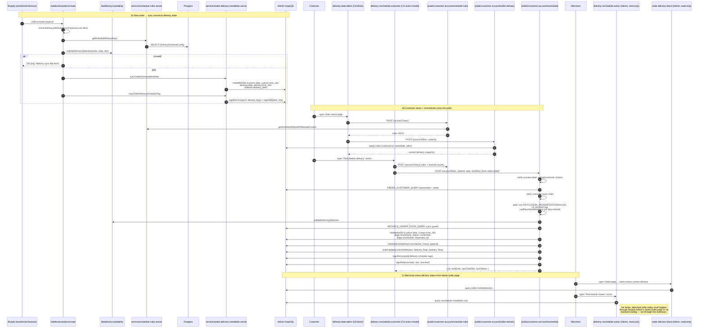
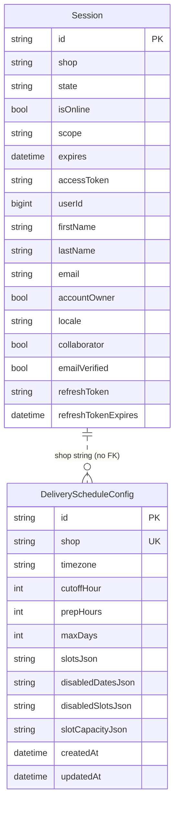
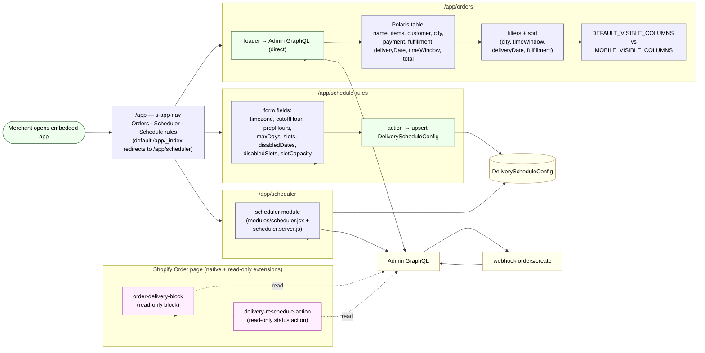
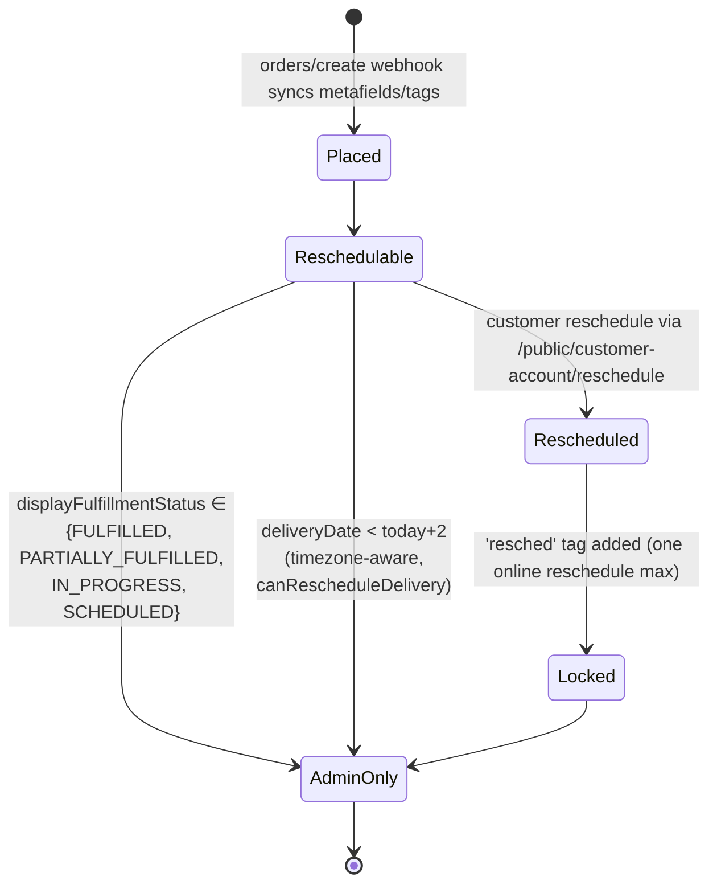

# Delivery Scheduler — Architecture (only what exists)

**Last full re-verification:** 2026-07-04
**Canonical truth:** this doc. Any conflict with `../../docs/delivery-operations-architecture.md` (older, drifted) is resolved in favor of this file — see [§ Superseded documents](#superseded-documents).
**Workflow:** before editing any file under `delivery-scheduler/app/`, `extensions/`, `prisma/`, or `shopify.app.toml`, read this doc first; after the edit, update the relevant section + add a new verification log entry dated today. The project skill `delivery-scheduler-architecture` (in `.claude/skills/`) enforces this loop for future Claude Code agents.

Verified against `app/`, `extensions/`, `prisma/schema.prisma`, `shopify.app.toml`.
Lahat ng nodes/edges sa baba ay may corresponding file or config.

## Verification log

| Date       | Scope verified                                                                                                                                                                                                            | Verifier notes                                                                                                                                                                                |
| ---------- | ------------------------------------------------------------------------------------------------------------------------------------------------------------------------------------------------------------------------- | --------------------------------------------------------------------------------------------------------------------------------------------------------------------------------------------- |
| 2026-05-22 | Initial sweep: extensions × 5, embedded admin routes, App Proxy routes, Customer-Account JWT routes, webhooks, services, Prisma schema, order metafields/tags                                                              | Cross-checked against each `shopify.extension.toml`, `shopify.app.toml`, `prisma/schema.prisma`, and `app/routes/**`. All 5 extension handles + targets confirmed.                            |
| 2026-05-23 | Admin order-page extensions confirmed **read-only**; full write-path inventory (§2); customer-reschedule extension confirmed posts to `/public/customer-account/reschedule` only — removed false "alt App Proxy" edge; `/app/orders` bulk-action handler scope documented; companion doc `../../docs/delivery-operations-architecture.md` flagged as stale. | `delivery-reschedule-action/src/OrderActionExtension.jsx` does only `query GetReschedule`; no mutations. `order-delivery-block/src/BlockExtension.jsx` reads metafields only. `delivery-reschedule-customer/src/order-action-modal.tsx` posts to `RESCHEDULE_URL = /public/customer-account/reschedule` only — no App Proxy fallback. `app.orders.tsx` `action` exports `archive`/`unarchive`/`cancel`/`tagsAdd`/`tagsRemove`/`markFulfilled` Admin mutations; none target delivery metafields, attributes, or write delivery tags automatically — but freeform `tagsAdd`/`tagsRemove` text input means a merchant *could* type a delivery-style tag (flagged in §2). `/app/_index` redirect target is `/app/scheduler` (verified `sanitizeEmbeddedAppReturnTo(...) ?? "/app/scheduler"`). |
| 2026-05-23 | Diagram + prose cleanup: simplified §1 system diagram (removed session-only edges, consolidated read-only nodes, dropped lifecycle webhook nodes — still listed in Webhooks table); removed the standalone "Dead code inside `delivery-date-editor/src/`" paragraph and the parallel mention in §2; verified every file path referenced in this doc exists on disk; added project skill `delivery-scheduler-architecture` to enforce read-first / update-after for future agents. | All 35 referenced paths (extensions, routes, services, schemas, configs) confirmed via filesystem check on 2026-05-23. Skill file: `.claude/skills/delivery-scheduler-architecture/SKILL.md` at repo root. |
| 2026-06-06 | Full re-verification sweep: (1) removed stale `/app/dashboard` route — `app.dashboard.jsx` no longer exists on disk; (2) removed stale `delivery-orders.server.ts` service — file does not exist; (3) added `webhooks.orders.cancelled.ts` (new Shopify webhook, topic `orders/cancelled`, registered in `shopify.app.toml`); (4) added `webhooks.lalamove.ts` (new Lalamove callback endpoint — not a Shopify webhook, receives Lalamove event payloads and writes `lalamove.*` metafields + `fulfillmentCreate`); (5) added `app/lib/lalamove.server.ts` and `app/lib/order-utils.ts` to services/lib table; (6) added §2 Lalamove dispatch write paths subsection documenting `lalamove.*` metafield writes and `fulfillmentCreate`; (7) updated system diagram and data model to reflect Lalamove nodes; (8) updated `shopify.app.toml` webhooks section to include `orders/cancelled` topic. | All referenced paths confirmed via `Get-ChildItem` on `app/routes/`, `app/services/`, `app/lib/`, and `shopify.app.toml` on 2026-06-06. `app.dashboard.jsx` and `delivery-orders.server.ts` confirmed absent — both now removed from this doc. `webhooks.lalamove.ts` and `webhooks.orders.cancelled.ts` confirmed present and read in full. |

| 2026-06-07 | Lalamove dispatch hardening + constant centralization (no write-path / contract change): (1) added `app/lib/constants.ts` exporting `RESCHEDULED_ORDER_TAG`; both reschedule routes now import it instead of duplicating the `"resched"` literal; (2) added exported `sanitizeCoordinate` in `lib/lalamove.server.ts` (plain-decimal, range-checked, 6dp) — applied to sender pickup coords in both `app.orders.tsx` Lalamove handlers and inside `geocodeAddress`; (3) exported `parseLalamoveError`; (4) `app.orders.tsx` Lalamove error responses no longer leak raw `String(e)` — use `e.message` / static friendly text; (5) `OrderDrawer.tsx` dispatch quote now debounced 300ms + dispatch modal given `role=dialog` / `aria-modal` / focus trap; (6) added Vitest unit tests (`test/lalamove.server.test.ts`) + `npm test` script. | `npm test` 18/18 green; `npm run typecheck` clean. No metafield/tag/customAttribute/webhook/extension/mutation contract changed — §2 write-paths table re-confirmed untouched. `RESCHEDULED_ORDER_TAG` now single-sourced: grepped both reschedule route files, no remaining `= "resched"` literal. Coordinate sanitization confirmed against live Lalamove Settings values (`14.6318942183155`, `120.96987720940528`) → normalized to `14.631894`, `120.969877`. |

| 2026-06-07 | Order drawer UI redesign (no write-path / contract change): restyled the `/app/orders` Lalamove dispatch modal to a Lalamove-style panel (Route pickup/drop-off card, Additional Services with fees, Estimated Invoice Breakdown, "Dispatch Lalamove Driver" CTA); removed the Customer + Sender Info display sections from the drawer; added "Extra waiting time" service mapped to the existing `QUEUEING_SERVICE` enum (already whitelisted — no new special-request value). `app/routes/app.orders.tsx` loader gained a **read-only** `shop` metafield query (`lalamove.sender_name/phone/address`) to render the pickup card; no new mutation, metafield write, tag, or webhook. | `npm test` 23/23 green; `npm run typecheck` clean. Confirmed `VALID_SPECIAL_REQUESTS` already contained `QUEUEING_SERVICE` (no whitelist change). Verified no `metafieldsSet`/`tagsAdd`/`orderUpdate` added — §2 write-paths table unchanged. New loader query is a read against `shop` metafields only. |
| 2026-06-16 | Added `GET /apps/schedule-rules/products` App Proxy route (new file: `app/routes/apps.schedule-rules.products.ts`) — **read-only** collection product pagination endpoint. Accepts `collection` (handle), `cursor` (GraphQL endCursor), `limit` (default 8, max 24) query params. Calls Shopify Admin GraphQL `collection.products(first, after)` and returns `{ products, nextCursor, hasNextPage }`. No Postgres writes; no order/metafield/tag mutations; no new access scopes required (uses existing `write_products` scope which covers reads). Theme side: added Load More button + `data-next-cursor`/`data-has-next-page` attributes in `Dawn-theme/sections/main-collection-product-grid.liquid`; added `Dawn-theme/assets/collection-load-more.js` (vanilla JS, no framework, fetches via App Proxy, appends `<li>` cards to existing `#product-grid`). §2 write-paths table unchanged. | New route confirmed read-only: only Admin GraphQL `query CollectionProducts` — no mutations, no `metafieldsSet`, no tag writes. `authenticate.public.appProxy` used (same as existing `apps.schedule-rules.ts`). Proxy coverage: existing `[app_proxy] url = ".../apps/schedule-rules"` already forwards all sub-paths including `/products`. |
| 2026-07-02 | `apps.schedule-rules.products.ts` reworked to remove its session-storage (Neon/Prisma) dependency, fixing a double cold-start (Cloud Run scale-to-zero + Neon Free auto-suspend both waking on first hit). This route now: (1) verifies the App Proxy `signature` manually via new `app/lib/verify-app-proxy.server.ts` (`verifyAppProxySignature` — HMAC-SHA256 over sorted `key=value` query params excluding `signature`, keyed with `SHOPIFY_API_SECRET`, plus a 5-minute timestamp freshness check) instead of calling `authenticate.public.appProxy` (which always resolves an offline session from Prisma/Neon per Shopify's own docs, even though this route never needed a merchant session); (2) calls the **Storefront API** directly via `fetch` with a new private access token (`SHOPIFY_STOREFRONT_ACCESS_TOKEN`, manual one-time setup — see `docs/cloud-run-neon.md` §6) instead of the Admin API. Response contract (`{ products, nextCursor, hasNextPage }` and each product's shape) is unchanged — `assets/global.js`'s `collection-show-more` custom element in the separate theme repo needs no changes. Filtering logic simplified: the old manual `isBuyable()` check (`status === "ACTIVE"` + `tracksInventory`/`totalInventory`) was removed because the Storefront API only ever returns products published + purchasable on the calling sales channel — `availableForSale` is now read directly off the Storefront `Product` object instead of being derived. §2 write-paths table unchanged (still read-only, still no order/metafield/tag mutation). | `npm run typecheck` clean. Confirmed via Shopify dev-docs MCP: app proxy signature algorithm (sort remaining query keys, concatenate `key=value` with no separator, HMAC-SHA256 hex digest, shared secret = same `SHOPIFY_API_SECRET` used elsewhere in `app/shopify.server.js`) against `https://shopify.dev/docs/apps/build/online-store/app-proxies/authenticate-app-proxies`; Storefront `Product.availableForSale` (direct Boolean field) and `Product.compareAtPriceRange.minVariantPrice` (same `ProductPriceRange` type as `priceRange`, unlike Admin's separate `ProductCompareAtPriceRange.minVariantCompareAtPrice`) confirmed via `validate_graphql_codeblocks` against the Storefront 2026-04 schema. No fallback to the Admin API path — if `SHOPIFY_STOREFRONT_ACCESS_TOKEN` is unset the route returns `502`. `SHOPIFY_STOREFRONT_ACCESS_TOKEN` is configured in both local `.env` and the Cloud Run secret. Added `test/verify-app-proxy.server.test.ts` (8 tests: valid signature, multi-value params, wrong secret, tampered param, missing signature, non-hex signature, stale timestamp, future timestamp) — `npm test` 31/31 green. |

| 2026-07-04 | **Custom Lalamove integration fully removed** — the store now books couriers via the **official Shopify Lalamove app**, so this app's bespoke dispatch/tracking/quote code was deleted. Removed wholesale: `app/lib/lalamove.server.ts`, `app/routes/webhooks.lalamove.ts`, `app/routes/webhooks.orders.cancelled.ts`, `test/lalamove.server.test.ts`, `test/order-drawer-flow.test.tsx`, and the three `docs/superpowers/**` Lalamove plan/spec docs. Surgically excised Lalamove code from `app.orders.tsx` (GraphQL `lalamove.*` aliases, sender loader query, dispatch/quote/cancel/priority-fee action branches, `setLalamoveMetafields`, `Export for Lalamove` CSV, `<OrderDrawer>` sender prop), `OrderDrawer.tsx` (dispatch UI + `LalamoveStatusLabel` + all fetchers/state/effects), `order-utils.ts` (`Order` Lalamove fields + `getLalamove*`/`isLalamoveCOD` helpers), `app.schedule-rules/route.tsx` (Lalamove Settings query/mutation/action/UI + `registerLalamoveWebhook`), and `orders-dashboard.css` (the `Lalamove UX Polish` block). Config: removed the `orders/cancelled` webhook subscription from `shopify.app.toml` and the Lalamove/Google-Maps secrets from `.env`. **Preserved untouched:** all delivery scheduling/rescheduling/capacity/validation, `webhooks.orders.create.ts`, the manual `markFulfilled` bulk action (its own `fulfillmentCreate`, distinct from the removed callback one), all access scopes, all 5 extensions, and `app.reschedule_*` metafield defs. Removed §"Lalamove callback endpoint", §"Lalamove dispatch write paths", the `MF_lalamove_*` erDiagram rows, and the Lalamove diagram nodes/edges below. | `npm run typecheck` clean, `npm run lint` clean, `npm test` green (Lalamove suites deleted). `grep -ri lalamove app/ extensions/ shopify.app.toml` returns zero hits. Access scopes deliberately left intact — `read/write_fulfillments` + merchant-managed-fulfillment scopes are used by the manual `markFulfilled` action, not Lalamove-only; removing them would force merchant re-consent. ⚠️ Leaked prod Lalamove + Google Maps keys previously committed to `.env` were deleted from the file but MUST be rotated/revoked at their providers. |

Update this log whenever architecture behavior, write paths, or extension wiring change.

---

## What's actually in this repo

### Extensions (5 total — verified via each `shopify.extension.toml`)

| Handle                         | Target                                                                                    | Status / Write capability                                          | Source                                                                                                                                                                                                                            |
| ------------------------------ | ----------------------------------------------------------------------------------------- | ------------------------------------------------------------------ | --------------------------------------------------------------------------------------------------------------------------------------------------------------------------------------------------------------------------------- |
| `order-delivery-block`         | `admin.order-details.block.render`                                                        | **Read-only.** Queries order metafields/attrs; no mutations.       | [src/BlockExtension.jsx](../extensions/order-delivery-block/src/BlockExtension.jsx)                                                                                                                                               |
| `delivery-reschedule-action`   | `admin.order-details.action.render`                                                       | **Read-only.** Single `query GetReschedule` for status display.    | [src/OrderActionExtension.jsx](../extensions/delivery-reschedule-action/src/OrderActionExtension.jsx)                                                                                                                             |
| `delivery-date-editor`         | `customer-account.order-status.block.render`                                              | **Read-only block.** Calls backend for snapshot/refresh, not write. | [src/index.tsx](../extensions/delivery-date-editor/src/index.tsx)                                                                                                                                                                |
| `delivery-reschedule-customer` | `customer-account.order.action.menu-item.render` + `customer-account.order.action.render` | **Write path** for customer reschedule via `/public/customer-account/reschedule`. | [src/order-action-menu-item.tsx](../extensions/delivery-reschedule-customer/src/order-action-menu-item.tsx) + [src/order-action-modal.tsx](../extensions/delivery-reschedule-customer/src/order-action-modal.tsx) |
| `delivery-thank-you`           | `purchase.thank-you.block.render`                                                         | **Read-only.** Reads metafields via host APIs; no backend call.    | [src/Checkout.jsx](../extensions/delivery-thank-you/src/Checkout.jsx)                                                                                                                                                            |

**Walang theme app extension. Walang Checkout UI Extension (other than thank-you).** Only `./src/index.tsx` is registered in `delivery-date-editor/shopify.extension.toml`; other source files in that folder are not wired and do not run.

### Embedded admin routes

| Path                                  | File                                                                                  | Has `action` (writes)?                                                                                                                                                                                                                                                                                       |
| ------------------------------------- | ------------------------------------------------------------------------------------- | ------------------------------------------------------------------------------------------------------------------------------------------------------------------------------------------------------------------------------------------------------------------------------------------------------------ |
| `/app` (shell + nav)                  | [app/routes/app.jsx](../app/routes/app.jsx)                                           | No — loader only.                                                                                                                                                                                                                                                                                            |
| `/app/_index` (redirect to scheduler) | [app/routes/app.\_index.jsx](../app/routes/app._index.jsx)                            | No — loader-side redirect. Default destination is `/app/scheduler` (`sanitizeEmbeddedAppReturnTo(...) ?? "/app/scheduler"`).                                                                                                                                                                                  |
| `/app/orders`                         | [app/routes/app.orders.tsx](../app/routes/app.orders.tsx)                             | **Yes — generic order bulk actions only, not delivery state.** Mutations: `orderClose`, `orderOpen`, `orderCancel`, `tagsAdd`, `tagsRemove`, `fulfillmentCreate`. Does **not** write `custom.date`, `custom.time_slot`, `$app.reschedule_*`, `delivery.*`, or `Delivery Date/Time` attributes. See §2 caveat. |
| `/app/scheduler`                      | [app/routes/app.scheduler.jsx](../app/routes/app.scheduler.jsx)                       | No — read-only view.                                                                                                                                                                                                                                                                                         |
| `/app/schedule-rules`                 | [app/routes/app.schedule-rules/route.tsx](../app/routes/app.schedule-rules/route.tsx) | **Yes — writes `DeliveryScheduleConfig` only** (rules config in Postgres). Does not touch any order.                                                                                                                                                                                                         |

### Shopify auth / bootstrap routes

Boilerplate scaffold para sa OAuth at non-embedded login. Hindi business logic.

| Path              | File                                                                  | Purpose                                                                                              |
| ----------------- | --------------------------------------------------------------------- | ---------------------------------------------------------------------------------------------------- |
| `/` (root index)  | [app/routes/\_index/route.jsx](../app/routes/_index/route.jsx)        | Redirects to `/app?shop=...` kung may `?shop=` param; else shows template landing/login form.        |
| `/auth/*` (splat) | [app/routes/auth.$.jsx](../app/routes/auth.$.jsx)                     | Shopify auth boundary — calls `authenticate.admin`, sets `boundary.headers`.                          |
| `/auth/login`     | [app/routes/auth.login/route.jsx](../app/routes/auth.login/route.jsx) | Non-embedded login form; calls `login()` from `shopify.server`.                                       |

### App proxy routes (HMAC-signed by Shopify, prefix `/apps/schedule-rules`)

| Path                                   | File                                                                                 |
| -------------------------------------- | ------------------------------------------------------------------------------------ |
| `GET /apps/schedule-rules`             | [apps.schedule-rules.ts](../app/routes/apps.schedule-rules.ts)                       |
| `POST /apps/schedule-rules/validate`   | [apps.schedule-rules.validate.ts](../app/routes/apps.schedule-rules.validate.ts)     |
| `POST /apps/schedule-rules/reschedule` | [apps.schedule-rules.reschedule.ts](../app/routes/apps.schedule-rules.reschedule.ts) — **route exists but no registered extension target currently calls it**; only the dead `delivery-date-editor/src/order-action-modal.tsx` references it. |
| `GET /apps/schedule-rules/products`    | [apps.schedule-rules.products.ts](../app/routes/apps.schedule-rules.products.ts) — unrelated to delivery scheduling; paginates collection products for the theme's "Show more" button (`assets/global.js`'s `collection-show-more` custom element, in the separate theme repo). **Only route that does NOT call `authenticate.public.appProxy`** — verifies the signature by hand (`lib/verify-app-proxy.server.ts`) and queries the Storefront API directly, to avoid a Prisma/Neon session lookup on every cold start. See verification log 2026-07-02. |

### Customer-account JWT routes (called by customer-account extensions)

| Path                                           | File                                                                                                 | Caller                                                                                                            |
| ---------------------------------------------- | ---------------------------------------------------------------------------------------------------- | ----------------------------------------------------------------------------------------------------------------- |
| `POST /public/customer-account/schedule-rules` | [public.customer-account.schedule-rules.ts](../app/routes/public.customer-account.schedule-rules.ts) | `delivery-date-editor` (block) + `delivery-reschedule-customer` (modal)                                            |
| `POST /public/customer-account/order-delivery` | [public.customer-account.order-delivery.ts](../app/routes/public.customer-account.order-delivery.ts) | `delivery-date-editor` (block snapshot refresh)                                                                    |
| `POST /public/customer-account/reschedule`     | [public.customer-account.reschedule.ts](../app/routes/public.customer-account.reschedule.ts)         | `delivery-reschedule-customer` modal — **the only live customer reschedule write path**                            |

### Webhooks (per `shopify.app.toml`)

| Topic               | File                                                                           |
| ------------------- | ------------------------------------------------------------------------------ |
| `orders/create`     | [webhooks.orders.create.ts](../app/routes/webhooks.orders.create.ts)           |
| `app/uninstalled`   | [webhooks.app.uninstalled.jsx](../app/routes/webhooks.app.uninstalled.jsx)     |
| `app/scopes_update` | [webhooks.app.scopes_update.jsx](../app/routes/webhooks.app.scopes_update.jsx) |

API version sa `shopify.app.toml` is `2026-04`.

> **Courier dispatch note:** Last-mile courier booking is handled by the **official Shopify Lalamove app**, not this app. The former custom Lalamove callback endpoint (`webhooks.lalamove.ts`) and the `orders/cancelled` webhook (which existed only to cancel a Lalamove order) were removed 2026-07-04 — see the verification log.

### Services / lib

| Module                            | File                                                                                                                  |
| --------------------------------- | --------------------------------------------------------------------------------------------------------------------- |
| Validation engine                 | [app/lib/delivery-availability.ts](../app/lib/delivery-availability.ts)                                               |
| Shared constants (reschedule tag) | [app/lib/constants.ts](../app/lib/constants.ts) — single source of `RESCHEDULED_ORDER_TAG`                            |
| Embedded URL path builder         | [app/lib/embedded-route.js](../app/lib/embedded-route.js)                                                             |
| Order utility helpers             | [app/lib/order-utils.ts](../app/lib/order-utils.ts)                                                                   |
| Rules loader + booked-count merge | [app/services/schedule-rules.server.ts](../app/services/schedule-rules.server.ts)                                     |
| Order metafield + tag sync        | [app/services/order-delivery-metafields.server.ts](../app/services/order-delivery-metafields.server.ts)               |
| Booking helper                    | [app/services/delivery-bookings.server.ts](../app/services/delivery-bookings.server.ts)                               |
| Scheduler module                  | [app/modules/scheduler.jsx](../app/modules/scheduler.jsx) + [scheduler.server.js](../app/modules/scheduler.server.js) |
| Session shop extractor            | [app/modules/session.server.js](../app/modules/session.server.js)                                                     |

### Database (Prisma — `prisma/schema.prisma`)

Two models lang. Walang other table.

- `Session`
- `DeliveryScheduleConfig`

---

## 1. System diagram

```mermaid
flowchart TB
    classDef ext fill:#eef,stroke:#557,color:#000
    classDef be  fill:#efe,stroke:#575,color:#000
    classDef db  fill:#fee,stroke:#a55,color:#000
    classDef sh  fill:#ffe,stroke:#a85,color:#000
    classDef rd  fill:#fef,stroke:#a5a,color:#000

    subgraph THANKYOU["Post-purchase"]
        TY["delivery-thank-you<br/>(read-only)"]:::rd
    end

    subgraph CUSTACCT["Customer Account"]
        CADE["delivery-date-editor<br/>(read-only block)"]:::rd
        CARC["delivery-reschedule-customer<br/>(write — customer reschedule)"]:::ext
    end

    subgraph ADMINUI["Shopify Admin — embedded app"]
        APP["/app (shell + nav) →<br/>orders · scheduler · schedule-rules"]:::ext
        ORD["/app/orders<br/>(generic order bulk writes;<br/>no delivery writes)"]:::ext
        SCH["/app/scheduler (read-only)"]:::rd
        RUL["/app/schedule-rules<br/>(writes DeliveryScheduleConfig)"]:::ext
    end

    subgraph ADMINEXT["Shopify Admin — order details (read-only)"]
        ADB["order-delivery-block"]:::rd
        ARA["delivery-reschedule-action"]:::rd
    end

    subgraph BACKEND["Backend — Remix/React-Router on Cloud Run"]
        P_GET["GET /apps/schedule-rules"]:::be
        P_VAL["POST /apps/schedule-rules/validate"]:::be
        P_RES["POST /apps/schedule-rules/reschedule<br/>(no live extension caller)"]:::be
        CA_SR["POST /public/customer-account/schedule-rules"]:::be
        CA_OD["POST /public/customer-account/order-delivery"]:::be
        CA_RE["POST /public/customer-account/reschedule<br/>(active customer write path)"]:::be
        WH_OC["POST /webhooks/orders/create<br/>(order-create delivery sync)"]:::be
        ENG["lib/delivery-availability<br/>validateDeliverySelection,<br/>cutoff/prep/disabled/capacity"]:::be
        SR["services/schedule-rules.server<br/>getScheduleRules(+BookedCounts)"]:::be
        ODM["services/order-delivery-metafields.server<br/>syncOrderDeliveryMetafields,<br/>syncOrderDeliveryScheduleTag"]:::be
    end

    subgraph DATA["Postgres (Prisma)"]
        T_CFG[("DeliveryScheduleConfig")]:::db
    end

    subgraph SHOP["Shopify Platform — Admin GraphQL (2026-04)"]
        SADM["Admin GraphQL API"]:::sh
        SMETA["Order metafields:<br/>custom.date, custom.time_slot,<br/>$app.reschedule_status,<br/>$app.reschedule_requested_at,<br/>delivery.reschedule_history,<br/>delivery.* / sidekick.* (legacy mirrors)"]:::sh
        STAGS["Order tags: YYYY-MM-DD, slot label, 'resched'"]:::sh
        SCATTR["Order customAttributes: 'Delivery Date', 'Delivery Time'"]:::sh
    end

    %% Embedded admin nav
    APP --> ORD
    APP --> SCH
    APP --> RUL
    SCH --> SR
    RUL --> SR
    RUL --> T_CFG

    %% Admin order-page extensions: READ-ONLY
    ADB -. read .-> SADM
    ARA -. read .-> SADM

    %% Customer account extensions
    CADE --> CA_SR
    CADE --> CA_OD
    CARC --> CA_SR
    CARC --> CA_RE

    %% Thank-you reads metafields via host APIs (no backend call)
    TY -. read host metafields .-> SMETA

    %% Backend route → engine + services
    P_GET --> SR
    P_VAL --> ENG
    P_RES --> ENG
    P_RES --> ODM
    CA_SR --> SR
    CA_OD --> SADM
    CA_RE --> ENG
    CA_RE --> SADM
    WH_OC --> ENG
    WH_OC --> ODM

    %% Services → data
    SR --> T_CFG
    SR --> SADM
    ODM --> SADM

    %% Shopify writes only happen via backend routes/services. Admin extensions do NOT write.
    SADM --> SMETA
    SADM --> STAGS
    SADM --> SCATTR
```

**Legend:** pink-tone nodes = **read-only** surfaces. Green = backend routes/services. Yellow = Shopify platform. Blue = surface that performs writes (only `CARC`, `RUL`, `ORD`, `WH_OC`, `CA_RE`, `P_RES`).

Auth `/auth/*` and `/auth/login`, lifecycle webhooks `/webhooks/app/uninstalled` and `/webhooks/app/scopes_update`, and the standalone `delivery-bookings.server.ts` helper are omitted from this diagram — they exist (see route tables below) but don't move delivery state. Session storage in Postgres (`Session` model) is also omitted; it backs the auth layer, not delivery logic.

---

## 2. Actual order write paths (the only places that mutate delivery state)

Every other surface in the system is read-only. Confirmed in code:

- `delivery-reschedule-action/src/OrderActionExtension.jsx` → single `query GetReschedule` call, no mutations.
- `order-delivery-block/src/BlockExtension.jsx` → reads only.
- `delivery-thank-you/src/Checkout.jsx` → reads metafields via host APIs.
- `delivery-date-editor/src/index.tsx` → reads block state + calls read endpoints.

The three delivery-schedule write paths:

| Trigger / route | File | Metafield writes | Tag writes | Custom attribute writes |
| --- | --- | --- | --- | --- |
| `orders/create` webhook | [webhooks.orders.create.ts](../app/routes/webhooks.orders.create.ts) | Via `syncOrderDeliveryMetafields`: `custom.date`, `custom.time_slot`, plus legacy mirror metafields `delivery.date`, `delivery.time_slot`, `sidekick.delivery_date` | Via `syncOrderDeliveryScheduleTag`: replaces existing delivery schedule tags with new date + slot label | None |
| App Proxy reschedule | [apps.schedule-rules.reschedule.ts](../app/routes/apps.schedule-rules.reschedule.ts) | `metafieldsSet`: `custom.date`, `custom.time_slot`, `$app.reschedule_status`, `$app.reschedule_requested_at` (no legacy mirrors written here) | Via `syncOrderDeliveryScheduleTag` with `additionalTags: ['resched']`: removes prior delivery schedule tags, adds new date + slot + `'resched'` | `orderUpdate(customAttributes)`: sets `Delivery Date` and `Delivery Time` |
| Customer Account JWT reschedule | [public.customer-account.reschedule.ts](../app/routes/public.customer-account.reschedule.ts) | `metafieldsSet`: `custom.date`, `custom.time_slot`, `$app.reschedule_status`, `$app.reschedule_requested_at`; separate `metafieldsSet` appends to `delivery.reschedule_history` | Direct `tagsRemove` of old delivery schedule tags, then `tagsAdd` of new date + slot + `'resched'` | `orderUpdate(customAttributes)`: sets `Delivery Date` and `Delivery Time` |

**Important:** The `RESCHEDULED_ORDER_TAG = "resched"` constant is now centralized in [`app/lib/constants.ts`](../app/lib/constants.ts) and imported by both reschedule routes (previously duplicated as a string literal in each).

The active `delivery-reschedule-customer` modal posts to `/public/customer-account/reschedule` (CA_RE). The App Proxy `/apps/schedule-rules/reschedule` (P_RES) route exists in the backend and still writes if reached via a signed proxy URL, but no registered extension target wires to it.

### Caveat — admin bulk actions are NOT a delivery write path, but can touch delivery tags by hand

`/app/orders` (`app/routes/app.orders.tsx`) exposes a merchant-facing bulk-action `action` handler. It runs the following Admin GraphQL mutations:

- `orderClose` / `orderOpen` (archive/unarchive)
- `orderCancel`
- `tagsAdd` / `tagsRemove` — **freeform text input**; merchant types arbitrary tag strings
- `fulfillmentCreate` (mark fulfilled, with optional tracking number/URL)

None of these mutations are part of the delivery sync contract — none write `custom.date`, `custom.time_slot`, `delivery.date`, `delivery.time_slot`, `sidekick.delivery_date`, `$app.reschedule_status`, `$app.reschedule_requested_at`, `delivery.reschedule_history`, or the `Delivery Date` / `Delivery Time` customAttributes.

However, because the tag input is freeform, a merchant *can* manually add or remove a string that matches `DELIVERY_SCHEDULE_TAG_PATTERN` (e.g. `2026-05-23` or `9AM-12PM`). The system does not validate or enforce this — if it happens, downstream readers (`order-delivery-block`, scheduler queries) will see the manually-typed tag the same way they see auto-synced delivery tags. Treat this as a manual-override side channel, not a supported delivery write path.

### Courier dispatch write paths — none (removed 2026-07-04)

This app no longer writes any `lalamove.*` metafields or performs any last-mile dispatch. Courier booking is handled entirely by the **official Shopify Lalamove app**. The former custom integration (a `webhooks.lalamove.ts` callback that wrote `lalamove.status`/`lalamove.driver_*` + `fulfillmentCreate`, an `orders/cancelled` webhook that cancelled the Lalamove order, and an `app.orders.tsx` dispatch action that wrote `lalamove.order_id`/`lalamove.share_link`) was deleted — see the 2026-07-04 verification-log entry. Do not reintroduce a `lalamove.*` write surface here.

---

## 3. User-flow sequence (only the flows that exist in live code)

---

## 4. Database diagram (Prisma — actual schema)

**Order delivery state ay nasa Shopify side, hindi sa DB:**

```mermaid
erDiagram
    Order ||--o| MF_custom_date             : "custom.date (date)"
    Order ||--o| MF_custom_time_slot        : "custom.time_slot (single_line_text_field)"
    Order ||--o| MF_delivery_date           : "delivery.date (date, legacy mirror)"
    Order ||--o| MF_delivery_time_slot      : "delivery.time_slot (legacy mirror)"
    Order ||--o| MF_sidekick_delivery_date  : "sidekick.delivery_date (legacy mirror)"
    Order ||--o| MF_app_reschedule_status   : "$app.reschedule_status"
    Order ||--o| MF_app_reschedule_at       : "$app.reschedule_requested_at"
    Order ||--o| MF_delivery_resched_hist   : "delivery.reschedule_history (JSON-like audit log)"
    Order ||--o{ OrderTag                   : "YYYY-MM-DD, slot label, 'resched'"
    Order ||--o{ OrderCustomAttribute       : "'Delivery Date', 'Delivery Time'"
    Order }o--|| Customer                   : "owns"
```

---

## 5. Admin operations workflow

### Reschedule lock — state machine actually enforced in code

(from [apps.schedule-rules.reschedule.ts](../app/routes/apps.schedule-rules.reschedule.ts) and [public.customer-account.reschedule.ts](../app/routes/public.customer-account.reschedule.ts))

Both reschedule routes use `RESCHEDULED_ORDER_TAG = "resched"` (imported from [`app/lib/constants.ts`](../app/lib/constants.ts)) as the lock primitive. Removing this tag on Shopify side re-opens the online reschedule flow — fragile by design.

---

## What this doc explicitly does **not** claim

- The Admin order-page extensions do **not** write delivery state. Anyone building on top of `delivery-reschedule-action` expecting it to edit a delivery is working off an outdated assumption — the file's only network call is a single `query GetReschedule`.
- The `delivery-reschedule-customer` modal does **not** have an App Proxy fallback in its live code. The diagram no longer shows one.
- The App Proxy reschedule route (`/apps/schedule-rules/reschedule`) is **not** currently called from any registered extension target. It still exists, still validates and writes if reached via a signed proxy URL, but no shipped UI wires to it.
- The `/app/orders` admin page is **not** a delivery write path. Its `action` handler mutates order state and freeform tags only — see the §2 caveat for the one manual-override side channel.
- Booking counts are **not** stored locally. They are computed by querying Shopify orders via Admin GraphQL on every `getScheduleRulesWithBookedCounts` call.
- There is no local audit table. `delivery.reschedule_history` metafield is the only persistent audit trail for customer-initiated reschedules.

---

## Superseded documents

`../../docs/delivery-operations-architecture.md` (relative to this file: repo root `docs/delivery-operations-architecture.md`) is an older architecture overview that has drifted from the current code as of 2026-05-23. Known stale claims in that file:

- States `/app` "currently defaults to `/app/dashboard`". The actual default in `app.routes.app._index.jsx` is `/app/scheduler`.
- Does not list `/app/orders` (the live orders surface; documented above).
- Describes `/apps/schedule-rules/reschedule` as "Possibly core" — re-verified here as having **no registered extension caller**.
- Treats admin extensions ambiguously; this doc is explicit that both `order-delivery-block` and `delivery-reschedule-action` are read-only.

If you read both, this file (`delivery-scheduler/docs/architecture.md`) is the trusted reference. Update the older doc only if/when the team decides to retire it formally; do not build on its claims without cross-checking here first.
