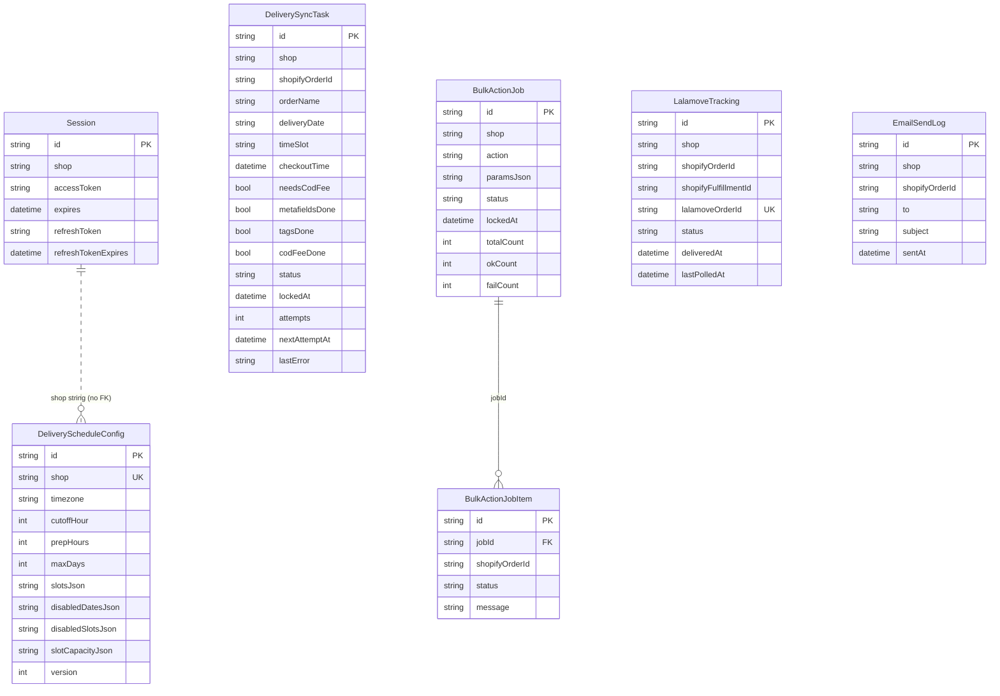

# Delivery Scheduler Architecture (only what exists)

> **This file covers system topology and data model only.** It is the pointer hub for the docs set.
>
> - Route-by-route detail, auth mechanisms, write-path contract → [api.md](./api.md)
> - Orders Operations page (`/app/orders`: table, KPIs, details panel, modals, refresh model) → [orders-ui.md](./orders-ui.md)
> - Dated verification history → [verification-log.md](./verification-log.md)
> - Why specific technical decisions were made → [decisions.md](./decisions.md)
> - Commands, local dev, testing, deployment/cold-start notes → [development.md](./development.md)
> - Known open issues → [known-issues.md](./known-issues.md)
> - Feature history in plain language → [changelog.md](./changelog.md)

**Last full re-verification:** 2026-09-09, against `app/`, `extensions/`, `prisma/schema.prisma`, `shopify.app.toml` (dev), `shopify.app.production.toml` (prod), `.env.example`, `Dockerfile`. Every route, extension, model, env var, and Shopify write named below has a corresponding file or config in the repo at that date.

---

## What's in this repo

A Shopify embedded app (React Router 7 on `@shopify/shopify-app-react-router`, `AppDistribution.SingleMerchant`, expiring offline access tokens, Prisma session storage) that adds delivery-date/time-slot scheduling to checkout, syncs that state onto Shopify orders, and gives the merchant an Orders Operations page to run deliveries from. It runs as one Node 22 container on Cloud Run (`Dockerfile`; container start runs `prisma generate && prisma migrate deploy`) against a Postgres database on Neon.

**Delivery state lives on the Shopify order, not in Postgres.** Everything about a specific order's delivery date, slot, reschedule status, and sync status is stored as order metafields, tags, and customAttributes (see [Delivery state on the Shopify order](#delivery-state-on-the-shopify-order)). Postgres holds seven models: the Shopify session, the shop's schedule configuration, and side tables for work bookkeeping and courier/email correlation (see [Database](#database)). Booked-slot counts are never persisted: `services/delivery-bookings.server.ts` derives them from one Admin GraphQL orders search filtered by `metafields.custom.date:` over the capacity-tracked dates, matched on `custom.date` + `custom.time_slot` only, memoized in-process per shop for a short TTL.

The app has these external integrations beyond the Shopify Admin, Storefront, and extension APIs:

1. **Google Cloud Tasks** (`services/ops-queue.server.ts`): the `orders/create` delivery sync and large `/app/orders` bulk actions run as signed tasks against two worker routes. When no queue is configured the same work runs inline in the request. See [Async work rails](#async-work-rails).
2. **Lalamove Open API v3, status-listen only** (`lib/lalamove-client.server.ts`): read-only order-status lookups for Lalamove order ids the merchant pasted into the "Mark as fulfilled" modal. The app never books, edits, or cancels a Lalamove delivery. See [Lalamove courier status](#lalamove-courier-status).
3. **SMTP via nodemailer** (`services/send-customer-email.server.ts`): plain-text customer email from the merchant's business mailbox, sent from the ops page compose modal and after a merchant reschedule. Writes nothing to any order; logs one `EmailSendLog` row per send.
4. **Meta Business Agent, inbound only** (`routes/api.agent.*`, `services/agent-api.server.ts`): three bearer-token JSON routes the Meta-hosted agent's tools call to create a draft or COD order, look up an order's status, and quote coverage/fees/slots. No chat, LLM, or Messenger transport code lives in this repo; conversation state and knowledge live in Meta. See [Agent API](#agent-api-meta-business-agent-tools).
5. **Google Places** (`lib/google-places.client.ts`, `GOOGLE_MAPS_API_KEY`): browser-side address search inside the ops page "Edit details" modal; the key is optional and the manual address form works without it.

---

## 1. System diagram

```mermaid
flowchart TB
    classDef ext fill:#eef,stroke:#557,color:#000
    classDef be  fill:#efe,stroke:#575,color:#000
    classDef db  fill:#fee,stroke:#a55,color:#000
    classDef sh  fill:#ffe,stroke:#a85,color:#000
    classDef rd  fill:#fef,stroke:#a5a,color:#000
    classDef ex  fill:#eee,stroke:#777,color:#000

    subgraph CHECKOUT["Checkout / post-purchase (Shopify-hosted)"]
        COD["cod-eligibility (Function)<br/>hides manual COD outside NCR ZIP/city<br/>or outside the min/max subtotal window"]:::rd
        TY["delivery-thank-you<br/>(reads cart metafields / attributes)"]:::rd
        CFN["cod-fee-notice<br/>('Total with fee' on COD orders)"]:::rd
    end

    subgraph CUSTACCT["Customer Account extensions"]
        CADE["delivery-date-editor<br/>(read-only block)"]:::rd
        CARC["delivery-reschedule-customer<br/>(self-service reschedule)"]:::ext
    end

    subgraph ADMINUI["Shopify Admin: embedded app"]
        APP["/app nav → Orders Operations ·<br/>Delivery Scheduler · COD Settings · Manual order"]:::ext
        ORD["/app/orders<br/>(bulk ops, reschedule, send email,<br/>edit details, mark fulfilled, seen)"]:::ext
        SCH["/app/scheduler<br/>(DeliveryScheduleConfig via granular ops<br/>+ version guard)"]:::ext
        CODS["/app/cod-settings<br/>(payment customization config, toggle,<br/>COD-FEE variant price, fee mirrors)"]:::ext
        MAN["/app/manual-order<br/>(draftOrderCreate / draftOrderComplete)"]:::ext
    end

    subgraph ADMINEXT["Shopify Admin: order details + Sidekick (read-only)"]
        ADB["order-delivery-block"]:::rd
        ARA["delivery-reschedule-action"]:::rd
        SKD["delivery-sidekick-data<br/>(3 tools → /sidekick/tools/*)"]:::rd
        SKA["delivery-sidekick-actions ·<br/>delivery-sidekick-scheduler<br/>(deep links into /app/orders, /app/scheduler)"]:::rd
    end

    subgraph STOREFRONT["Storefront (theme + App Proxy)"]
        FEE["delivery-fee-checker<br/>(theme block → /apps/schedule-rules/coverage)"]:::rd
        THEME["Theme date/slot picker (theme repo)<br/>writes cart attributes<br/>'Delivery Date' / 'Delivery Time'"]:::ex
    end

    subgraph META["Meta Business Agent (external)"]
        MBA["Agent tools:<br/>create_draft_order · get_order_status · get_delivery_quote"]:::ex
    end

    subgraph BACKEND["Backend: React Router on Cloud Run"]
        P_GET["GET /apps/schedule-rules"]:::be
        P_VAL["POST /apps/schedule-rules/validate"]:::be
        P_RES["POST /apps/schedule-rules/reschedule<br/>(no extension caller)"]:::be
        P_PRD["GET /apps/schedule-rules/products"]:::be
        P_COV["GET /apps/schedule-rules/coverage"]:::be
        CA_SR["POST /public/customer-account/schedule-rules"]:::be
        CA_OD["POST /public/customer-account/order-delivery"]:::be
        CA_RE["POST /public/customer-account/reschedule<br/>(the live customer write path)"]:::be
        SK["POST /sidekick/tools/*"]:::be
        AG["POST /api/agent/orders/draft<br/>GET /api/agent/orders/status<br/>GET /api/agent/delivery/quote"]:::be
        WH_OC["POST /webhooks/orders/create<br/>(thin receiver → DeliverySyncTask)"]:::be
        W_DS["POST /webhooks/delivery-sync/worker"]:::be
        W_BA["POST /webhooks/bulk-action/worker"]:::be
        SWEEP["POST /internal/delivery-sync-sweep"]:::be
        POLL["POST /internal/lalamove-poll"]:::be
        ENG["lib/delivery-availability"]:::be
        SR["services/schedule-rules.server<br/>+ delivery-bookings.server"]:::be
        ODM["services/order-delivery-metafields.server<br/>reschedule-order-delivery.server"]:::be
        OPSQ["services/ops-queue.server<br/>(Cloud Tasks)"]:::be
    end

    subgraph DATA["Postgres on Neon (Prisma)"]
        T_CFG[("DeliveryScheduleConfig")]:::db
        T_SYNC[("DeliverySyncTask")]:::db
        T_BULK[("BulkActionJob / Item")]:::db
        T_LALA[("LalamoveTracking")]:::db
        T_MAIL[("EmailSendLog")]:::db
        T_SESS[("Session")]:::db
    end

    subgraph SHOP["Shopify Admin GraphQL (2026-04)"]
        SADM["Admin GraphQL API"]:::sh
        SORD["Order: metafields · tags ·<br/>customAttributes · line items ·<br/>fulfillments · shipping address"]:::sh
        SDRAFT["Draft orders"]:::sh
        SPAY["Payment customization<br/>+ COD-FEE variant"]:::sh
    end

    subgraph EXTERN["Other external services"]
        CT["Google Cloud Tasks"]:::ex
        LALA["Lalamove Open API"]:::ex
        SMTP["Merchant mailbox (SMTP)"]:::ex
    end

    APP --> ORD
    APP --> SCH
    APP --> CODS
    APP --> MAN
    SCH --> SR
    SR --> T_CFG
    SR --> SADM
    ORD --> SADM
    ORD --> ODM
    ORD --> OPSQ
    ORD --> SMTP
    ORD --> T_MAIL
    ORD --> T_LALA
    CODS --> SPAY
    MAN --> SDRAFT

    ADB -. read .-> SADM
    ARA -. read .-> SADM
    SKD --> SK
    SK --> SR
    SK --> SADM

    THEME -. cart attributes .-> SORD
    FEE --> P_COV
    CADE --> CA_OD
    CARC --> CA_SR
    CARC --> CA_RE
    TY -. reads host metafields .-> SORD

    MBA --> AG
    AG --> SDRAFT
    AG --> SADM
    AG --> SR

    P_GET --> SR
    P_VAL --> ENG
    P_RES --> ODM
    P_PRD -. Storefront API .-> SADM
    CA_SR --> SR
    CA_OD --> SADM
    CA_RE --> ENG
    CA_RE --> ODM

    SDRAFT -. paid / completed .-> SORD
    SORD -. orders/create webhook .-> WH_OC
    WH_OC --> T_SYNC
    WH_OC --> OPSQ
    OPSQ --> CT
    CT --> W_DS
    CT --> W_BA
    W_DS --> T_SYNC
    W_DS --> ODM
    W_BA --> T_BULK
    SWEEP --> T_SYNC
    SWEEP --> T_BULK
    SWEEP --> OPSQ
    POLL --> T_LALA
    POLL --> LALA
    POLL --> SADM
    ODM --> SADM
    SADM --> SORD
```

**Legend:** pink = read-only surface; blue = surface that performs writes; green = backend route or service; red = Postgres; yellow = Shopify; grey = code or service outside this repo.

The diagram omits the auth routes (`/auth/*`, `/auth/login`, landing `/`), the lifecycle webhooks (`app/uninstalled`, `app/scopes_update`), the dev-only `/proxy/track` order-status JSON route, and the best-effort `POST /webhooks/lalamove-tracking` listener. They exist (see the route tables in [api.md](./api.md)) and are described below where they matter.

---

## 2. Surfaces (verified inventory)

### 2.1 Embedded admin (session cookie / session token via `authenticate.admin`)

| Route | What it does today |
|---|---|
| `/app` | App shell + `ui-nav-menu`: Orders Operations, Delivery Scheduler, COD Settings, Manual order. |
| `/app/_index` | Redirects to `/app/orders` (or a sanitized `returnTo`). |
| `/app/orders` | Orders Operations. Loader reads orders live from Admin GraphQL (no local order table). Action ops: bulk `archive` / `unarchive` / `cancel` / `tagsAdd` / `tagsRemove` / `markFulfilled` / `reschedule` (inline up to `BULK_INLINE_MAX`, otherwise a `BulkActionJob` processed by the bulk-action worker); single-order `sendEmail`, `editDetails`, `markRescheduleSeen`. Detail in [orders-ui.md](./orders-ui.md). |
| `/app/orders/reschedule-rules` | Read-only resource route: schedule rules + live booked counts for the reschedule modal. |
| `/app/orders/bulk-job/:jobId` | Read-only poll of a `BulkActionJob` (shop-scoped; missing and foreign jobs both answer `found:false`). |
| `/app/scheduler` | The schedule configuration page: cutoff, prep hours, max days, slots, disabled dates/slots, per-date capacity. Saves through granular ops in `services/scheduler-ops.server.ts` under an optimistic `version` guard on `DeliveryScheduleConfig`. |
| `/app/schedule-rules` | Redirect stub → `/app/scheduler`. |
| `/app/cod-settings` | COD settings. Writes the `$app:cod-eligibility` / `function-configuration` metafield on the COD payment customization (min/max amount, allowed areas, fee amount), toggles the customization (`paymentCustomizationUpdate`), reprices the hidden `COD-FEE` product variant (`productVariantsBulkUpdate`), and mirrors the fee to three shop metafields: `$app:cod`/`fee` (checkout UI extensions), `custom`/`cod_fee` (Liquid), and `_cod_fee`/`commission` (the Releasit COD app's namespace, whose own fee engine stays off). |
| `/app/manual-order` | Merchant form that creates a Shopify draft order with the delivery customAttributes and a `LALAMOVE` shipping line; optionally completes it (`draftOrderComplete`) when payment is already verified. Fallback for orders taken by a person in chat. |

### 2.2 Storefront App Proxy (`/apps/schedule-rules/*`)

Production TOML maps storefront `/apps/schedule-rules` → backend `/apps/schedule-rules`. The dev TOML instead maps `/apps/track` → backend `/proxy` (so `routes/proxy.track.tsx`, the order-number + contact status JSON, is reachable only through the dev app).

| Route | Auth | What it does today |
|---|---|---|
| `GET /apps/schedule-rules` | `authenticate.public.appProxy` | Active schedule rules + live booked counts + `availabilityWindow` for the theme's date/slot picker. |
| `POST /apps/schedule-rules/validate` | `authenticate.public.appProxy` | Validates one date + slot with `validateDeliverySelection`. |
| `POST /apps/schedule-rules/reschedule` | `authenticate.public.appProxy` | Validates and writes a reschedule. **No extension or theme file in this repo calls it** (verified by grep; the customer extension calls the customer-account route instead). |
| `GET /apps/schedule-rules/products` | Hand-verified proxy signature, no DB | Storefront API product pagination for a collection ("Show more"). Uses `SHOPIFY_STOREFRONT_ACCESS_TOKEN`. |
| `GET /apps/schedule-rules/coverage` | Hand-verified proxy signature + `shop` must equal `SHOP_DOMAIN`, no DB | Delivery coverage + fee estimate for a city/barangay/ZIP from `services/delivery-coverage.server.ts` (in-process data, no external API). Called by the `delivery-fee-checker` theme block. |

The theme's own date/slot picker (in the theme repo, not here) writes the cart attributes `Delivery Date` and `Delivery Time`; nothing under `extensions/` writes cart attributes.

### 2.3 Customer account routes (`/public/customer-account/*`, JWT verified with `jose`, `aud` = `SHOPIFY_API_KEY`)

| Route | What it does today |
|---|---|
| `POST …/schedule-rules` | Rules + booked counts for the reschedule modal. |
| `POST …/order-delivery` | Delivery snapshot for one order (used by `delivery-date-editor`). |
| `POST …/reschedule` | **The live customer write path.** Re-checks that the token's customer owns the order, rejects if already rescheduled once (`RESCHEDULED_ORDER_TAG`), too close/past, or fulfillment status is `FULFILLED` / `PARTIALLY_FULFILLED` / `IN_PROGRESS` / `SCHEDULED`, then calls the shared `rescheduleOrderDelivery()`. |

### 2.4 Sidekick tool routes (`/sidekick/tools/*`, session token via `authenticate.admin` + `cors`)

`booked-counts`, `order-delivery`, `schedule-config`: read-only, always `200 {ok}`; backed by the `delivery-sidekick-data` extension's three tools. The two `admin_link` extensions only deep-link to `/app/orders` and `/app/scheduler`.

### 2.5 Agent API (Meta Business Agent tools)

`lib/verify-agent-token.server.ts` accepts `Authorization: Bearer <token>` or `X-Api-Key`, compared timing-safe against `META_AGENT_API_TOKEN` and `META_AGENT_API_TOKEN_PREV` (rotation window); an in-process sliding-window limiter allows 20/min on draft and 60/min on status and quote and answers `429` with `Retry-After`. Shopify access is the shop's offline session (`unauthenticated.admin(SHOP_DOMAIN)`).

| Route | What it does today |
|---|---|
| `POST /api/agent/orders/draft` | Validates the body, validates date + slot against the live rules, resolves products (variant id, handle, or title), and creates a draft order carrying `Delivery Date`, `Delivery Time`, `Card Message`, `Instruction`, `Agent Idempotency Key`, and (when supplied) `_Messenger PSID` customAttributes; tags `<date>`, `<slot>`, `source:messenger`, `agent-key-<key>`; a `LALAMOVE` shipping line. Idempotent: a draft already tagged `agent-key-<key>` is returned instead of created. `paymentMode: "cod"` checks NCR area + the COD amount window from the same function-configuration metafield, adds the `COD-FEE` variant line, and completes the draft with `paymentPending: true`, so a real order exists immediately. Otherwise it returns the draft's `invoiceUrl`. |
| `GET /api/agent/orders/status` | Order number + email → stage computed by `lib/order-tracking.server.ts` (`waiting_payment` / `confirmed` / `preparing` / `on_the_way` / `own_rider` / `delivered` / `cancelled`), delivery date/slot, fulfillment tracking URL, status page URL, reschedule page URL. Works for every Shopify order; the email must match the order. |
| `GET /api/agent/delivery/quote` | Coverage + fee range for a city/ZIP (`delivery-coverage.server.ts`), COD availability and amount window, the configured slots, and, for an optional date, whether it is bookable and which slots remain. |

Orders created this way enter the same `orders/create` sync as website orders once paid or completed. The ops page shows an "Open Messenger conversation" action (and a "Messenger" link in the Customer column) built from `META_PAGE_ID` and the order's `_Messenger PSID` attribute (`lib/messenger-conversation.ts`).

### 2.6 Webhooks, workers, internal jobs

| Route | Auth | What it does today |
|---|---|---|
| `POST /webhooks/orders/create` | Shopify HMAC (`authenticate.webhook`) | Thin receiver. Skips orders with neither delivery attributes nor a COD gateway. Otherwise upserts a `DeliverySyncTask` (frozen `checkoutTime`), enqueues a Cloud Tasks job, and acks. If the queue is not configured or enqueue fails, runs the sync inline once. |
| `POST /webhooks/app/uninstalled`, `…/scopes_update` | Shopify HMAC | Lifecycle. |
| `POST /webhooks/delivery-sync/worker` | HMAC over the raw body, header `X-Messenger-Worker-Signature`, secret from `resolveOpsWorkerSecret()` | Runs `processDeliverySyncTask`: claims the row (lease), loads the offline session, and checkpoints three idempotent steps: delivery metafields, schedule tags, COD fee. Validation against the checkout time never blocks the write; it only stamps `delivery.sync_status`. Retries with backoff up to 8 attempts, then `failed`. |
| `POST /webhooks/bulk-action/worker` | same HMAC scheme | Processes a `BulkActionJob` chunk by chunk, re-enqueuing itself until done. |
| `POST /internal/delivery-sync-sweep` | header `x-ops-worker-secret` = `resolveOpsWorkerSecret()` | Re-enqueues (or runs inline) stranded `DeliverySyncTask` rows and stale `BulkActionJob`s. Written to be invoked by an external scheduler; the schedule itself is not defined in this repo. |
| `POST /internal/lalamove-poll` | header `x-lalamove-poll-secret` = `LALAMOVE_POLL_SECRET` | For every `LalamoveTracking` row not yet delivered and not terminal, calls Lalamove `getOrderStatus`; on `COMPLETED` creates a Shopify fulfillment event (`fulfillmentEventCreate`, status delivered) and stamps `deliveredAt`; otherwise mirrors the status. Written to be invoked by an external scheduler. |
| `POST /webhooks/lalamove-tracking` | Lalamove HMAC (`lib/verify-lalamove-signature.server.ts`) | Best-effort push listener for the same rows. The code documents that Lalamove has never delivered order events for this account; the poll is the mechanism that runs in practice. |

Cloud Tasks env resolution (`ops-queue.server.ts`): `OPS_WORKER_SECRET` → `MESSENGER_WORKER_SECRET`; `OPS_TASKS_QUEUE_PATH` → `MESSENGER_TASKS_QUEUE_PATH`; worker URLs from `DELIVERY_SYNC_WORKER_URL` / `BULK_ACTION_WORKER_URL`, else derived from `OPS_WORKER_BASE_URL`, else path-swapped from the legacy `MESSENGER_WORKER_URL`. The task's OAuth token comes from the Cloud Run metadata server.

### 2.7 Extensions (11)

| Extension | Type / target | Reads | Writes |
|---|---|---|---|
| `cod-eligibility` | Function, `cart.payment-methods.transform.run` | Cart address + subtotal; config from the function-configuration metafield | Hides/renames the manual COD method only; zero order writes |
| `delivery-thank-you` | `purchase.thank-you.block.render` | Cart metafields `custom.date` / `custom.time_slot`, attributes `Delivery Date` / `Delivery Time`, COD detection | None |
| `cod-fee-notice` | `purchase.thank-you.block.render` | Order total + COD fee | None ("Total with fee" line) |
| `delivery-date-editor` | `customer-account.order-status.block.render` | Host metafields/attributes, `POST /public/customer-account/order-delivery` | None |
| `delivery-reschedule-customer` | `customer-account.order.action.menu-item.render` + `…action.render` | `…/schedule-rules` | `POST /public/customer-account/reschedule` (hardcoded production `APP_BASE_URL`) |
| `order-delivery-block` | `admin.order-details.block.render` | Admin GraphQL query of the order's attributes and `custom.*` / `$app.*` metafields | None |
| `delivery-reschedule-action` | `admin.order-details.action.render` | Admin GraphQL query `GetReschedule` | None |
| `delivery-sidekick-data` | `admin.app.tools.data` | `/sidekick/tools/*` (relative fetch, session token) | None |
| `delivery-sidekick-actions`, `delivery-sidekick-scheduler` | `admin_link`, `admin.app.intent.link` | — | None (navigation only) |
| `delivery-fee-checker` | Theme app extension, section block | `GET /apps/schedule-rules/coverage` | None |

Only `delivery-reschedule-customer` writes, and it does so through the backend route.

---

## 3. Delivery state on the Shopify order

```mermaid
erDiagram
    Order ||--o{ OrderCustomAttribute       : "'Delivery Date', 'Delivery Time', 'Card Message', 'Instruction', 'Agent Idempotency Key', '_Messenger PSID'"
    Order ||--o| MF_custom_date             : "custom.date (date)"
    Order ||--o| MF_custom_time_slot        : "custom.time_slot (single_line_text_field)"
    Order ||--o| MF_delivery_date           : "delivery.date (mirror)"
    Order ||--o| MF_delivery_time_slot      : "delivery.time_slot (mirror)"
    Order ||--o| MF_sidekick_delivery_date  : "sidekick.delivery_date (mirror)"
    Order ||--o| MF_delivery_sync_status    : "delivery.sync_status ('ok' | 'attention:<code>')"
    Order ||--o| MF_app_reschedule_status   : "$app.reschedule_status ('confirmed')"
    Order ||--o| MF_app_reschedule_at       : "$app.reschedule_requested_at (date_time)"
    Order ||--o| MF_delivery_resched_hist   : "delivery.reschedule_history (json array)"
    Order ||--o| MF_app_reschedule_seen     : "$app.reschedule_seen_at (merchant ack, not delivery state)"
    Order ||--o{ OrderTag                   : "YYYY-MM-DD · slot · resched lock · resched-<day> · trackingAdded · source:messenger · agent-key-<key> · cod"
    Order ||--o{ LineItem                   : "COD-FEE variant added post-purchase on COD orders"
    Order ||--o{ Fulfillment                : "trackingInfo.url set by Mark as fulfilled; delivered event by the Lalamove poll"
```

- **Ingest:** the checkout writes only the two attributes. The `orders/create` sync reads them (exact keys `Delivery Date` / `Delivery Time`, matched by `key` or `name`) and writes the metafields and schedule tags; `delivery.sync_status` records whether the selection was valid at checkout time.
- **Display readers** (`lib/order-utils.ts`, the extensions) accept the metafields first, then the attributes, then a date-shaped or slot-shaped tag, so older orders still render.
- **Reschedule** (`services/reschedule-order-delivery.server.ts`, shared by the customer route, the merchant op, and the proxy route): sets `custom.date` / `custom.time_slot` + mirrors + `$app.reschedule_status` + `$app.reschedule_requested_at` in one `metafieldsSet`; then appends to `delivery.reschedule_history`; then rewrites the two customAttributes via `orderUpdate`; then replaces the date/slot tags and adds the `resched-<day>` event tag. A customer reschedule also adds the `RESCHEDULED_ORDER_TAG` lock; a merchant reschedule does not.
- **Booked counts** come only from `custom.date` + `custom.time_slot`, cancelled orders excluded, and the order being written is excluded from its own count.

### Order write paths

| Writer | Delivery state? | What it writes |
|---|---|---|
| `orders/create` sync (worker or inline) | Yes | Delivery metafields + mirrors, `delivery.sync_status`, schedule tags, COD-FEE line via order edit |
| `POST /public/customer-account/reschedule` | Yes | `rescheduleOrderDelivery()` + lock tag |
| `/app/orders` `reschedule` op | Yes | `rescheduleOrderDelivery()` (merchant override; optional plain-text email notice) |
| `POST /apps/schedule-rules/reschedule` | Yes | `rescheduleOrderDelivery()`; no caller in this repo |
| `/app/orders` bulk ops | No | `orderClose` / `orderOpen` / `orderCancel` / `tagsAdd` / `tagsRemove` / `fulfillmentCreate` (+ `trackingInfo.url`, `notifyCustomer`, `trackingAdded` tag, `LalamoveTracking` row) |
| `/app/orders` `editDetails` | No | Shipping address + receiver phone via `orderUpdate`, plus a tag |
| `/app/orders` `markRescheduleSeen` | No | `$app.reschedule_seen_at` |
| `/internal/lalamove-poll` | No | `fulfillmentEventCreate` (delivered) |
| `/app/manual-order`, `POST /api/agent/orders/draft` | Creates orders | `draftOrderCreate` (+ `draftOrderComplete`); the resulting order then flows through the `orders/create` sync |
| `/app/cod-settings` | No (shop-level) | Payment customization config + toggle, `COD-FEE` variant price, fee mirror metafields |

---

## 4. Async work rails

- **Delivery sync:** webhook → `DeliverySyncTask` row (unique per shop + order, so redelivery reuses the row) → Cloud Tasks → worker. Each step (`metafieldsDone`, `tagsDone`, `codFeeDone`) is checkpointed; the row is claimed with a lease (`lockedAt`) so two workers cannot process it at once. `nextAttemptAt` paces only the sweep; Cloud Tasks paces its own retries.
- **Bulk actions:** an `/app/orders` op on more than `BULK_INLINE_MAX` orders becomes a `BulkActionJob` + `BulkActionJobItem`s; the worker processes a chunk, renews the lease, re-enqueues; the client polls `/app/orders/bulk-job/:jobId`.
- **Sweep:** rescues pending sync rows whose `nextAttemptAt` has passed and whose lease is missing or stale, and bulk jobs whose `updatedAt` is older than the job lease.
- **No queue configured:** the webhook and the sweep run the work inline in the request.

## Lalamove courier status

The merchant books every delivery by hand on web.lalamove.com and pastes the Lalamove order id into the ops page "Mark as fulfilled" modal; `recordLalamoveOrderId()` stores it in `LalamoveTracking` against the Shopify order and fulfillment. The poll route then asks Lalamove for that order's status until it is `COMPLETED` (a `fulfillmentEventCreate` with status `DELIVERED`, `deliveredAt` set) or terminal (`CANCELED` / `REJECTED` / `EXPIRED`, never polled again). Customer-facing courier emails are Shopify's own notifications, triggered by `notifyCustomer` on the fulfillment and by the fulfillment event according to the store's notification settings; this repo sends no courier email itself.

---

## Database

Prisma 7, `prisma/schema.prisma`, PostgreSQL on Neon. Seven models; none holds an order's delivery state.

- `DeliveryScheduleConfig` is the only merchant-edited configuration. `disabledSlotsJson` and `slotCapacityJson` are date-keyed maps whose inner keys are slot-value references resolved through the canonical slot comparator (`lib/slot-value.ts`), which tolerates drifted spellings such as `"9am - 12pm"` vs `"9AM-12PM"`.
- `DeliverySyncTask`, `BulkActionJob`, `BulkActionJobItem` are work bookkeeping; `LalamoveTracking` and `EmailSendLog` are side tables for the ops page timeline and the courier poll.
- There is no local order, customer, conversation, or audit table. `delivery.reschedule_history` on the order is the only reschedule audit trail.

---

## Configuration (env vars read by `app/`)

| Group | Variables |
|---|---|
| Shopify app | `SHOPIFY_API_KEY`, `SHOPIFY_API_SECRET`, `SCOPES`, `SHOPIFY_APP_URL`, `SHOP_CUSTOM_DOMAIN` (optional), `SHOPIFY_STOREFRONT_ACCESS_TOKEN` (products proxy) |
| Database | `DATABASE_URL` (pooled), `DIRECT_DATABASE_URL` (migrations) |
| Shop identity | `SHOP_DOMAIN` (fallbacks `MESSENGER_SHOP`, `LALAMOVE_SHOP`) via `lib/shop-domain.server.ts`; `LALAMOVE_SHOP` is still read directly by the Lalamove routes |
| Cloud Tasks | `OPS_WORKER_SECRET`, `OPS_TASKS_QUEUE_PATH`, `OPS_WORKER_BASE_URL`, `DELIVERY_SYNC_WORKER_URL`, `BULK_ACTION_WORKER_URL`; legacy fallbacks `MESSENGER_WORKER_SECRET`, `MESSENGER_TASKS_QUEUE_PATH`, `MESSENGER_WORKER_URL` |
| Lalamove | `LALAMOVE_API_KEY`, `LALAMOVE_API_SECRET`, `LALAMOVE_MARKET`, `LALAMOVE_ENV`, `LALAMOVE_POLL_SECRET` |
| Email | `EMAIL_SMTP_HOST`, `EMAIL_SMTP_PORT`, `EMAIL_SMTP_USER`, `EMAIL_SMTP_PASSWORD`, `EMAIL_FROM_NAME` |
| Agent API | `META_AGENT_API_TOKEN`, `META_AGENT_API_TOKEN_PREV`, `META_PAGE_ID` (fallback `MESSENGER_PAGE_ID`), `STATUS_PAGE_BASE_URL`, `CUSTOMER_ACCOUNT_URL` |
| Ops UI | `GOOGLE_MAPS_API_KEY` (optional) |
| Runtime | `NODE_ENV` |

---

## What this doc doesn't claim

- No chat, LLM, or Messenger transport runs in this repo. The Meta agent is external; the app only serves the three bearer-token routes above. The `MESSENGER_*` names that remain are env fallbacks and one HTTP header name (`X-Messenger-Worker-Signature`) kept for compatibility with in-flight Cloud Tasks.
- The Admin order-page extensions do not write delivery state; each makes a single read query.
- `POST /apps/schedule-rules/reschedule` still validates and writes if reached through a signed proxy URL, but no shipped UI in this repo calls it.
- `POST /webhooks/lalamove-tracking` is wired but is not the mechanism that runs in practice; the poll is.
- `/proxy/track` has no production proxy mapping; the customer-facing status page is a theme page (`STATUS_PAGE_BASE_URL`, default `https://flowercart.store/pages/track`) in the theme repo.
- The schedules for the sweep and the Lalamove poll are external (the code expects a shared-secret header from a scheduler); nothing in this repo defines or verifies them.
- Booking counts are a lower bound whenever the scan hits its page or date caps; the service reports `countsMeta.status: "partial"` rather than `"ok"` in that case.
- Delivery fees are computed by Shopify's shipping rates at checkout. `delivery-coverage.server.ts` only estimates (distance formula with a flat per-city fallback) for the storefront fee checker and the agent quote.
