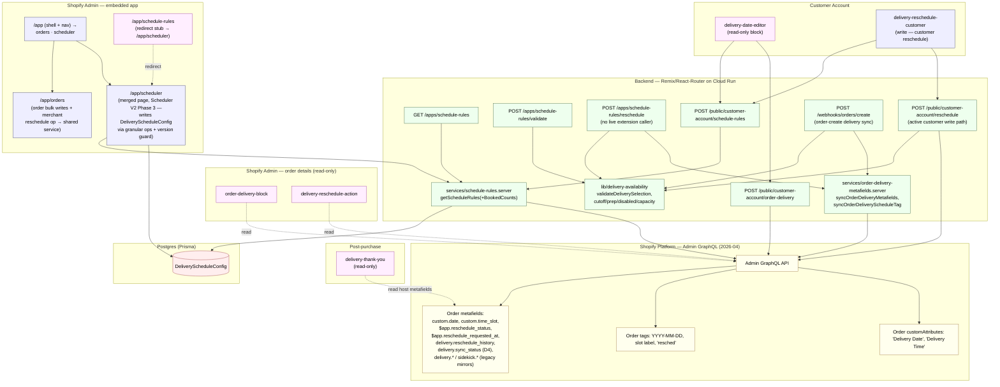
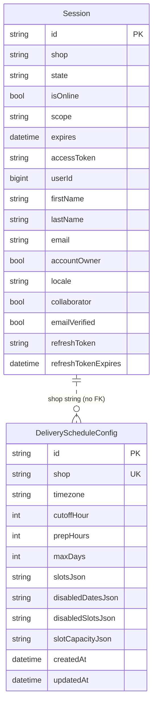

# Delivery Scheduler — Architecture (only what exists)

> **This file covers system topology and data model only.** It is the source of truth and pointer hub for the docs set.
>
> - Route-by-route detail, auth mechanisms, write-path contract → [api.md](./api.md)
> - Orders Operations UI (list page + detail drawer) composition & data flow → [orders-ui.md](./orders-ui.md)
> - Dated verification history → [verification-log.md](./verification-log.md)
> - Why specific technical decisions were made → [decisions.md](./decisions.md)
> - Commands, local dev, testing, deployment/cold-start notes → [development.md](./development.md)
> - Known open issues → [known-issues.md](./known-issues.md)
> - Feature history in plain language → [changelog.md](./changelog.md)

**Last full re-verification:** 2026-07-04
**Canonical truth:** this doc. Any conflict with `../../docs/delivery-operations-architecture.md` (older, drifted) is resolved in favor of this file — see [§ Superseded documents](#superseded-documents).
**Workflow:** before editing any file under `delivery-scheduler/app/`, `extensions/`, `prisma/`, or `shopify.app.toml`, read this doc first; after the edit, update the relevant doc(s) + add a new entry to [verification-log.md](./verification-log.md) dated today. The project skill `delivery-scheduler-architecture` (in `.claude/skills/`) enforces this loop for future Claude Code agents.

Verified against `app/`, `extensions/`, `prisma/schema.prisma`, `shopify.app.toml`.
Lahat ng nodes/edges sa baba ay may corresponding file or config.

---

## What's actually in this repo

This is a Shopify embedded app (React Router 7, ported from the Shopify Remix template) that adds delivery-date/time-slot scheduling to checkout and syncs that state onto Shopify orders. **Delivery state lives on the Shopify order, not in Postgres** — Postgres holds only two models (`Session`, `DeliveryScheduleConfig`); everything about a specific order's delivery date/slot/reschedule status is stored as order metafields, tags, and customAttributes. Booked-slot counts are live-derived and never persisted — since Scheduler V2 Phase 2 ([ADR-12](./decisions.md)) they come from a `metafields.custom.date:`-scoped Admin GraphQL orders search over the capacity-tracked dates, memoized in-process for 60 seconds. Last-mile courier dispatch is **not** handled here — it is delegated to the official Shopify Lalamove app (the former custom Lalamove integration was removed 2026-07-04; see [decisions.md ADR-1](./decisions.md)). The app has two outbound side channels besides the Shopify APIs: (1) **customer email** (2026-07-13, [ADR-11](./decisions.md)): the `/app/orders` `sendEmail` op sends plain-text mail through the merchant's business mailbox (Namecheap Private Email SMTP via nodemailer, [`services/send-customer-email.server.ts`](../app/services/send-customer-email.server.ts)) — an outbound side effect that **writes nothing to any order** (design: [customer-email-design.md](./customer-email-design.md)); and (2) the **Meta Messenger webhook** (2026-07-27, FlowerCart Messenger agent phase 2 — echo bot): `GET/POST /webhooks/messenger` receives Meta-signed page events and replies via the Messenger Send API ([`services/messenger-send.server.ts`](../app/services/messenger-send.server.ts)) — no DB, no Admin API, no session storage, zero order writes; route/auth detail in [api.md](./api.md#meta-messenger-webhook-flowercart-messenger-agent). Phase 3 adds Cloud Tasks + Neon conversation models (master context outside the repo).

The full route/extension/service inventory (extensions ×5, embedded admin routes, auth/bootstrap routes, App Proxy routes, customer-account JWT routes, webhooks, services/lib) lives in **[api.md](./api.md)** — along with the order write-path contract. The one-sentence version proved there: only **4 surfaces** actually mutate delivery-schedule state (`webhooks.orders.create.ts`; `apps.schedule-rules.reschedule.ts` with no live caller; `public.customer-account.reschedule.ts` the only live customer path; and the `/app/orders` merchant `reschedule` op added by Orders Ops V2 Phase 4, ADR-10), and all 5 extensions except `delivery-reschedule-customer` are read-only.

### Database (Prisma — `prisma/schema.prisma`)

Two models lang. Walang other table.

- `Session`
- `DeliveryScheduleConfig`

---

## 1. System diagram

**Legend:** pink-tone nodes = **read-only** surfaces. Green = backend routes/services. Yellow = Shopify platform. Blue = surface that performs writes (only `CARC`, `RUL`, `ORD`, `WH_OC`, `CA_RE`, `P_RES`).

Auth `/auth/*` and `/auth/login`, lifecycle webhooks `/webhooks/app/uninstalled` and `/webhooks/app/scopes_update`, and the standalone `delivery-bookings.server.ts` helper are omitted from this diagram — they exist (see the route tables in [api.md](./api.md)) but don't move delivery state. Session storage in Postgres (`Session` model) is also omitted; it backs the auth layer, not delivery logic.

---

## 4. Database diagram (Prisma — actual schema)

**Order delivery state ay nasa Shopify side, hindi sa DB:**

```mermaid
erDiagram
    Order ||--o| MF_custom_date             : "custom.date (date)"
    Order ||--o| MF_custom_time_slot        : "custom.time_slot (single_line_text_field)"
    Order ||--o| MF_delivery_date           : "delivery.date (date, legacy mirror)"
    Order ||--o| MF_delivery_time_slot      : "delivery.time_slot (legacy mirror)"
    Order ||--o| MF_sidekick_delivery_date  : "sidekick.delivery_date (legacy mirror)"
    Order ||--o| MF_app_reschedule_status   : "$app.reschedule_status"
    Order ||--o| MF_app_reschedule_at       : "$app.reschedule_requested_at"
    Order ||--o| MF_delivery_resched_hist   : "delivery.reschedule_history (JSON-like audit log)"
    Order ||--o| MF_delivery_sync_status    : "delivery.sync_status (checkout-time validation outcome, D4)"
    Order ||--o{ OrderTag                   : "YYYY-MM-DD, slot label, 'resched'"
    Order ||--o{ OrderCustomAttribute       : "'Delivery Date', 'Delivery Time'"
    Order }o--|| Customer                   : "owns"
```

> The user-flow sequence diagram, the admin operations workflow, and the reschedule-lock state machine moved to [api.md](./api.md) (§3 and §5). The dated verification log moved to [verification-log.md](./verification-log.md).

---

## What this doc explicitly does **not** claim

- The Admin order-page extensions do **not** write delivery state. Anyone building on top of `delivery-reschedule-action` expecting it to edit a delivery is working off an outdated assumption — the file's only network call is a single `query GetReschedule`.
- The `delivery-reschedule-customer` modal does **not** have an App Proxy fallback in its live code. The diagram no longer shows one.
- The App Proxy reschedule route (`/apps/schedule-rules/reschedule`) is **not** currently called from any registered extension target. It still exists, still validates and writes if reached via a signed proxy URL, but no shipped UI wires to it.
- The `/app/orders` admin page **became the 4th delivery write path with Orders Ops V2 Phase 4** (2026-07-11, ADR-10): its `action` gained a `reschedule` op that calls the shared `rescheduleOrderDelivery()` service (`source: "merchant"`, administrative override — no `resched` lock tag, capacity warn+override). The OTHER bulk ops remain generic order state and freeform tags — see the [api.md §2](./api.md) write-paths table + caveat. (The non-delivery `custom.bouquet_photo` metafield write was removed 2026-07-12 — Bouquet Photo descoped.)
- Booking counts are **not** stored locally. Since Scheduler V2 Phase 2 ([ADR-12](./decisions.md)) they are derived from an Admin GraphQL orders search filtered by `metafields.custom.date:` over the future capacity-tracked dates (metafields-only matching through the canonical slot comparator, cancelled orders excluded), with the raw matched bookings memoized in-process per shop for 60 seconds — never written to Postgres. Rules saves and the tracked-date set changing both invalidate the memo; reschedule paths exclude the order being moved from its own counts.
- There is no local audit table. `delivery.reschedule_history` metafield is the only persistent audit trail for customer-initiated reschedules.

---

## Superseded documents

`../../docs/delivery-operations-architecture.md` (relative to this file: repo root `docs/delivery-operations-architecture.md`) is an older architecture overview that had drifted from the current code as of 2026-05-23.

> **⚠️ Not found on disk (2026-07-04):** during the docs restructuring this superseded file was **not located** at either candidate path (`delivery-scheduler/docs/delivery-operations-architecture.md` or the repo-root `docs/delivery-operations-architecture.md` that `../../docs/` resolves to). The reference is therefore currently dangling. It was **not deleted by this restructuring** (it was already absent). Flagged for human review — see [known-issues.md](./known-issues.md#possible-future-work-unconfirmed-not-committed). No `⚠️ SUPERSEDED` banner could be added because there is no file to add it to.

Known stale claims that file was recorded to contain (retained here for provenance):

- States `/app` "currently defaults to `/app/dashboard`". The actual default in `app.routes.app._index.jsx` is `/app/orders` (was `/app/scheduler` until Scheduler V2 Phase 3, 2026-07-17).
- Does not list `/app/orders` (the live orders surface; documented in [api.md](./api.md)).
- Describes `/apps/schedule-rules/reschedule` as "Possibly core" — re-verified as having **no registered extension caller**.
- Treats admin extensions ambiguously; this doc set is explicit that both `order-delivery-block` and `delivery-reschedule-action` are read-only.

If the file resurfaces, this file (`delivery-scheduler/docs/architecture.md`) plus [api.md](./api.md) is the trusted reference. Do not build on the superseded doc's claims without cross-checking here first.
